# TORMS — Complete System Specification

| Field | Value |
|-------|-------|
| **Product** | TORMS — Transcript & Official Records Management System |
| **Document type** | Complete System Specification (SRS + Architecture + Features + LLD) |
| **Date** | November 2026 |
| **Classification** | Proprietary |

## Document contents

1. System Requirements Specification (SRS)
2. Architecture Design
3. Features & Requirements
4. Low-Level Design (LLD) Workflows

---

## Part 1 — System Requirements Specification (SRS)

### Transcript & Official Records Management System (TORMS)

| Field | Value |
|-------|-------|
| **Document ID** | SRS-TORMS-001 |
| **Product** | TORMS (Transcript & Official Records Management System) |
| **Repository** | `WMSU/wmsu-platform` (`apps/records-web`, `apps/base-api` module `records`) |
| **Version** | 1.0 |
| **Date** | November 2026 |
| **Classification** | Proprietary |

---

### 1. Introduction

#### 1.1 Purpose

This Software Requirements Specification defines functional and non-functional requirements for **TORMS**, the official academic records and certification system managing transcript of records (TOR) issuance, certification document processing, academic ledger management, alumni registry, public document verification, and records office operations for Philippine university compliance.

#### 1.2 Scope

**In scope**

- TOR request management: creation, requirement tracking, payment verification linkage, status workflow, document generation, issuance logging, print audit trail
- Certification types and certification request processing: honorable dismissal, good moral character, units earned, completion certificates, diploma verification
- Public document verification: unauthenticated QR code and reference number verification with tamper-evident audit trails
- Academic ledger projections synchronized from USiS enrollment system (grades, enrollment history)
- Ledger discrepancy detection and reconciliation workflows
- Alumni registry: profile management, standing classification, graduation-driven enrollment
- Records officer dashboard and comprehensive reporting (issuance statistics, request aging, alumni demographics)
- University Platform Access SSO integration (platform code `records`)
- Student self-service request submission and status tracking
- Document numbering schemes and template management
- Integration with UFMS for payment/clearance verification where configured

**Out of scope**

- Authoritative grade entry and enrollment workflow (owned by **USiS**)
- Tuition assessment, cashiering, official receipt issuance (owned by **UFMS**)
- Library operations, document repository (owned by **ULMIS**, **UDMS**)
- Inventory and asset management (owned by **UIMS**)
- Student admissions and registration approval (owned by **USiS**)

#### 1.3 Definitions

| Term | Definition |
|------|------------|
| **TORMS** | Transcript & Official Records Management System |
| **TOR** | Transcript of Records — official academic transcript document |
| **Issuance** | Generated official document with verification metadata, print log, and QR code |
| **Ledger projection** | TORMS copy of academic grades and enrollment history synchronized from USiS (USiS remains system of record) |
| **Certification** | Official non-TOR document types: honorable dismissal, good moral character, units earned, completion, diploma verification |
| **Verification token** | Unique code (UUID or sequential) enabling public unauthenticated verification of issued documents |
| **Discrepancy** | Mismatch between TORMS ledger projection and USiS source data requiring registrar review |
| **Alumni standing** | Classification of alumni status: active, inactive, distinguished, emeritus |

#### 1.4 References

- `WMSU/wmsu-platform/README.md`
- `apps/web-portal/public/docs/TORMS-Complete-Guide.html`
- `apps/web-portal/public/docs/TORMS-API-Specs-Manual.html`
- USiS Grade Projection API Specification
- UFMS Internal Clearance API Specification
- University Platform Access Architecture

---

### 2. Overall Description

#### 2.1 Product Perspective

TORMS operates within the WMSU Campus Information System modular architecture:

| Component | Technology | Role |
|-----------|------------|------|
| Records web | React 19 + Vite | Staff and student UI for requests, issuance, alumni management |
| Base API records module | AdonisJS 7 + Lucid ORM | REST services at `/api/v1/records/*` |
| Database | PostgreSQL schema `records` | Official records system of record for issuances and alumni |
| Identity provider | University Platform Access | Authentication, authorization, user management |
| Queue system | BullMQ + Redis | Background jobs (sync, notifications, report generation) |

| Surface | Dev port | Production example |
|---------|----------|----------------------|
| Records web | `http://127.0.0.1:5181` | `https://records.wmsu.edu.ph` |
| Base API | `http://127.0.0.1:3500` | `https://api.wmsu.edu.ph` |
| Identity API | `http://127.0.0.1:3411` | `https://auth.wmsu.edu.ph` |
| Public verify | Records web `/verify` | `https://records.wmsu.edu.ph/verify` |

**Health endpoint:** `GET /health` → `{ status: 'ok', service: 'base-api', module: 'records' }`

#### 2.2 User Classes

| Role | Primary capabilities | Access level |
|------|---------------------|--------------|
| **Records Officer** | Process TOR/certification requests, sync academic data, issue documents, manage alumni, generate reports | Full records management |
| **Student** | Submit and track own TOR/certification requests, download issued documents | Own requests only |
| **Registrar (cross-system)** | Review sync discrepancies, approve special requests | Records oversight |
| **Alumni** | Update contact information, view issued documents | Own alumni profile |
| **Identity Administrator** | Full TORMS access when `records` platform granted | All TORMS permissions |
| **Public Visitor** | Verify authenticity of issued documents without authentication | Verification only |

Frontend permission checks provide user experience; API enforces authorization on every route.

#### 2.3 Constraints

- Platform tile visibility requires Identity platform grant `records`
- Grades are NOT authored in TORMS — all academic data synchronized read-only from USiS
- Sync discrepancies must surface to records officers for manual review and resolution
- Public verification is unauthenticated and rate-limited to prevent abuse
- Internal alumni-from-graduation route requires service API key protection
- TOR and certification numbering must follow configured foundation settings (year-based, sequential)
- Document templates and layout configured per institution requirements
- Historical data integrity preserved — issued documents immutable after generation

#### 2.4 Assumptions

- USiS enrollment system is running and grade data available for synchronization
- Payment/clearance verification checks integrate with UFMS when configured (optional gating)
- Graduation events from USiS enrollment trigger internal alumni profile creation
- Document issuance templates provided in PDF generation format (e.g., Puppeteer/headless Chrome)
- University seal and authorized signatory images configured in system settings
- Records office staff trained on request processing workflows
- Demo/staging environments provision sample students, requests, and issued documents
- Regular automated sync jobs scheduled (nightly grade sync, weekly enrollment history)

---

### 3. Functional Requirements

#### 3.1 Authentication & Authorization

| ID | Requirement | Priority |
|----|-------------|----------|
| FR-AUTH-001 | System shall authenticate all users via University Platform Access SSO | Must |
| FR-AUTH-002 | System shall resolve user home path based on role (records officer → `/staff`, student → `/student`, alumni → `/alumni`) | Must |
| FR-AUTH-003 | System shall enforce `torms.*` permission checks on every authenticated API endpoint | Must |
| FR-AUTH-004 | Public verification routes shall be unauthenticated with rate limiting | Must |
| FR-AUTH-005 | Internal service routes shall require `X-Service-Api-Key` header validation | Must |

#### 3.2 TOR Request Management

| ID | Requirement | Priority |
|----|-------------|----------|
| FR-TOR-001 | Students shall submit TOR requests with purpose, delivery mode (pickup/mail), and copies quantity | Must |
| FR-TOR-002 | System shall assign unique request numbers using configured format (e.g., `TOR-2026-0001`) | Must |
| FR-TOR-003 | System shall track request status: submitted → requirements_pending → requirements_complete → processing → approved → issued → released | Must |
| FR-TOR-004 | Records officers shall view all TOR requests with filtering by status, date, student | Must |
| FR-TOR-005 | Records officers shall transition request status with required notes for audit | Must |
| FR-TOR-006 | System shall validate clearance requirements before allowing approval (configurable) | Must |
| FR-TOR-007 | System shall verify payment status from UFMS if payment gating enabled | Should |
| FR-TOR-008 | System shall attach requirement documents (clearance certificate, ID, etc.) | Must |
| FR-TOR-009 | System shall notify students on status transitions via email/SMS when configured | Should |
| FR-TOR-010 | System shall generate TOR PDF document with academic ledger, seal, and signatories | Must |
| FR-TOR-011 | System shall embed verification QR code on generated TOR documents | Must |
| FR-TOR-012 | System shall log all TOR print events with timestamp, officer, and copy count | Must |
| FR-TOR-013 | Students shall download digital copy of issued TOR via portal | Must |

#### 3.3 Certification Request Management

| ID | Requirement | Priority |
|----|-------------|----------|
| FR-CRT-001 | System shall support certification types: honorable dismissal, good moral character, units earned, completion, diploma verification | Must |
| FR-CRT-002 | Students shall submit certification requests with type selection and purpose | Must |
| FR-CRT-003 | System shall assign unique certification numbers per type (e.g., `HD-2026-0001`, `GMC-2026-0001`) | Must |
| FR-CRT-004 | System shall track certification status workflow parallel to TOR (submitted → processing → issued → released) | Must |
| FR-CRT-005 | Records officers shall configure certification types with templates and requirements | Should |
| FR-CRT-006 | System shall generate certification PDFs from configured templates with verification codes | Must |
| FR-CRT-007 | System shall log certification print events | Must |

#### 3.4 Academic Ledger Sync

| ID | Requirement | Priority |
|----|-------------|----------|
| FR-LED-001 | System shall synchronize grade data from USiS via internal API pull | Must |
| FR-LED-002 | System shall create/update ledger projection records without mutating USiS source | Must |
| FR-LED-003 | System shall detect discrepancies between ledger projection and USiS source | Must |
| FR-LED-004 | System shall surface discrepancy reports to records officers with comparison view | Must |
| FR-LED-005 | Records officers shall manually resolve discrepancies with audit logging | Must |
| FR-LED-006 | System shall synchronize enrollment history (terms, status, programs) from USiS | Must |
| FR-LED-007 | System shall track sync run metadata (timestamp, record count, errors) | Must |
| FR-LED-008 | System shall retry failed sync operations with exponential backoff | Should |
| FR-LED-009 | Records officers shall manually trigger on-demand sync for specific students | Should |

#### 3.5 Alumni Registry

| ID | Requirement | Priority |
|----|-------------|----------|
| FR-ALM-001 | System shall create alumni profile automatically from USiS graduation event via internal API | Must |
| FR-ALM-002 | Alumni shall update contact information (address, phone, email) via portal | Must |
| FR-ALM-003 | Alumni shall view issued TOR and certification documents | Must |
| FR-ALM-004 | Records officers shall maintain alumni standing classification (active, inactive, distinguished, emeritus) | Should |
| FR-ALM-005 | System shall track alumni employment and further education (self-reported) | Should |
| FR-ALM-006 | Records officers shall generate alumni demographic reports | Should |
| FR-ALM-007 | System shall support bulk alumni data import from legacy systems | Could |

#### 3.6 Public Document Verification

| ID | Requirement | Priority |
|----|-------------|----------|
| FR-VRF-001 | System shall provide public `/verify` page without authentication | Must |
| FR-VRF-002 | Public users shall verify documents by entering verification code or scanning QR | Must |
| FR-VRF-003 | System shall return verification result: valid (with student name, document type, issue date) or invalid | Must |
| FR-VRF-004 | System shall NOT expose sensitive PII beyond name, document type, and issue date | Must |
| FR-VRF-005 | System shall log all verification attempts with IP address and timestamp | Must |
| FR-VRF-006 | System shall rate-limit verification endpoint to prevent scraping (e.g., 10 requests/minute/IP) | Must |
| FR-VRF-007 | System shall display verification result with institutional branding | Should |

#### 3.7 Dashboard & Reporting

| ID | Requirement | Priority |
|----|-------------|----------|
| FR-DSH-001 | Records officers shall view dashboard with pending requests, recent issuances, sync status | Must |
| FR-DSH-002 | Dashboard shall display KPIs: total requests by status, average processing time, issuance volume by month | Should |
| FR-RPT-001 | System shall generate TOR issuance report by date range, program, student type | Must |
| FR-RPT-002 | System shall generate certification issuance report by type and date range | Must |
| FR-RPT-003 | System shall generate request aging report (days in each status) | Must |
| FR-RPT-004 | System shall generate alumni demographics report (graduation year, program, location) | Should |
| FR-RPT-005 | System shall export all reports in CSV and PDF formats | Must |
| FR-RPT-006 | System shall log all report exports with user and timestamp for audit | Must |

#### 3.8 Configuration Management

| ID | Requirement | Priority |
|----|-------------|----------|
| FR-CFG-001 | Administrators shall configure document numbering schemes (prefix, year format, sequence) | Must |
| FR-CFG-002 | Administrators shall upload document templates (TOR, certifications) in PDF-compatible format | Should |
| FR-CFG-003 | Administrators shall configure authorized signatories with titles and signature images | Must |
| FR-CFG-004 | Administrators shall configure clearance requirement rules per document type | Should |
| FR-CFG-005 | System shall maintain audit log of configuration changes | Must |

---

### 4. External Interface Requirements

#### 4.1 Integration Interfaces

| Interface | Direction | Protocol | Purpose |
|-----------|-----------|----------|---------|
| University Platform Access | Inbound | OIDC/JWKS | SSO authentication, JWT verification, role resolution |
| USiS Enrollment API | Inbound | REST+JSON | Grade projection pull, enrollment history sync |
| USiS Graduation Events | Inbound | REST/Webhook | Alumni profile creation trigger |
| UFMS Finance API | Outbound (optional) | REST+JSON | Payment/clearance verification for request gating |
| SMTP/SMS Gateway | Outbound | SMTP/HTTP | Request status notifications |
| Object Storage | Outbound | S3-compatible | Issued document archival (PDF storage) |

#### 4.2 API Specifications

**Records API base:** `/api/v1/records/*`

**Internal service routes:** `/api/v1/records/internal/*` (service key protected)

**Public routes:** `/api/v1/records/public/verify/*` (unauthenticated, rate-limited)

**OpenAPI documentation:** Available at `/api/v1/records/docs` (Swagger UI)

**Authentication:** Bearer JWT from University Platform Access in `Authorization` header

#### 4.3 User Interface Requirements

- Responsive design supporting desktop (≥1280px), tablet (768-1023px), and mobile (360-767px)
- Browser compatibility: Chrome/Edge (latest 2), Firefox (latest 2), Safari (latest 2)
- Accessibility: WCAG 2.1 Level AA for public verification page
- Print-optimized PDF generation for TOR and certifications
- QR code rendering in standard formats (PNG, SVG)
- Document preview before issuance
- Bulk request processing interface for records officers

---

### 5. Non-Functional Requirements

#### 5.1 Performance

| ID | Requirement | Target |
|----|-------------|--------|
| NFR-PERF-001 | API response time (p95) for standard queries | ≤ 2 seconds |
| NFR-PERF-002 | TOR/certification PDF generation time | ≤ 10 seconds |
| NFR-PERF-003 | Public verification response time (p95) | ≤ 1 second |
| NFR-PERF-004 | Health check endpoint response time | ≤ 500 ms |
| NFR-PERF-005 | Academic ledger sync job completion for 1000 students | ≤ 30 minutes |

#### 5.2 Scalability

| ID | Requirement |
|----|-------------|
| NFR-SCAL-001 | Support ≥10,000 alumni records |
| NFR-SCAL-002 | Support ≥5,000 TOR requests per academic year |
| NFR-SCAL-003 | Horizontal scaling of API replicas |
| NFR-SCAL-004 | Background job queue processing with worker pools |

#### 5.3 Security

| ID | Requirement |
|----|-------------|
| NFR-SEC-001 | TLS 1.2+ required for all client-server communication |
| NFR-SEC-002 | RBAC enforcement on every authenticated API endpoint using `torms.*` permissions |
| NFR-SEC-003 | Service-to-service communication via API keys for internal routes |
| NFR-SEC-004 | Public verification rate limiting (10 requests/minute/IP) |
| NFR-SEC-005 | Document verification tokens cryptographically unique (UUID v4) |
| NFR-SEC-006 | Issued document PDFs stored with restricted access (records officers only) |
| NFR-SEC-007 | Audit logging of all issuance, print, and configuration changes |
| NFR-SEC-008 | CORS allowlist limited to authorized web client origins |
| NFR-SEC-009 | Non-root container execution in production |
| NFR-SEC-010 | Student PII protection per RA 10173 (Data Privacy Act) |

#### 5.4 Reliability

| ID | Requirement |
|----|-------------|
| NFR-REL-001 | System availability ≥99% during business hours |
| NFR-REL-002 | Automated database backups (daily incremental, weekly full) |
| NFR-REL-003 | Point-in-time recovery capability ≤15 minutes RPO |
| NFR-REL-004 | Graceful degradation when USiS/UFMS temporarily unavailable |
| NFR-REL-005 | Issued documents immutable — no deletion, only void with audit trail |

#### 5.5 Maintainability

| ID | Requirement |
|----|-------------|
| NFR-MAIN-001 | Modular domain architecture with separation of concerns |
| NFR-MAIN-002 | Comprehensive API documentation (OpenAPI 3.0+) |
| NFR-MAIN-003 | Structured logging with correlation IDs |
| NFR-MAIN-004 | Database schema migrations versioned and reversible |
| NFR-MAIN-005 | Document template hot-reloading without deployment |

#### 5.6 Compliance

| ID | Requirement |
|----|-------------|
| NFR-COMP-001 | RA 10173 (Data Privacy Act) compliance for student/alumni PII |
| NFR-COMP-002 | FERPA-equivalent protections for educational records |
| NFR-COMP-003 | Audit trail retention ≥7 years per Philippine records management guidelines |
| NFR-COMP-004 | Document issuance chain of custody preservation |

---

### 6. Verification Criteria

#### 6.1 Functional Verification

| Scenario | Expected result | Test type |
|----------|----------------|-----------|
| Records officer login via SSO | Redirect to `/staff` dashboard | Integration |
| Student login via SSO | Redirect to `/student` requests page | Integration |
| Student submit TOR request | Request created with status `submitted` | E2E |
| Records officer transition request to processing | Status updated, audit log entry created | Unit |
| Generate TOR PDF | PDF file generated with QR code and ledger data | Integration |
| Public verify valid TOR code | Returns valid with student name, document type, issue date | API test |
| Public verify invalid code | Returns invalid/not found | API test |
| Sync grades from USiS | Ledger projections created/updated, no USiS mutation | Integration |
| Detect grade discrepancy | Discrepancy record created, visible in officer view | Unit |
| Alumni graduation trigger | Alumni profile created via internal API | Integration |
| Rate limit verification endpoint | HTTP 429 after 10 requests in 1 minute | Security test |

#### 6.2 Non-Functional Verification

| Scenario | Expected result | Test type |
|----------|----------------|-----------|
| 100 concurrent public verifications | p95 response ≤1s, no errors | Load test |
| TOR PDF generation for 50-page transcript | Completes in ≤10s | Performance test |
| Unauthorized access to internal sync API | HTTP 401/403 | Security test |
| Database failover | Recovery within 15 minutes | DR drill |

---

### 7. Document Control

| Version | Date | Description |
|---------|------|-------------|
| 1.0 | November 2026 | Complete System Specification from wmsu-platform records module |

#### Related Design Documents

- **[TORMS-Architecture.md](./TORMS-Architecture.md)** — Architecture design (containers, domains, security, deployment)
- **[TORMS-Features-Requirements.md](./TORMS-Features-Requirements.md)** — Feature catalog + requirements traceability
- **[TORMS-LLD.md](./TORMS-LLD.md)** — Low-level design workflows (TOR, certifications, sync, verification, alumni)

**End of SRS — TORMS**

---

## Part 2 — Architecture Design

### TORMS — Transcript & Official Records Management System Architecture

| Field | Value |
|-------|-------|
| **Document ID** | AD-TORMS-001 |
| **Product** | TORMS |
| **Companions** | [TORMS-SRS.md](./TORMS-System-Specification.md) · [TORMS-Features-Requirements.md](./TORMS-Features-Requirements.md) · [TORMS-LLD.md](./TORMS-LLD.md) |
| **Date** | November 2026 |

---

### 1. Purpose

Architecture design for TORMS within WMSU CIS modular monolith — covering system context, container architecture, domain module organization, security architecture, deployment topology, integration patterns, and quality attributes for official records management.

---

### 2. System Context

TORMS integrates with Identity for SSO, USiS for academic data sync, and optional UFMS for clearance checks:

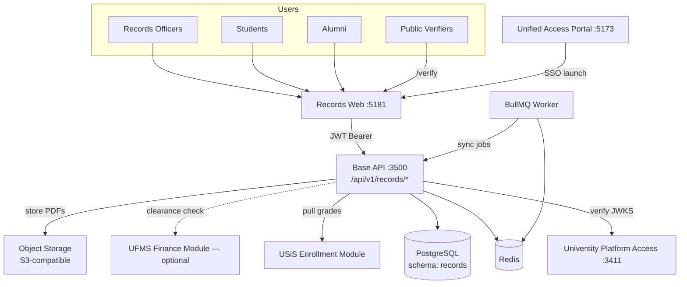

**Key relationships:**
- Records officers, students, and alumni authenticate via Portal SSO
- Public verifiers access `/verify` without authentication
- All authenticated requests flow through Base API records module
- USiS is authoritative source for grades; TORMS stores projections
- UFMS provides optional clearance/payment verification
- Background sync jobs run via BullMQ worker
- Issued document PDFs archived to object storage

---

### 3. Container View

| Container | Technology | Port | Purpose |
|-----------|------------|------|---------|
| **Records web** | React 19 + Vite | 5181 | Staff operations, student requests, alumni portal, public verify |
| **Base API (records module)** | AdonisJS 7 + Lucid ORM | 3500 | Domain services, controllers, business logic |
| **PostgreSQL** | PostgreSQL 15+ | 5432 | Schema `records` — official records SoR (issuances, alumni) |
| **Redis** | Redis 7+ | 6379 | Cache, queue backend, rate limiting |
| **BullMQ Worker** | Node.js + BullMQ | N/A | Background sync, notifications, PDF generation |
| **Object Storage** | S3-compatible | N/A | Issued document PDF archival |
| **University Platform Access** | Identity service | 3411 | Authentication, authorization |
| **USiS Enrollment** | CIS module | 3500 | Grade/enrollment history source |

**Deployment notes:**
- Records web served statically from CDN or Vite dev server
- Base API runs in containerized Node.js (non-root)
- PostgreSQL schema `records` isolated within `wmsu_cis` database
- Redis persistent (AOF + RDB) for queue durability
- Worker pool for concurrent job processing

---

### 4. Domain Module Architecture

TORMS records module organized by official records lifecycle:

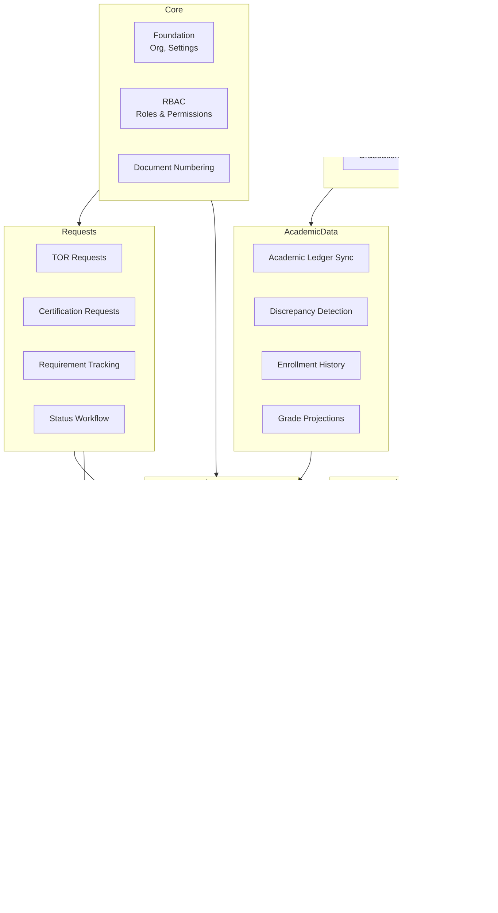

**Domain responsibilities:**

| Domain | Key entities | Services |
|--------|-------------|----------|
| **Core** | Organization, Campus, DocumentNumbering, Settings | Foundation config, numbering schemes |
| **Requests** | TORRequest, CertificationRequest, RequestRequirement, StatusHistory | Request lifecycle management |
| **Issuance** | Issuance, IssuanceLog, VerificationToken, PrintEvent | Document generation, verification |
| **Academic Data** | LedgerProjection, GradeProjection, Discrepancy, SyncRun | USiS data sync, discrepancy detection |
| **Alumni** | AlumniProfile, AlumniContact, AlumniEmployment, AlumniEducation | Alumni registry, standing management |
| **Integration** | USiSGradeSync, UFMSClearanceClient, GraduationEventHandler | External system integration |
| **Public Verify** | VerificationAttempt, RateLimitRecord | Public verification, rate limiting |
| **Reporting** | Report, ReportExport, DashboardMetric | Analytics, export audit |

---

### 5. Security Architecture

#### 5.1 Authentication Flow

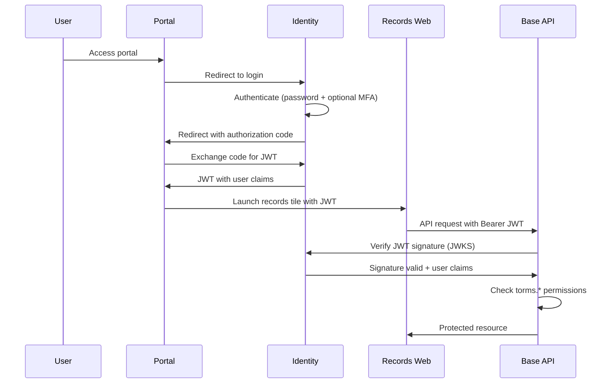

**Public verification flow:**
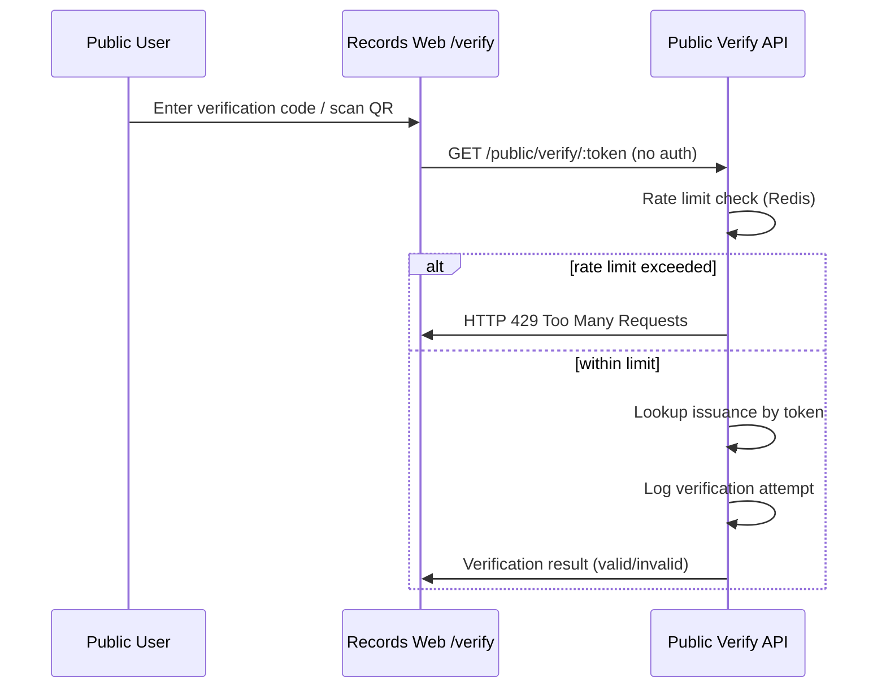

**Security controls:**

| Layer | Control | Implementation |
|-------|---------|----------------|
| Transport | TLS 1.2+ | Reverse proxy termination |
| Authentication | OIDC/JWT | Identity service RS256 tokens |
| Authorization | RBAC | `torms.*` permission checks |
| Public endpoints | Rate limiting | Redis-backed limiter (10/min/IP) |
| Internal APIs | Service keys | `X-Service-Api-Key` header |
| Document access | Role-based | Issued PDFs restricted to officers |
| Verification tokens | UUID v4 | Cryptographically unique |

#### 5.2 Permission Model

TORMS permission categories:
- `torms.requests.*` — Request management (view, create, transition)
- `torms.issuance.*` — Document generation and printing
- `torms.alumni.*` — Alumni registry management
- `torms.sync.*` — Academic sync operations
- `torms.reports.*` — Report generation and export
- `torms.config.*` — System configuration

**Role mappings:**
- `records_officer` → All `torms.*` permissions
- `student` → `torms.requests.own`, `torms.issuance.view_own`
- `alumni` → `torms.alumni.own`, `torms.issuance.view_own`
- `registrar` (cross-system) → `torms.sync.view`, `torms.reports.view`

---

### 6. Data Architecture

#### 6.1 Schema Organization

PostgreSQL schema **`records`** contains:

**Core tables:**
- `organizations`, `campuses`, `settings`
- `document_numbering_schemes`

**Request lifecycle:**
- `tor_requests`, `certification_requests`
- `request_requirements`, `request_status_history`

**Issuance:**
- `issuances`, `issuance_logs`, `print_events`
- `verification_tokens`

**Academic data (projections from USiS):**
- `ledger_projections`, `grade_projections`
- `enrollment_history`
- `discrepancies`, `sync_runs`

**Alumni:**
- `alumni_profiles`, `alumni_contacts`
- `alumni_employment`, `alumni_education`
- `alumni_standing_history`

**Integration:**
- `sync_runs`, `clearance_checks`

**Verification:**
- `verification_attempts` (audit log)

**Reporting:**
- `report_exports` (audit log)

#### 6.2 Data Sync Strategy

**USiS → TORMS sync:**
- **Pull model:** TORMS queries USiS internal API
- **Frequency:** Nightly automated job (2:00 AM) + on-demand manual trigger
- **Data:** Grades, enrollment history, graduation events
- **Idempotency:** Upsert by student_id + term + course
- **Discrepancy detection:** Compare projection against USiS source after sync

**No reverse sync:** TORMS never writes back to USiS. USiS remains single source of truth for academic data.

---

### 7. Deployment Topology

#### 7.1 Production Architecture

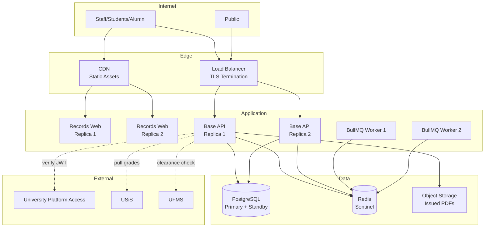

**Sizing guidance:**
- API: 2 replicas, 2 vCPU / 4 GB RAM each
- Worker: 2 replicas, 1 vCPU / 2 GB RAM each
- PostgreSQL: 4 vCPU / 16 GB RAM
- Redis: 2 vCPU / 4 GB RAM
- Object Storage: S3-compatible managed service

#### 7.2 Local Development

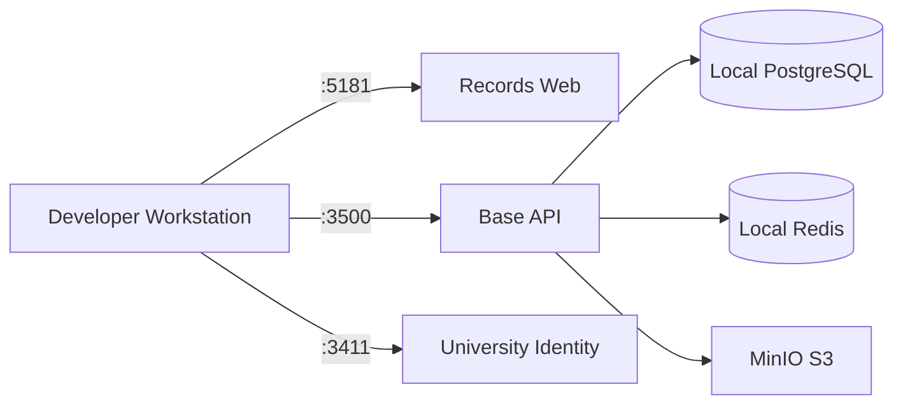

---

### 8. Integration Architecture

#### 8.1 USiS Academic Data Sync

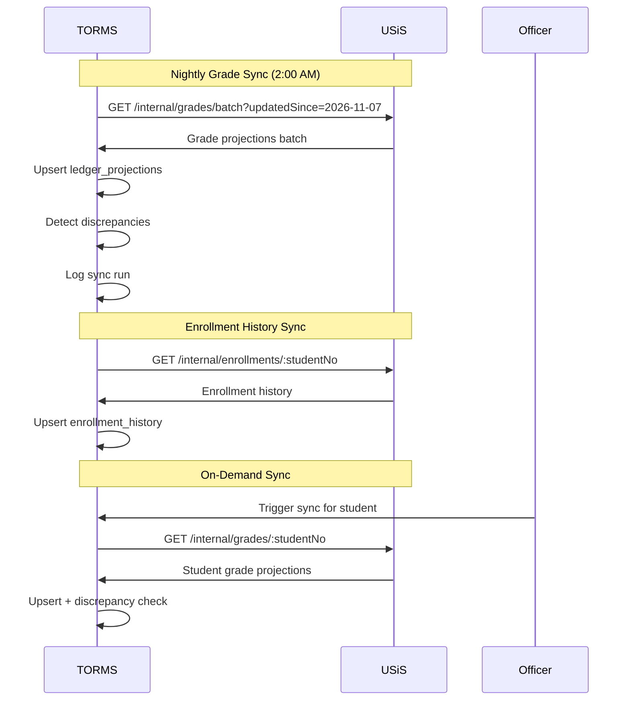

#### 8.2 UFMS Clearance Check

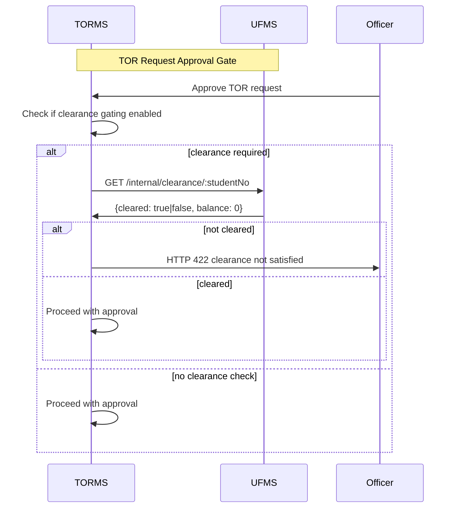

#### 8.3 Alumni Creation Trigger

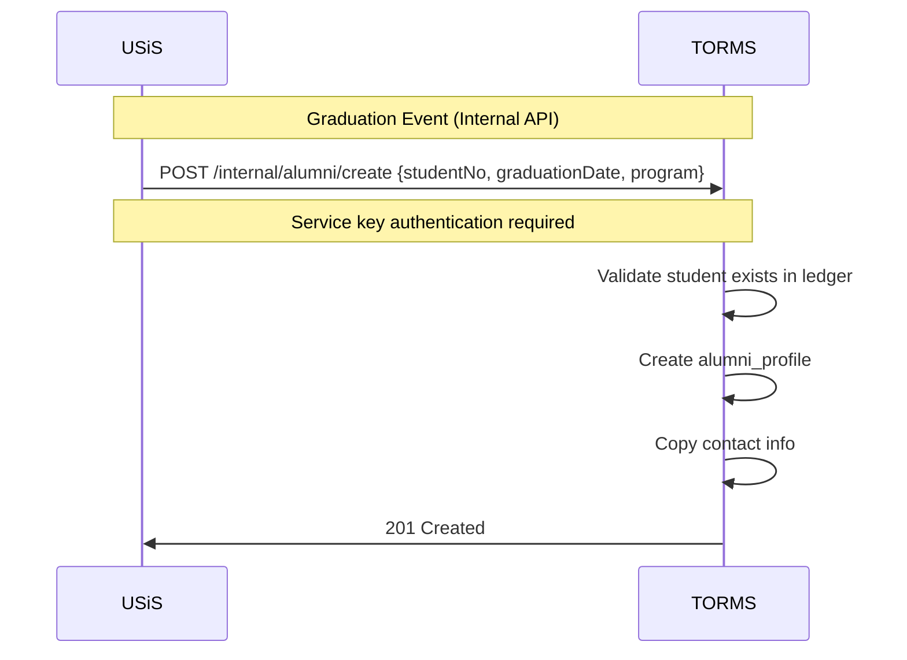

---

### 9. Quality Attributes

#### 9.1 Performance

**Optimization strategies:**
- Database indexing on student_no, status, issue_date, verification_token
- Redis caching for frequently accessed settings (document numbering, templates)
- Background PDF generation (async job queue) for large TOR documents
- Lazy loading in records web UI
- Paginated API responses (default 25, max 100)
- Read replicas for reporting queries

**Monitoring:**
- APM (Sentry/OpenTelemetry) for request tracing
- PDF generation time metrics
- Sync job duration and error rates
- Public verification endpoint latency

#### 9.2 Scalability

**Horizontal scaling:**
- Stateless API design
- Load balancer with health checks
- Worker pool for concurrent job processing
- Database connection pooling (PgBouncer)

**Data growth:**
- Partitioning for large tables (issuances, verification_attempts) by year
- Archival strategy for old verification attempts (retain 1 year)

#### 9.3 Reliability

**Failure handling:**
- Graceful degradation when USiS unavailable (serve cached ledger projections, warn users)
- Retry logic for sync jobs (exponential backoff)
- Circuit breaker for external API calls
- Immutable issued documents — no deletion, only void with audit trail

**Data integrity:**
- Foreign key constraints
- Transaction management with rollback
- Idempotent sync operations
- Audit trails for all state changes

#### 9.4 Maintainability

**Code organization:**
- Domain-driven design with bounded contexts
- Service layer abstraction
- Shared validation schemas
- OpenAPI documentation

**Operational:**
- Structured JSON logging
- Feature flags
- Blue-green deployment
- Automated schema migrations

#### 9.5 Compliance

**Data privacy (RA 10173):**
- Student PII access restricted by role
- Public verification limited to name + document metadata
- Audit logging of document access
- Retention policies configurable

**Records management:**
- Issued documents immutable (void only, never delete)
- 7-year audit trail retention
- Chain of custody preservation for issuances

---

**End of Architecture Design — TORMS**

---

## Part 3 — Features & Requirements

### TORMS — Transcript & Official Records Management System Features & Requirements

| Field | Value |
|-------|-------|
| **Document ID** | FEAT-TORMS-001 |
| **Product** | TORMS |
| **Companions** | [TORMS-SRS.md](./TORMS-System-Specification.md) · [TORMS-LLD.md](./TORMS-LLD.md) |
| **Date** | November 2026 |

---

### 1. Feature Summary

TORMS provides comprehensive official records management for Philippine university compliance:

| Area | Features | Status |
|------|----------|--------|
| **Authentication** | University Platform Access SSO, role-based routing | Delivered |
| **TOR Requests** | Submission, status workflow, requirement tracking, PDF generation, print logging | Delivered |
| **Certifications** | Multiple types (honorable dismissal, good moral, units, completion), PDF generation | Delivered |
| **Academic Ledger** | Grade/enrollment sync from USiS, discrepancy detection, reconciliation | Delivered |
| **Alumni Registry** | Profile management, contact updates, standing classification | Delivered |
| **Public Verification** | Unauthenticated QR/code verification with rate limiting | Delivered |
| **Dashboard** | KPIs, pending requests, recent issuances, sync status | Delivered |
| **Reporting** | Issuance reports, request aging, alumni demographics, export audit | Delivered |
| **Configuration** | Document numbering, templates, signatories, clearance rules | Delivered |

---

### 2. Feature Catalog

| Feature ID | Feature | Description | Priority | Actors |
|------------|---------|-------------|----------|--------|
| **F-AUTH-01** | SSO Authentication | University Platform Access OIDC/JWT | Must | All |
| **F-AUTH-02** | Role Routing | Home path by role (staff/student/alumni) | Must | All |
| **F-AUTH-03** | Permission Enforcement | `torms.*` checks on all endpoints | Must | System |
| **F-TOR-01** | TOR Request Submission | Student submits with purpose, delivery mode, copies | Must | Student |
| **F-TOR-02** | Request Numbering | Auto-assign unique numbers (TOR-YYYY-NNNN) | Must | System |
| **F-TOR-03** | Status Workflow | submitted → requirements_pending → processing → approved → issued → released | Must | Officer, System |
| **F-TOR-04** | Request Management | Officer view/filter/search all requests | Must | Officer |
| **F-TOR-05** | Status Transitions | Officer advances status with notes | Must | Officer |
| **F-TOR-06** | Clearance Validation | Check clearance before approval (configurable) | Must | System |
| **F-TOR-07** | Payment Verification | UFMS payment check if gating enabled | Should | System |
| **F-TOR-08** | Requirement Attachments | Upload/attach requirement documents | Must | Student, Officer |
| **F-TOR-09** | Request Notifications | Email/SMS on status transitions | Should | System |
| **F-TOR-10** | TOR PDF Generation | Generate with ledger, seal, signatures | Must | System |
| **F-TOR-11** | Verification QR Codes | Embed QR on TOR documents | Must | System |
| **F-TOR-12** | Print Logging | Log print events with timestamp/officer | Must | System |
| **F-TOR-13** | Digital Download | Student download issued TOR | Must | Student |
| **F-CRT-01** | Certification Types | Honorable dismissal, good moral, units, completion, diploma verify | Must | System |
| **F-CRT-02** | Certification Requests | Student submit with type and purpose | Must | Student |
| **F-CRT-03** | Certification Numbering | Type-specific numbering (HD-YYYY-NNNN) | Must | System |
| **F-CRT-04** | Certification Workflow | submitted → processing → issued → released | Must | Officer, System |
| **F-CRT-05** | Certification Configuration | Configure types, templates, requirements | Should | Admin |
| **F-CRT-06** | Certification PDF | Generate from templates with verification codes | Must | System |
| **F-CRT-07** | Certification Print Log | Log print events | Must | System |
| **F-LED-01** | Grade Sync | Pull grades from USiS internal API | Must | System |
| **F-LED-02** | Ledger Projections | Create/update projections (no USiS mutation) | Must | System |
| **F-LED-03** | Discrepancy Detection | Compare projections to USiS source | Must | System |
| **F-LED-04** | Discrepancy Reports | Surface discrepancies to officers | Must | Officer |
| **F-LED-05** | Manual Resolution | Officer resolves discrepancies with audit | Must | Officer |
| **F-LED-06** | Enrollment History Sync | Sync enrollment records from USiS | Must | System |
| **F-LED-07** | Sync Metadata Tracking | Log run timestamp, count, errors | Must | System |
| **F-LED-08** | Sync Retry Logic | Exponential backoff on failure | Should | System |
| **F-LED-09** | On-Demand Sync | Officer trigger sync for specific student | Should | Officer |
| **F-ALM-01** | Alumni Auto-Creation | Create from USiS graduation event | Must | System |
| **F-ALM-02** | Contact Updates | Alumni update address/phone/email | Must | Alumni |
| **F-ALM-03** | Document Viewing | Alumni view issued TOR/certifications | Must | Alumni |
| **F-ALM-04** | Standing Classification | Maintain alumni standing (active, distinguished, etc.) | Should | Officer |
| **F-ALM-05** | Employment Tracking | Self-reported employment/education | Should | Alumni |
| **F-ALM-06** | Alumni Reports | Demographic reports by graduation year/program | Should | Officer |
| **F-ALM-07** | Bulk Import | Import legacy alumni data | Could | Admin |
| **F-VRF-01** | Public Verify Page | `/verify` without authentication | Must | Public |
| **F-VRF-02** | Code/QR Entry | Enter code or scan QR | Must | Public |
| **F-VRF-03** | Verification Result | Return valid (name, type, date) or invalid | Must | System |
| **F-VRF-04** | PII Protection | No sensitive data beyond name/type/date | Must | System |
| **F-VRF-05** | Verification Logging | Log attempts with IP/timestamp | Must | System |
| **F-VRF-06** | Rate Limiting | 10 requests/minute/IP | Must | System |
| **F-VRF-07** | Branded Display | Show university branding on results | Should | System |
| **F-DSH-01** | Officer Dashboard | Pending requests, recent issuances, sync status | Must | Officer |
| **F-DSH-02** | KPIs | Requests by status, processing time, issuance volume | Should | Officer |
| **F-RPT-01** | TOR Issuance Report | By date range, program, student type | Must | Officer |
| **F-RPT-02** | Certification Report | By type and date range | Must | Officer |
| **F-RPT-03** | Request Aging Report | Days in each status | Must | Officer |
| **F-RPT-04** | Alumni Demographics | By graduation year, program, location | Should | Officer |
| **F-RPT-05** | Report Export | CSV and PDF formats | Must | Officer |
| **F-RPT-06** | Export Audit Log | Log exports with user/timestamp | Must | System |
| **F-CFG-01** | Numbering Schemes | Configure prefix, year format, sequence | Must | Admin |
| **F-CFG-02** | Template Upload | PDF-compatible document templates | Should | Admin |
| **F-CFG-03** | Signatory Config | Authorized signatories with titles/signatures | Must | Admin |
| **F-CFG-04** | Clearance Rules | Configure requirements per document type | Should | Admin |
| **F-CFG-05** | Config Audit Log | Log configuration changes | Must | System |

---

### 3. Requirements Traceability Matrix

#### 3.1 Functional Requirements Mapping

| Requirement ID | Requirement | Related Features | Priority | Implementation Status |
|----------------|-------------|------------------|----------|----------------------|
| FR-AUTH-001..005 | Authentication and authorization | F-AUTH-01..03, F-VRF-01 | Must | Delivered |
| FR-TOR-001..013 | TOR request management | F-TOR-01..13 | Must/Should | Delivered |
| FR-CRT-001..007 | Certification management | F-CRT-01..07 | Must/Should | Delivered |
| FR-LED-001..009 | Academic ledger sync | F-LED-01..09 | Must/Should | Delivered |
| FR-ALM-001..007 | Alumni registry | F-ALM-01..07 | Must/Should/Could | Delivered |
| FR-VRF-001..007 | Public verification | F-VRF-01..07 | Must/Should | Delivered |
| FR-DSH-001..002 | Dashboard | F-DSH-01..02 | Must/Should | Delivered |
| FR-RPT-001..006 | Reporting | F-RPT-01..06 | Must/Should | Delivered |
| FR-CFG-001..005 | Configuration | F-CFG-01..05 | Must/Should | Delivered |

#### 3.2 Non-Functional Requirements Mapping

| NFR Category | Requirement ID | Related Features | Implementation Approach |
|--------------|----------------|------------------|------------------------|
| Performance | NFR-PERF-001..005 | All features | Database indexing, Redis caching, async PDF generation, pagination |
| Scalability | NFR-SCAL-001..004 | All features | Horizontal API scaling, worker pools, table partitioning |
| Security | NFR-SEC-001..010 | F-AUTH-*, F-VRF-*, F-CFG-* | TLS, RBAC, rate limiting, UUID tokens, audit logging, RA 10173 compliance |
| Reliability | NFR-REL-001..005 | All features | HA deployment, backups, DR procedures, graceful degradation, immutable docs |
| Maintainability | NFR-MAIN-001..005 | All features | Modular architecture, OpenAPI, structured logs, versioned migrations |
| Compliance | NFR-COMP-001..004 | Student/alumni data | RA 10173, FERPA-equivalent, 7-year audit retention |

#### 3.3 Source Requirements Traceability

**WMSU TOR VI.E.6 compliance matrix:**

| TOR Requirement | Feature IDs | Implementation Notes | Compliance Status |
|-----------------|-------------|---------------------|-------------------|
| TOR request and processing | F-TOR-01..13 | Full lifecycle from submission to issuance | Delivered |
| Multiple certification types | F-CRT-01..07 | Honorable dismissal, good moral, units, completion, diploma verify | Delivered |
| Academic record management | F-LED-01..09 | USiS sync with discrepancy detection; TORMS is projection, not SoR | Delivered |
| Alumni registry | F-ALM-01..07 | Auto-creation from graduation, contact management, standing | Delivered |
| Document verification | F-VRF-01..07 | Public QR/code verification with rate limiting | Delivered |
| Clearance integration | F-TOR-06, F-TOR-07 | UFMS clearance checks when enabled | Delivered |
| Print audit trails | F-TOR-12, F-CRT-07 | Print event logging for accountability | Delivered |
| Reporting and analytics | F-RPT-01..06, F-DSH-01..02 | Issuance, aging, alumni reports with export | Delivered |

**Deferred/Out of scope:**
- Grade entry and enrollment workflows → USiS responsibility
- Financial transactions and cashiering → UFMS responsibility
- Library, documents, inventory → ULMIS, UDMS, UIMS

---

### 4. Non-Functional Requirements Summary

#### 4.1 Performance Targets

| Metric | Target | Measurement |
|--------|--------|-------------|
| API response (p95) | ≤2s standard queries | APM monitoring |
| PDF generation | ≤10s per TOR | Performance profiling |
| Public verification (p95) | ≤1s | Load testing |
| Academic sync (1000 students) | ≤30 minutes | Job duration metrics |

#### 4.2 Security Controls

| Control | Implementation | Verification |
|---------|----------------|-------------|
| TLS enforcement | Reverse proxy/ingress | SSL Labs scan |
| RBAC | `torms.*` permission checks | Automated security tests |
| Rate limiting | Redis-backed (10/min/IP) | Load test verification |
| Audit logging | Structured logs for issuance/print/config | Log review |
| Token uniqueness | UUID v4 | Code review + statistical testing |

#### 4.3 Reliability Measures

| Measure | Target | Method |
|---------|--------|--------|
| Availability | ≥99% business hours | SLA monitoring |
| Backup frequency | Daily incremental, weekly full | Automated verification |
| RPO | ≤15 minutes | DR drill testing |
| Document immutability | No deletion post-issuance | Business rule enforcement + audit |

---

### 5. Actors & Feature Access

| Actor | Primary Features | Restricted Features |
|-------|------------------|---------------------|
| **Records Officer** | F-TOR-04..12, F-CRT-05..07, F-LED-04..05, F-LED-09, F-ALM-04, F-RPT-01..06, F-DSH-01..02, F-CFG-01..05 | Full records management |
| **Student** | F-TOR-01, F-TOR-08, F-TOR-13, F-CRT-02 | Own requests only |
| **Alumni** | F-ALM-02, F-ALM-03, F-ALM-05 | Own profile and documents |
| **Registrar (cross-system)** | F-LED-04, F-RPT-01..06 | Oversight and reports |
| **Public** | F-VRF-01..07 | Verification only |
| **System (Background)** | F-TOR-02..03, F-TOR-10..12, F-CRT-06..07, F-LED-01..03, F-LED-06..08, F-ALM-01, F-VRF-03..06 | Automated operations |

---

**End of Features & Requirements — TORMS**

---

## Part 4 — Low-Level Design (LLD) Workflows

### TORMS — Transcript & Official Records Management System Low-Level Design

| Field | Value |
|-------|-------|
| **Document ID** | LLD-TORMS-001 |
| **Product** | TORMS |
| **Companion** | [TORMS-SRS.md](./TORMS-System-Specification.md) |
| **Date** | November 2026 |

---

### 1. Purpose

This Low-Level Design documents critical workflows for TORMS TOR requests, certification issuance, academic ledger synchronization from USiS, public document verification, alumni management, and records officer operations — providing sequence diagrams, state machines, and implementation details.

---

### 2. System Context (Multi-Role Architecture)

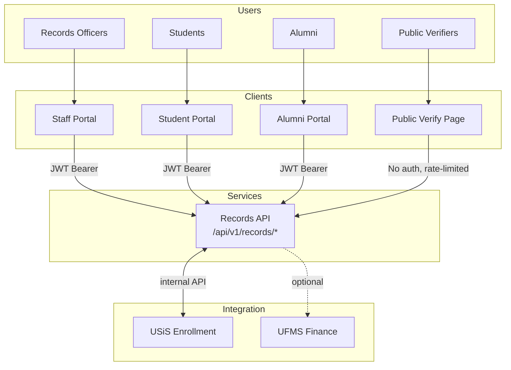

**Role-specific routes:**
- Records officer: `/staff/*`
- Student: `/student/*`
- Alumni: `/alumni/*`
- Public: `/verify`

---

### 3. TOR Request Workflow

#### 3.1 TOR Request State Machine

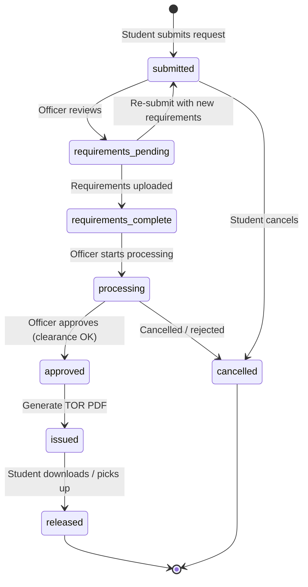

#### 3.2 TOR Request Submission Sequence

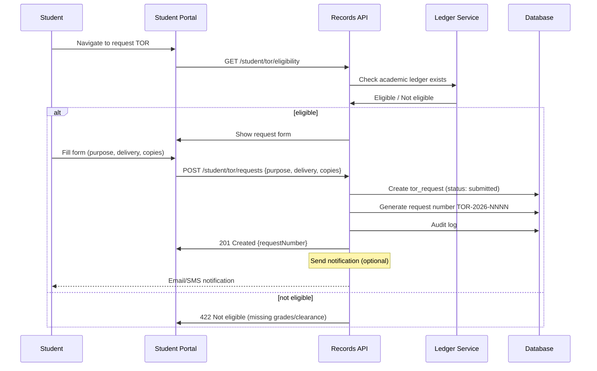

#### 3.3 Officer Request Processing

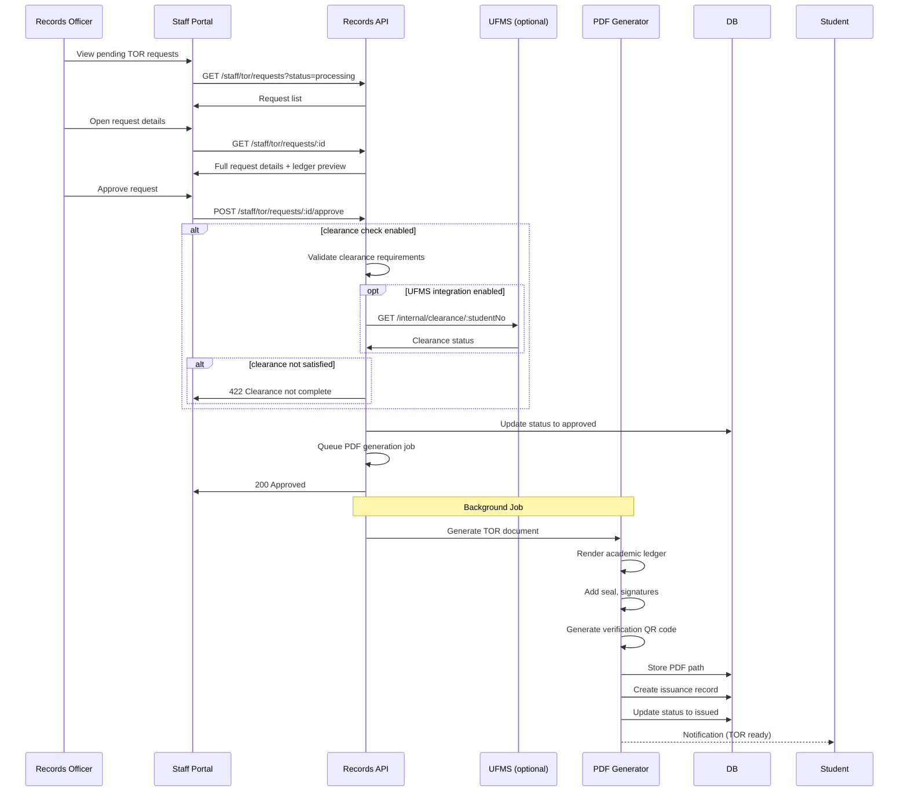

---

### 4. Certification Request Workflow

#### 4.1 Certification Types and Numbering

| Certification Type | Code | Number Format | Typical Use |
|--------------------|------|---------------|-------------|
| Honorable Dismissal | HD | `HD-2026-0001` | Transfer to another institution |
| Good Moral Character | GMC | `GMC-2026-0001` | Employment, visa applications |
| Units Earned | UE | `UE-2026-0001` | Proof of partial completion |
| Completion | CMPL | `CMPL-2026-0001` | Program completion (non-degree) |
| Diploma Verification | DV | `DV-2026-0001` | Verify diploma authenticity |

#### 4.2 Certification Request State Machine

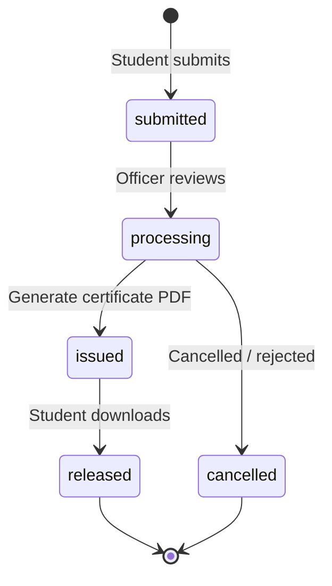

#### 4.3 Certification Issuance Sequence

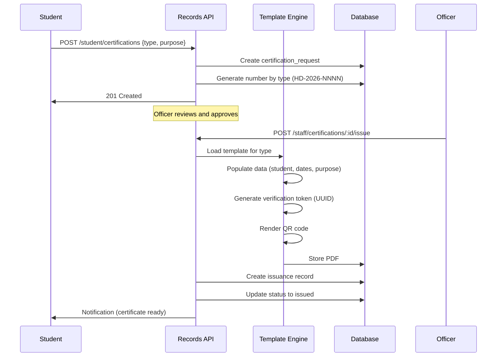

---

### 5. Academic Ledger Sync from USiS

#### 5.1 Nightly Batch Sync

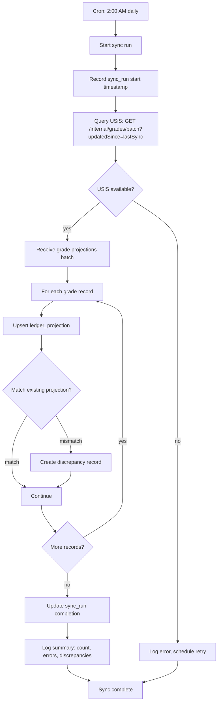

#### 5.2 Discrepancy Detection Logic

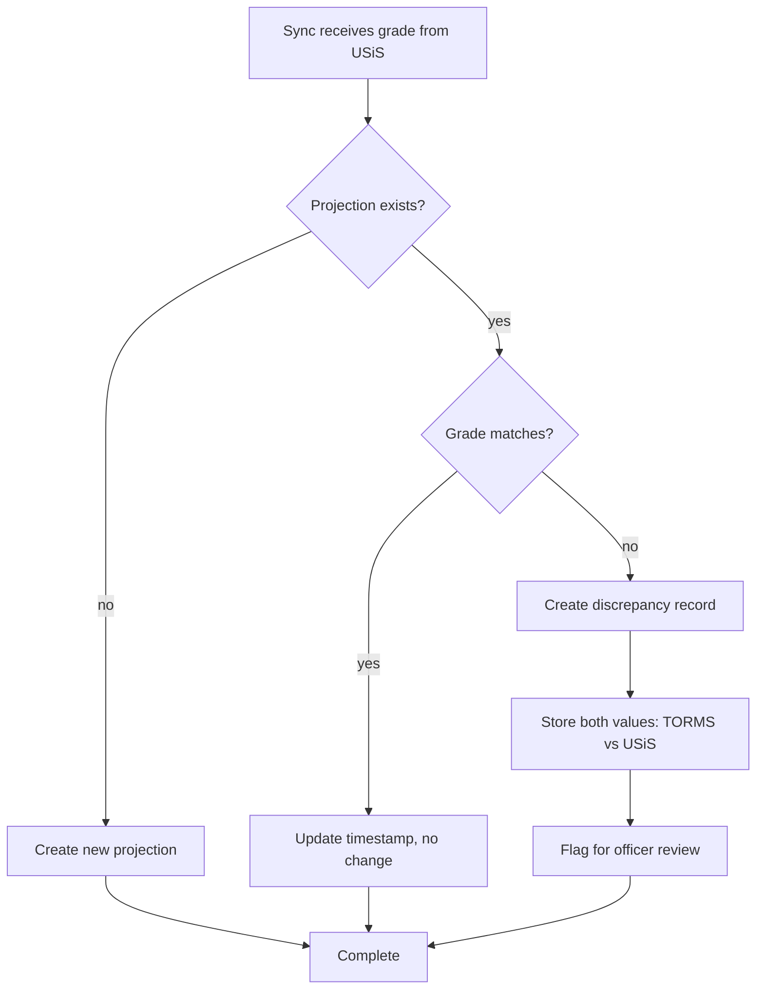

#### 5.3 Discrepancy Resolution

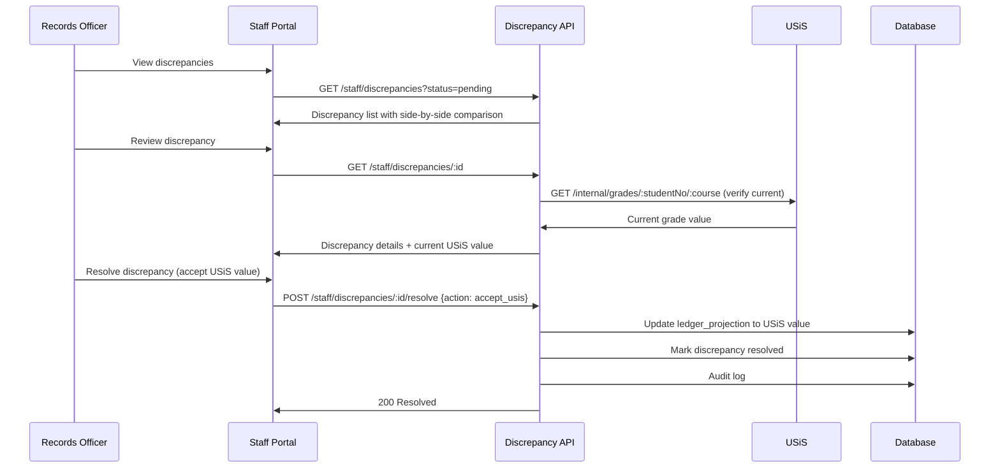

---

### 6. On-Demand Sync for Specific Student

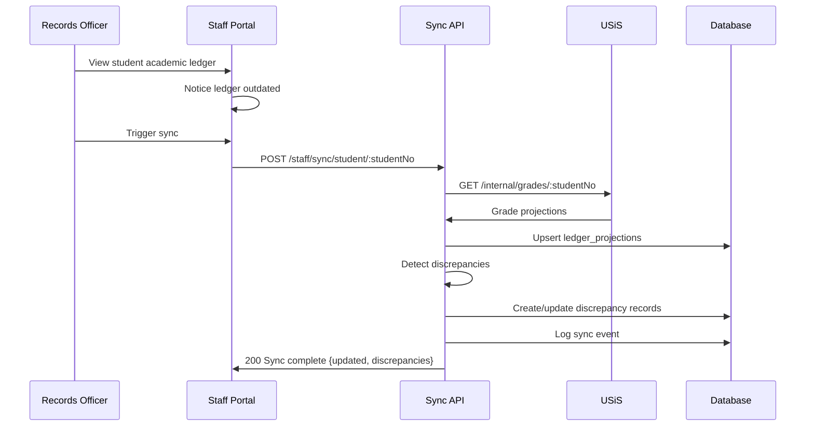

---

### 7. Public Document Verification

#### 7.1 Verification Flow

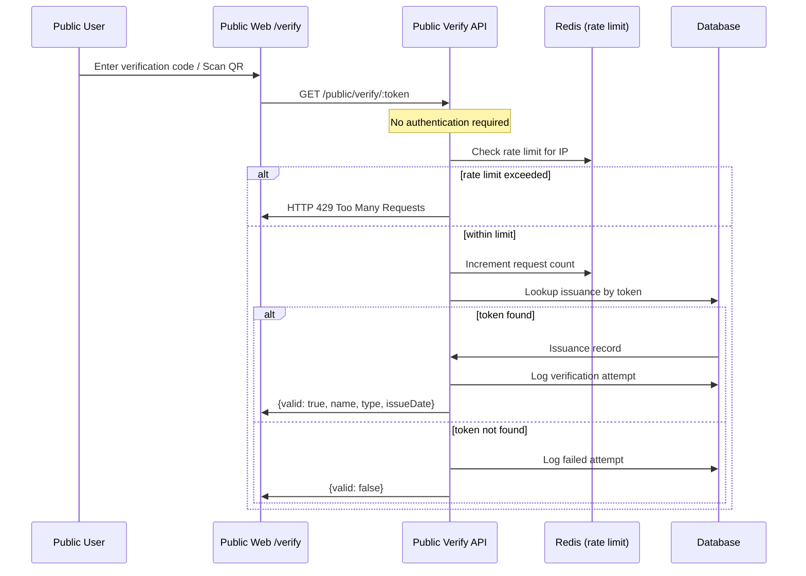

#### 7.2 Rate Limiting Logic

```mermaid
flowchart TD
    A[Verification request] --> B[Get IP address]
    B --> C[Check Redis: KEY=verify_rate:IP]
    C --> D{Count exists?}
    D -->|no| E[Set count=1, TTL=60s]
    D -->|yes| F{Count < 10?}
    F -->|yes| G[Increment count]
    F -->|no| H[HTTP 429 Too Many Requests]
    E --> I[Process verification]
    G --> I
    I --> J[Return result]
```

---

### 8. Alumni Management

#### 8.1 Alumni Creation from Graduation Event

```mermaid
sequenceDiagram
    participant USiS
    participant API as TORMS Internal API
    participant Ledger as Ledger Service
    participant DB as Database
    
    Note over USiS: Student completes graduation requirements
    USiS->>API: POST /internal/alumni/create
    Note over API: Service key authentication
    API->>API: Validate X-Service-Api-Key
    
    API->>Ledger: Verify student exists in ledger
    Ledger->>API: Student found
    
    API->>DB: Create alumni_profile
    API->>DB: Copy contact info from student record
    API->>DB: Set standing = active
    API->>DB: Link to existing issuances
    API->>DB: Audit log
    API->>USiS: 201 Alumni created
```

#### 8.2 Alumni Self-Service

```mermaid
flowchart TD
    A[Alumni logs in via SSO] --> B[Portal redirect to /alumni]
    B --> C[View issued documents]
    C --> D[Download TOR/certifications]
    B --> E[Update contact information]
    E --> F[Save address/phone/email]
    F --> G[Audit log]
    B --> H[View alumni services]
    H --> I[Browse events/news]
```

---

### 9. Records Officer Dashboard

#### 9.1 Dashboard Data Flow

```mermaid
flowchart TD
    A[Officer opens dashboard] --> B[API: GET /staff/dashboard]
    B --> C[Query pending TOR requests]
    B --> D[Query pending certifications]
    B --> E[Query recent issuances]
    B --> F[Query sync status]
    B --> G[Calculate KPIs]
    C --> H[Aggregate data]
    D --> H
    E --> H
    F --> H
    G --> H
    H --> I[Return dashboard JSON]
    I --> J[Render UI widgets]
```

#### 9.2 KPI Calculations

| KPI | Calculation | Data source |
|-----|-------------|-------------|
| Total pending requests | Count where status IN (submitted, requirements_pending, processing) | tor_requests + certification_requests |
| Average processing time | AVG(issued_at - submitted_at) for last 30 days | issuances |
| Issuance volume (monthly) | Count issuances grouped by month | issuances |
| Sync status | Latest sync_run timestamp + error count | sync_runs |
| Discrepancy count | Count where status = pending | discrepancies |
| Alumni registered (YTD) | Count created this year | alumni_profiles |

---

### 10. Report Generation

#### 10.1 Report Export Workflow

```mermaid
sequenceDiagram
    participant O as Records Officer
    participant UI as Staff Portal
    participant API as Reports API
    participant Queue as Job Queue
    participant Worker as Report Worker
    participant Storage as Object Storage
    
    O->>UI: Select report type + filters + format
    UI->>API: POST /staff/reports/generate {type, filters, format}
    API->>API: Check permission: reports.export
    API->>Queue: Enqueue report job
    API->>UI: 202 Accepted {jobId}
    
    Queue->>Worker: Process report job
    Worker->>Worker: Query database
    Worker->>Worker: Format as CSV/PDF
    Worker->>Storage: Upload report file
    Worker->>DB: Log export in report_exports
    Worker->>O: Notification (report ready)
    
    O->>UI: Download report
    UI->>API: GET /staff/reports/:jobId/download
    API->>Storage: Get signed URL
    API->>UI: Redirect to signed URL
```

#### 10.2 Report Types

| Report Type | Query complexity | Typical runtime |
|-------------|------------------|-----------------|
| TOR Issuance | Simple (issuances + student join) | <5s |
| Certification Issuance | Simple (issuances + type filter) | <5s |
| Request Aging | Medium (status history aggregation) | 10-30s |
| Alumni Demographics | Medium (alumni + program join, grouping) | 10-30s |
| Sync Status | Simple (latest sync_runs) | <2s |

---

### 11. Error Cases & Edge Conditions

| Case | Expected Behavior | HTTP Status | User Message |
|------|-------------------|-------------|--------------|
| TOR request without academic ledger | Block submission | 422 | "Academic records not found. Contact registrar." |
| Approve TOR with pending clearance | Block approval | 422 | "Clearance requirements not satisfied." |
| UFMS unavailable during clearance check | Log error, allow manual override | 503 | "Clearance service unavailable. Manual verification required." |
| Public verify with invalid token | Return not found | 404 | "Invalid verification code." |
| Public verify exceeds rate limit | Block request | 429 | "Too many verification attempts. Try again in 1 minute." |
| Sync while USiS down | Log error, retry scheduled | N/A | "Sync failed. Will retry automatically." |
| Duplicate alumni creation (graduation replay) | Idempotent — return existing | 200 | Existing alumni ID |
| Student accesses other student's TOR request | Authorization failure | 403 | "Access denied." |
| Alumni updates to restricted fields (e.g., graduation date) | Block update | 422 | "Field cannot be modified." |
| PDF generation failure | Log error, flag for manual generation | 500 | "Document generation failed. Request logged." |
| Discrepancy resolve without permission | Authorization failure | 403 | "Insufficient permissions." |

---

### 12. Background Job Workflows

#### 12.1 Nightly Sync Job Schedule

```mermaid
flowchart TD
    A[Cron: 2:00 AM daily] --> B[Trigger grade sync job]
    A --> C[Trigger enrollment history sync job]
    B --> D[Execute batch sync]
    C --> E[Execute enrollment sync]
    D --> F{Success?}
    E --> G{Success?}
    F -->|yes| H[Update last_sync timestamp]
    F -->|no| I[Schedule retry at 3:00 AM]
    G -->|yes| J[Update enrollment_last_sync]
    G -->|no| K[Schedule retry at 3:30 AM]
    H --> END
    I --> END
    J --> END
    K --> END
```

#### 12.2 PDF Generation Job

```mermaid
flowchart TD
    A[Issuance approved] --> B[Enqueue PDF generation]
    B --> C[Worker picks job]
    C --> D[Load ledger data]
    D --> E[Load template]
    E --> F[Render HTML]
    F --> G[Convert to PDF]
    G --> H[Generate QR code]
    H --> I[Embed QR in PDF]
    I --> J[Upload to storage]
    J --> K[Update issuance record]
    K --> L[Send notification]
    L --> END[Job complete]
```

---

**End of LLD — TORMS**

---
