# UDMS — Complete System Specification

| Field | Value |
|-------|-------|
| **Product** | UDMS — University Document Management System |
| **Document type** | Complete System Specification (SRS + Architecture + Features + LLD) |
| **Date** | August 2026 |
| **Classification** | Proprietary |

## Document contents

1. System Requirements Specification (SRS)
2. Architecture Design
3. Features & Requirements
4. Low-Level Design (LLD) Workflows

---

## Part 1 — System Requirements Specification (SRS)

### UDMS — University Document Management System

| Field | Value |
|-------|-------|
| **Document ID** | SRS-UDMS-001 |
| **Product** | UDMS (University Document Management System) |
| **Repository** | `CDTS_Zamboanga` |
| **Version** | 1.2 |
| **Date** | August 2026 |
| **Classification** | Proprietary |

---

### 1. Introduction

#### 1.1 Purpose

This Software Requirements Specification defines the functional and non-functional requirements for **UDMS** (**University Document Management System**): an enterprise multi-tenant platform for document registration, workflow automation, approvals, records desk operations, SLA tracking, audit trails, and public status tracking.

#### 1.2 Scope

**In scope**

- Multi-tenant document lifecycle with unique tracking numbers
- Visual workflow designer and multi-step approvals (sequential, parallel, conditional)
- Records desk: request/release, digitization/OCR QA, receiving, archives, disposal, legal hold, retention
- SLA monitoring, notifications, search, AI help desk and document intelligence
- Subscription billing, tenant branding, platform super-admin
- Local auth, OAuth, MFA, and University Platform Access SSO (`AUTH_MODE=dual`)
- Public unauthenticated tracking for Public-visibility documents

**Out of scope**

- Full UHRIS, Library (ULMIS), or Inventory (UIMS) business logic (sibling platforms)
- Guaranteed 500-user / &lt;3s search SLA until proven in staging load tests
- Physical RFID / biometric hardware
- veraPDF-certified PDF/A archival validation

#### 1.3 Definitions

| Term | Definition |
|------|------------|
| **UDMS** | University Document Management System |
| **Tracking number** | Unique ID `{PREFIX}-YYYY-NNNNNNN` (default prefix `DTS`) |
| **Tenant** | Isolated organization on the shared SaaS database |
| **SLA** | Service-level agreement hours on workflow steps |

#### 1.4 References

- `CDTS_Zamboanga/README.md`
- `docs/DocsTrack-Complete-Guide.md` (legacy filename; product name is UDMS)
- `docs/engineering/ARCHITECTURE.md`
- `docs/API-Specs-Manual.md`
- Sibling: University Platform Access SSO topology

---

### 2. Overall Description

#### 2.1 Product Perspective

Monorepo with separately deployable processes:

| Component | Stack | Role |
|-----------|-------|------|
| API | AdonisJS 7, TypeScript, PostgreSQL, Redis | REST `/api/v1` |
| Web | React 19, Vite, Tailwind, ShadCN | Marketing, tenant app, admin, public track |
| Workers | BullMQ | Notifications, SLA checks, document intelligence |
| Storage | S3-compatible | Attachments |
| Search | Meilisearch (optional) + Postgres FTS | Full-text / OCR search |

#### 2.2 User Classes

| Role | Description |
|------|-------------|
| Tenant Owner | Full org control including billing and custom roles |
| Admin | Day-to-day user/workflow/org administration |
| Manager / Approver | Supervisory review and approval queue |
| Staff / Member | Create, edit, submit documents |
| Viewer | Read-only access to non-draft documents |
| Records Officer | Digitization, receiving, archives, retention, legal hold |
| Super Admin | Cross-tenant platform administration |
| Public visitor | Track public documents without login |

#### 2.3 Constraints

- Shared-database multi-tenancy with `tenant_id` isolation
- Workers must run separately from the API process
- University Platform Access remains a separate deployment; UDMS verifies platform JWTs via JWKS
- Default max attachment size 25 MB; plan quotas enforced
- Submit allowed from Draft only (returned documents follow admin resubmit path)

#### 2.4 Assumptions

- SMTP configured for invitations and email notifications
- Object storage credentials available in production
- Enterprise deployments wire University Platform Access SSO before retiring local-only login
- Approvers monitor the approval queue; SLA hours reflect operational norms

---

### 3. Functional Requirements

#### 3.1 Documents (FR-DOC)

| ID | Requirement | Priority |
|----|-------------|----------|
| FR-DOC-001 | Assign unique tracking numbers `{PREFIX}-YYYY-NNNNNNN` per tenant sequence | Must |
| FR-DOC-002 | Support lifecycle: draft → pending_approval → approved/rejected/returned → completed → archived | Must |
| FR-DOC-003 | Restrict draft visibility to creator until submit | Must |
| FR-DOC-004 | Version content/files (v0.x drafts, v1+ post-approval) | Must |
| FR-DOC-005 | Support Public/Private visibility; Public enables `/track/{trackingNumber}` | Must |
| FR-DOC-006 | Support Confidential/Restricted levels with watermarked downloads where applicable | Should |
| FR-DOC-007 | Allow multipart and presigned uploads; enforce size and storage quotas | Must |
| FR-DOC-008 | Support NAP-aligned retention schedules and legal hold blocking disposal | Must |
| FR-DOC-009 | Queue async OCR/intelligence jobs on upload | Should |
| FR-DOC-010 | Optional e-sign integration when enabled | Could |

#### 3.2 Workflows & Approvals (FR-WF / FR-APR)

| ID | Requirement | Priority |
|----|-------------|----------|
| FR-WF-001 | Represent workflows as directed graphs with sequential, parallel, and conditional steps | Must |
| FR-WF-002 | Allow create draft, publish, and archive workflows | Must |
| FR-WF-003 | Auto-provision a default published workflow on submit if none exists | Must |
| FR-WF-004 | Assign steps by role, named user, or department head | Must |
| FR-APR-001 | Provide Approvals queue with Approve, Return, Reject (comment required), Forward | Must |
| FR-APR-002 | Record routing timeline with actor and timestamp | Must |

#### 3.3 SLA (FR-SLA)

| ID | Requirement | Priority |
|----|-------------|----------|
| FR-SLA-001 | Support optional SLA hours per workflow step | Must |
| FR-SLA-002 | Periodically detect breaches (worker) and notify supervisors | Must |
| FR-SLA-003 | Surface overdue/at-risk metrics on dashboard and reports | Should |

#### 3.4 Records Desk (FR-REC)

| ID | Requirement | Priority |
|----|-------------|----------|
| FR-REC-001 | Record access requests (view/download/physical) with release desk workflow | Must |
| FR-REC-002 | Digitization batches with OCR QA checklist before link | Must |
| FR-REC-003 | Receiving log with channels and printable acknowledgment | Must |
| FR-REC-004 | Archival transfer packages and disposal with certificates | Must |
| FR-REC-005 | Legal hold blocks disposal | Must |

#### 3.5 Search, Notifications, Audit, AI

| ID | Requirement | Priority |
|----|-------------|----------|
| FR-SRH-001 | Command palette and full search across documents, files, OCR text, users, workflows | Must |
| FR-NOT-001 | Notify on assignment, approval outcomes, and SLA breaches via email/in-app/push | Must |
| FR-AUD-001 | Append-only audit logs for security and compliance actions | Must |
| FR-AI-001 | Permission-aware in-app Help Desk copilot; confirm before destructive actions | Should |

#### 3.6 Multi-Tenant, Billing, Auth

| ID | Requirement | Priority |
|----|-------------|----------|
| FR-MT-001 | Isolate all tenant-owned data by `tenant_id` | Must |
| FR-MT-002 | Self-service registration creates tenant + owner and onboarding | Should |
| FR-BIL-001 | Subscription plans with user/document/storage limits and Stripe/PayMongo checkout | Should |
| FR-ID-001 | Local JWT auth, optional OAuth (Google/Microsoft), optional TOTP MFA | Must |
| FR-ID-002 | Support University Platform Access SSO via JWKS (`AUTH_MODE=dual`) | Must |
| FR-PUB-001 | Rate-limited public tracking for Public documents | Must |

#### 3.7 Administration & Reports

| ID | Requirement | Priority |
|----|-------------|----------|
| FR-ADM-001 | Manage users, roles, departments, document types, branding | Must |
| FR-ADM-002 | Dashboard and reports with metrics and CSV export | Must |
| FR-ADM-003 | Super-admin portal for tenants, plans, and platform analytics | Must |

---

### 4. External Interface Requirements

#### 4.1 User Interfaces

| Surface | Audience |
|---------|----------|
| Marketing / login / register | Public |
| `/app/*` tenant application | Authenticated users |
| `/admin/*` platform portal | Super Admin |
| `/track/*` public tracking | Unauthenticated |

#### 4.2 Software Interfaces

| Interface | Detail |
|-----------|--------|
| REST API | HTTPS JSON `/api/v1/*`; Bearer JWT; optional `X-Tenant-ID` |
| OpenAPI / Swagger | `/api/v1/docs` |
| University Platform Access SSO | JWKS verification; launcher handoff to `/sso/callback#access_token=…` |
| Billing webhooks | Stripe / PayMongo / stub |
| SMTP / FCM / Socket.IO | Email, push, realtime notifications |
| S3 / Meilisearch / OCR-AI providers | Storage, search, intelligence |

---

### 5. Non-Functional Requirements

| ID | Category | Requirement |
|----|----------|-------------|
| NFR-SEC-001 | Security | HTTPS in production; VineJS validation; Shield XSS/CSRF; Redis rate limits |
| NFR-SEC-002 | Security | RBAC on sensitive routes; secrets in env/Secrets Manager; failed-login lockout |
| NFR-SEC-003 | Security | Presigned file URLs only; optional virus scan flags |
| NFR-PERF-001 | Performance | Target authenticated search p95 &lt; 3s under ~500 concurrent users (aspirational until proven) |
| NFR-AVL-001 | Availability | Liveness/readiness health endpoints; API and worker separation |
| NFR-AVL-002 | Availability | Target RPO ≤15 min; documented RTO for rollback/restore/DR |
| NFR-CMP-001 | Compliance | Immutable audit trail; retention schedules; disposal certificates; legal hold |
| NFR-UX-001 | Usability | Modern browsers; responsive layout; permission-based navigation |
| NFR-OBS-001 | Observability | Optional Prometheus `/metrics`, Sentry, structured logs |

---

### 6. Data Requirements

- PostgreSQL with UUID primary keys, soft deletes, ~40 tables
- Core domains: tenant config, auth/RBAC, documents/files, workflows/approvals, SLA, billing, notifications, audit, records desk
- Redis for cache, queues, and rate limiting

---

### 7. Verification Criteria (Summary)

| Scenario | Expected result |
|----------|-----------------|
| Create & submit document | Tracking number assigned; workflow starts; status pending_approval |
| Approve / return / reject | Timeline updated; notifications sent |
| Public track | Public document status visible without login |
| Legal hold | Disposal blocked |
| University Platform Access SSO | Platform JWT accepted in dual mode |
| Plan limit | User creation blocked at max users |

---

### 8. Document Control

| Version | Date | Description |
|---------|------|-------------|
| 1.2 | August 2026 | SRS baseline; product branded as UDMS |

#### Related design docs

- **[UDMS-Architecture.md](./UDMS-Architecture.md)** — Architecture design (context, containers, layers, deployment)
- **[UDMS-Features-Requirements.md](./UDMS-Features-Requirements.md)** — Feature catalog + requirements matrix
- **[UDMS-LLD.md](./UDMS-LLD.md)** — Low-level design workflows (auth, document pipeline, SLA, records desk, async workers)

**End of SRS — UDMS (University Document Management System)**

---

## Part 2 — Architecture Design

### UDMS — University Document Management System

| Field | Value |
|-------|-------|
| **Document ID** | AD-UDMS-001 |
| **Product** | UDMS |
| **Companions** | [UDMS-SRS.md](./UDMS-SRS.md) · [UDMS-Features-Requirements.md](./UDMS-Features-Requirements.md) · [UDMS-LLD.md](./UDMS-LLD.md) |
| **Date** | August 2026 |

---

### 1. Purpose

This Architecture Design (AD) describes the **system context, containers, layers, data stores, and deployment topology** for UDMS. Runtime workflows are in the LLD; requirements are in the SRS / Features catalogs.

---

### 2. System context

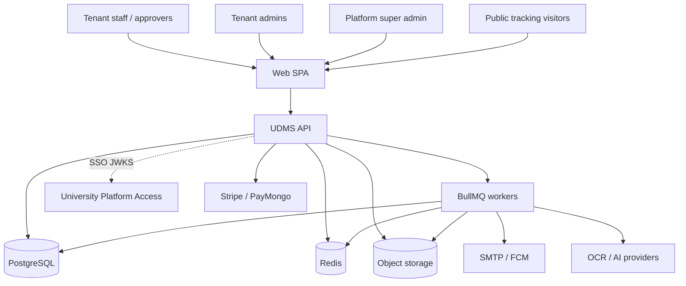

---

### 3. Container view

| Container | Technology | Responsibility |
|-----------|------------|----------------|
| Web | React 19, Vite, Tailwind, ShadCN | Marketing, `/app`, `/admin`, `/track` |
| API | AdonisJS 7, Lucid | Auth, RBAC, documents, workflows, records desk |
| Worker | BullMQ | Notifications, SLA checks, document intelligence |
| PostgreSQL | UUID PKs, soft deletes, `tenant_id` | System of record (~40 tables) |
| Redis | Cache + queues + rate limits | Async and performance |
| Object storage | S3 / R2 / MinIO | Attachments via presigned URLs |
| Search | Meilisearch (optional) + PG FTS | Indexed document/OCR search |

**Local ports (typical):** API separate from UHRIS/ULMIS (e.g. 3335); Web Vite; Redis/Postgres via Compose.

---

### 4. Backend layered architecture

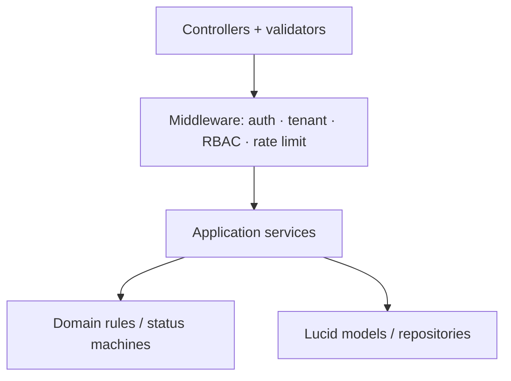

| Layer | Owns |
|-------|------|
| Presentation | HTTP, OpenAPI, transformers |
| Application | DocumentService, WorkflowEngine, billing, records desk |
| Domain | Lifecycle enums, SLA rules, permission codes |
| Infrastructure | PG, Redis, S3, Meilisearch, mail, OCR adapters |

---

### 5. Multi-tenancy & security

- Shared-database isolation with `tenant_id` on tenant-owned rows
- Tenant resolved from user membership, verified domain, or `X-Tenant-ID`
- Bearer JWT (local) and/or University Platform Access RS256 JWT (`AUTH_MODE=dual`)
- RBAC via role_permissions; owners bypass within org
- Files only via presigned URLs; secrets in env / Secrets Manager

---

### 6. Key domain modules

| Module | Primary tables / concerns |
|--------|---------------------------|
| Auth / RBAC | users, roles, permissions, sessions, MFA |
| Documents | documents, files, versions, tracking_sequences |
| Workflows | workflows, workflow_steps, document_workflow_instances, approvals |
| Records desk | record_requests, digitization, receiving, archives, retention |
| SLA | deadlines on instances; worker breach scan |
| Billing | plans, subscriptions, invoices |
| Audit | append-only audit_logs |
| Notifications | in-app, email, push tokens |

---

### 7. Deployment topology

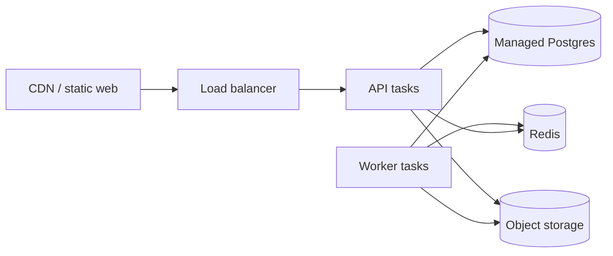

| Concern | Guidance |
|---------|----------|
| Processes | API and workers deploy separately |
| Health | `/health/live`, `/health/ready` |
| Target RPO/RTO | Documented in engineering DR notes (PITR / rollback) |
| Interim hosts | Railway API+worker; static web on Vercel/CDN |

---

### 8. Integration architecture

| Peer | Pattern |
|------|---------|
| University Platform Access | JWKS verify; `/sso/callback` handoff |
| Billing | Webhooks Stripe/PayMongo |
| OCR/AI | Provider adapters on intelligence queue |
| Email/Push | SMTP + FCM from notification worker |

---

### 9. Quality attributes

| Attribute | Approach |
|-----------|----------|
| Scalability | Stateless API; queue offload; optional Meilisearch |
| Availability | Multi-AZ DB target; worker isolation |
| Security | HTTPS, Shield, RBAC, rate limits, audit |
| Observability | Optional Prometheus `/metrics`, Sentry, structured logs |

---

**End of Architecture Design — UDMS**

---

## Part 3 — Features & Requirements

### UDMS — University Document Management System

| Field | Value |
|-------|-------|
| **Document ID** | FR-UDMS-001 |
| **Product** | UDMS |
| **Companions** | [UDMS-SRS.md](./UDMS-SRS.md) · [UDMS-LLD.md](./UDMS-LLD.md) |
| **Date** | August 2026 |

---

### 1. Feature summary

| Area | Features |
|------|----------|
| **Documents** | Register, version, classify, attach files, tracking numbers, retention, legal hold |
| **Workflows** | Visual designer; sequential / parallel / conditional steps; publish & archive |
| **Approvals** | Queue, approve / return / reject / forward, routing timeline |
| **SLA** | Per-step deadlines, breach detection, supervisor alerts, ops metrics |
| **Records desk** | Request/release, digitization + OCR QA, receiving, archives, disposal certificates |
| **ISO / ESS / Mobile** | ISO 9001 controlled docs; employee personal records portal; mobile offline approvals |
| **Search** | Command palette, full-text + OCR, filters, optional image search |
| **Notifications** | Email, in-app, push; realtime when Socket.IO enabled |
| **AI** | Permission-aware Help Desk copilot; OCR / classification / summary pipeline |
| **Public track** | Unauthenticated status page + QR for Public documents |
| **Admin / billing** | Users, roles, branding, domains, plans, usage limits, super-admin portal |
| **Security** | Local JWT, OAuth, MFA, University Platform Access SSO, RBAC, audit logs |

---

### 2. Feature catalog (by module)

#### 2.1 Document management

| Feature ID | Feature | Description | Priority |
|------------|---------|-------------|----------|
| F-DOC-01 | Tracking numbers | Auto `{PREFIX}-YYYY-NNNNNNN` per tenant | Must |
| F-DOC-02 | Lifecycle states | draft → pending_approval → approved/rejected/returned → completed → archived | Must |
| F-DOC-03 | Draft privacy | Only creator sees drafts until submit | Must |
| F-DOC-04 | Versioning | v0.x drafts; v1+ after approval | Must |
| F-DOC-05 | Visibility | Public / Private; Public enables external track | Must |
| F-DOC-06 | Confidentiality | Confidential / Restricted with watermarked download | Should |
| F-DOC-07 | Attachments | Multipart + presigned upload; size/quota limits | Must |
| F-DOC-08 | Retention | NAP-aligned schedules; due-date computation | Must |
| F-DOC-09 | Legal hold | Blocks disposal while hold is active | Must |
| F-DOC-10 | E-sign (PandaDoc) | Optional PandaDoc envelopes when enabled | Could |
| F-DOC-11 | E-sign provider matrix | DocuSign / PNKI adapters documented; PandaDoc primary; PNKI/DocuSign pluggable | Should |
| F-DOC-12 | NAP classification | Administrative, financial/property, legal, academic, personnel, student/support, governance categories with retention/disposition | Must |
| F-DOC-13 | Lifecycle labels | Product states map to Active / Semi-active / Inactive / Archived for NAP reporting views | Must |
| F-DOC-14 | Records inventory | Inventories by office, series, year, classification, retention; ref#, title, dates, volume, format, location, status | Must |
| F-DOC-15 | PDF/A capture | Digitization targets PDF/A; QA checklist; veraPDF certification is staging ops (NFR) | Should |
| F-DOC-16 | Confidentiality levels | Public · Internal · Confidential · Highly Confidential / Restricted with RBAC + watermark | Must |

#### 2.2 Workflows & approvals

| Feature ID | Feature | Description | Priority |
|------------|---------|-------------|----------|
| F-WF-01 | Graph workflows | Directed JSON workflows with typed steps | Must |
| F-WF-02 | Designer | Create draft, publish, archive workflows | Must |
| F-WF-03 | Auto default | Provision default workflow on first submit if missing | Must |
| F-WF-04 | Assignees | Role, named user, or department head | Must |
| F-APR-01 | Approvals queue | Dedicated queue UI for assignees | Must |
| F-APR-02 | Actions | Approve, Return, Reject (comment), Forward | Must |
| F-APR-03 | Timeline | Actor + timestamp routing history | Must |

#### 2.3 SLA

| Feature ID | Feature | Description | Priority |
|------------|---------|-------------|----------|
| F-SLA-01 | Step SLA hours | Configurable per workflow step | Must |
| F-SLA-02 | Breach worker | Periodic detection (~5 min) | Must |
| F-SLA-03 | Alerts & KPIs | Notify supervisors; dashboard/report metrics | Should |

#### 2.4 Records desk

| Feature ID | Feature | Description | Priority |
|------------|---------|-------------|----------|
| F-REC-01 | Record requests | View / download / physical checkout requests | Must |
| F-REC-02 | Release desk | Approve/deny/release/return with append-only log | Must |
| F-REC-03 | Digitization | Batches, capture, OCR confidence, QA checklist | Must |
| F-REC-04 | Receiving | Multi-channel inbound log + acknowledgment | Must |
| F-REC-05 | Archives | Transfer packages create → approve → complete | Must |
| F-REC-06 | Disposal | Justified disposal + certificate; hold enforcement | Must |
| F-REC-07 | Receiving metadata | Title, type, originating/receiving office, dates, subject/keywords, confidentiality, retention category | Must |
| F-ISO-01 | ISO 9001 controlled docs | Policies, procedures, manuals, forms, templates under Clause 7.5: owner, review/approve, current-version enforce, revision history | Must |
| F-ESS-01 | Employee personal records | View-only portal for appointment, travel orders, special orders, designations; download/print gated; access logged | Must |
| F-MOB-01 | Mobile offline approvals | Dedicated mobile UI for approvers with local cache for low connectivity | Should |

#### 2.5 Search, notify, AI, public

| Feature ID | Feature | Description | Priority |
|------------|---------|-------------|----------|
| F-SRH-01 | Global search | Documents, files, OCR text, users, workflows | Must |
| F-NOT-01 | Multi-channel notify | Email / in-app / push on key events | Must |
| F-AI-01 | Help Desk copilot | Permission-aware guidance; confirm destructive acts | Should |
| F-AI-02 | Document intelligence | Async OCR / classify / summarize | Should |
| F-PUB-01 | Public tracking | `/track/{number}` rate-limited status | Must |

#### 2.6 Tenancy, billing, auth, admin

| Feature ID | Feature | Description | Priority |
|------------|---------|-------------|----------|
| F-MT-01 | Multi-tenant isolation | Shared DB + `tenant_id` scoping | Must |
| F-MT-02 | Self-service signup | Tenant + owner + onboarding wizard | Should |
| F-BIL-01 | Subscriptions | Plans, quotas, Stripe/PayMongo checkout | Should |
| F-AUTH-01 | Local + OAuth + MFA | Email/password, Google/Microsoft, TOTP | Must |
| F-AUTH-02 | UPA SSO | Dual/platform mode via JWKS | Must |
| F-ADM-01 | Team & roles | Users, custom roles, permission matrix | Must |
| F-ADM-02 | Reports & dashboard | Metrics, trends, CSV/PDF ops pack (received/released, classification, archiving/disposal due, backlog, processing time) | Must |
| F-ADM-03 | Super admin | Tenants, plans, platform analytics | Must |
| F-INT-01 | University channels | UPA SSO + receiving via email/portal channels; internal-comms connectors via API | Should |
| F-AUD-01 | Immutable audit trail | Non-editable logs: view, download/print, release, modify, approve — user, time, action, reference | Must |
| F-CMP-01 | Retention compliance | Alerts for archival/disposal due; permanent inventory; authorized disposal workflow | Must |

#### 2.7 Source DOCX traceability (Document-Management-System.docx) — 100%

Every source requirement is documented below. Status = **Delivered** (in product scope), **Planned** (specified for delivery), **Excluded** (hardware/out of product), or **Service** (contractual).

| Source requirement | Feature / ID | Status |
|--------------------|--------------|--------|
| Lifecycle receive→register→digitize→classify→inventory→release→retain→archive | F-DOC-*, F-REC-* | Delivered |
| RA 10173 / NAP GC 5 / ISO 9001 7.5 / COA-CHED | F-DOC-08/12, F-ISO-01, NFR-CMP | Delivered |
| Web multi-office/campus, modular, API | F-MT-01, Architecture | Delivered |
| ≥500 concurrent / search ≤3s | NFR-PERF-001 | Delivered (target) |
| Receiving + registration metadata + unique ref | F-REC-04, F-REC-07, F-DOC-01 | Delivered |
| Routing / configurable approvals | F-WF-*, F-APR-* | Delivered |
| Request/release + release log | F-REC-01, F-REC-02 | Delivered |
| Digitization + OCR + QA | F-REC-03, F-AI-02, F-DOC-15 | Delivered |
| Archival transfer + disposal | F-REC-05, F-REC-06 | Delivered |
| Integrated e-signatures (DocuSign/PNKI) | F-DOC-10, F-DOC-11 | Delivered |
| Mobile app offline approvals | F-MOB-01 | Planned |
| NAP classification categories | F-DOC-12 | Delivered |
| Records inventory by office/series/year | F-DOC-14 | Delivered |
| Lifecycle Active/Semi-active/Inactive/Archived | F-DOC-13 | Delivered |
| Operational + analytical dashboards PDF/CSV | F-ADM-02 | Delivered |
| ISO 9001 controlled document module | F-ISO-01 | Delivered |
| Personal employee records portal | F-ESS-01 | Planned |
| Confidentiality Public→Restricted + RBAC | F-DOC-16, F-DOC-06 | Delivered |
| Immutable audit trail | F-AUD-01 | Delivered |
| Retention alerts + disposal authorization | F-CMP-01, F-DOC-08/09 | Delivered |
| University portal / email / communications | F-INT-01, F-AUTH-02 | Delivered |
| Architecture, schema, DR, manuals | Architecture + repo docs | Delivered |
| Training (5 sessions) / PM / UAT / migration | SVC-UDMS-* (contractual) | Service |
| Physical RFID / biometric hardware | — | Excluded |
| veraPDF-certified PDF/A gate | F-DOC-15 note | Excluded (ops certification) |

---

### 3. Requirements matrix

| Req ID | Requirement | Related features | Priority |
|--------|-------------|------------------|----------|
| FR-DOC-001 | Assign unique tracking numbers | F-DOC-01 | Must |
| FR-DOC-002 | Enforce document lifecycle states | F-DOC-02 | Must |
| FR-DOC-003 | Restrict draft visibility to creator | F-DOC-03 | Must |
| FR-DOC-004 | Version content and files | F-DOC-04 | Must |
| FR-DOC-005 | Support Public/Private visibility | F-DOC-05 | Must |
| FR-DOC-006 | Confidential/Restricted controls | F-DOC-06 | Should |
| FR-DOC-007 | Enforce upload size and storage quotas | F-DOC-07 | Must |
| FR-DOC-008 | Retention schedules + legal hold | F-DOC-08, F-DOC-09 | Must |
| FR-DOC-009 | NAP classification + inventory views | F-DOC-12, F-DOC-14 | Must |
| FR-DOC-010 | Lifecycle NAP label mapping | F-DOC-13 | Must |
| FR-DOC-011 | E-sign providers (PandaDoc + DocuSign/PNKI matrix) | F-DOC-10, F-DOC-11 | Should |
| FR-DOC-012 | Four confidentiality levels + RBAC | F-DOC-16 | Must |
| FR-ISO-001 | ISO 9001 Clause 7.5 controlled documents | F-ISO-01 | Must |
| FR-ESS-001 | Employee personal records view-only portal | F-ESS-01 | Must |
| FR-MOB-001 | Mobile offline approvals | F-MOB-01 | Should |
| FR-AUD-001 | Immutable activity audit trail | F-AUD-01 | Must |
| FR-CMP-001 | Retention compliance alerts + disposal auth | F-CMP-01 | Must |
| FR-INT-001 | Portal / email / UPA channel integration | F-INT-01, F-AUTH-02 | Should |
| FR-WF-001 | Directed workflow graphs with step types | F-WF-01 | Must |
| FR-WF-002 | Publish/archive workflows | F-WF-02 | Must |
| FR-WF-003 | Auto-provision default workflow | F-WF-03 | Must |
| FR-APR-001 | Approvals queue with required actions | F-APR-01, F-APR-02 | Must |
| FR-APR-002 | Persist routing timeline | F-APR-03 | Must |
| FR-SLA-001 | Optional SLA hours per step | F-SLA-01 | Must |
| FR-SLA-002 | Detect breaches and notify | F-SLA-02, F-SLA-03 | Must |
| FR-REC-001..006 | Records desk capabilities | F-REC-01..06 | Must |
| FR-SRH-001 | Search across indexed entities | F-SRH-01 | Must |
| FR-NOT-001 | Event notifications | F-NOT-01 | Must |
| FR-AI-001 | Permission-aware copilot | F-AI-01 | Should |
| FR-PUB-001 | Rate-limited public tracking | F-PUB-01 | Must |
| FR-MT-001 | Tenant data isolation | F-MT-01 | Must |
| FR-ID-001 | Local auth + OAuth + MFA | F-AUTH-01 | Must |
| FR-ID-002 | University Platform Access SSO | F-AUTH-02 | Must |
| FR-ADM-001..003 | Admin, reports, super-admin | F-ADM-01..03 | Must |

---

### 4. Non-functional requirements (summary)

| ID | Category | Requirement |
|----|----------|-------------|
| NFR-SEC-001 | Security | HTTPS, validation, Shield, rate limits, RBAC |
| NFR-SEC-002 | Security | Presigned files; secrets in env; lockout |
| NFR-PERF-001 | Performance | Search p95 &lt; 3s @ ~500 users (target) |
| NFR-AVL-001 | Availability | Health probes; API ≠ worker process |
| NFR-CMP-001 | Compliance | Audit trail, retention, disposal certificates |
| NFR-UX-001 | Usability | Modern browsers; responsive; permission menus |

---

### 5. Actors & feature access

| Actor | Primary features |
|-------|------------------|
| Staff / Member | F-DOC-*, submit, search |
| Approver | F-APR-*, F-MOB-01 |
| Records Officer | F-REC-*, F-ISO-01, F-CMP-01 |
| Employee (self-service) | F-ESS-01 |
| Admin / Owner | F-ADM-*, F-WF-*, F-BIL-* (owner), F-AUD-01 |
| Super Admin | F-ADM-03 |
| Public visitor | F-PUB-01 |

---

**End of Features & Requirements — UDMS**

---

## Part 4 — Low-Level Design (LLD) Workflows

### UDMS (University Document Management System)

| Field | Value |
|-------|-------|
| **Document ID** | LLD-UDMS-001 |
| **Product** | UDMS |
| **Companion** | [UDMS-SRS.md](./UDMS-SRS.md) |
| **Date** | August 2026 |

---

### 1. Purpose

This LLD describes **runtime workflows**: actor sequences, state machines, and component interactions for UDMS. It complements the SRS with implementable process detail for developers and operators.

---

### 2. System context (components)

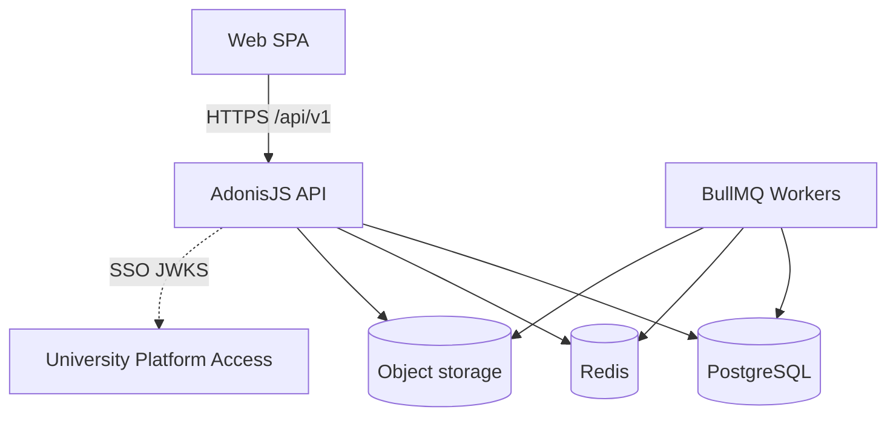

| Component | Responsibility |
|-----------|----------------|
| Web SPA | UI, approvals queue, records desk, public track |
| API | Auth, RBAC, document/workflow services |
| Workers | Notifications, SLA checks, OCR/intelligence |
| UPA | Optional SSO issuer (dual/platform mode) |

---

### 3. Authentication workflow

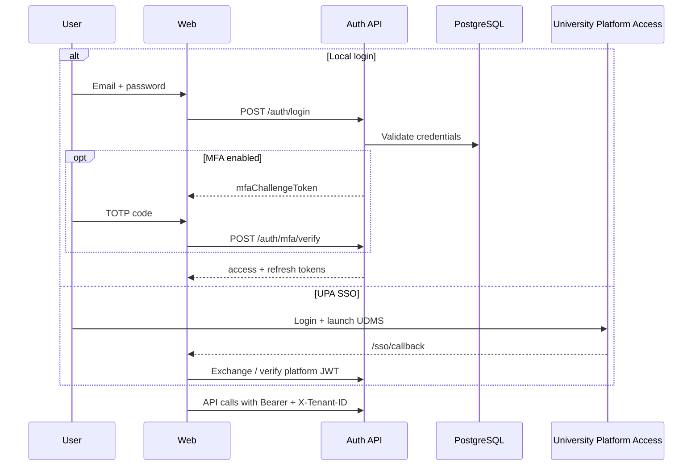

**Steps**

1. Resolve tenant from user membership, verified domain, or `X-Tenant-ID`.
2. Attach `TenantContext`; all queries scope by `tenant_id`.
3. Permission middleware checks RBAC (tenant owner may bypass within org).

---

### 4. Document lifecycle (state machine)

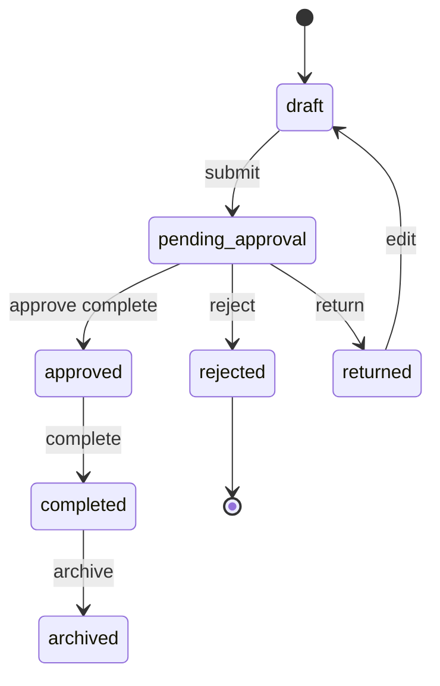

| Transition | Trigger | Side effects |
|------------|---------|--------------|
| submit | Creator / authorized user | Tracking already assigned; start workflow instance; init SLA; notify assignees |
| approve | Assigned approver | Advance workflow node; may complete document |
| return | Approver + comment | Editable draft path; notify creator |
| reject | Approver + comment | Terminal; notify creator |
| archive | Authorized | Retention / records policies apply |

**Tracking number:** `{PREFIX}-YYYY-NNNNNNN` (per-tenant sequence).

---

### 5. Submit → approval pipeline

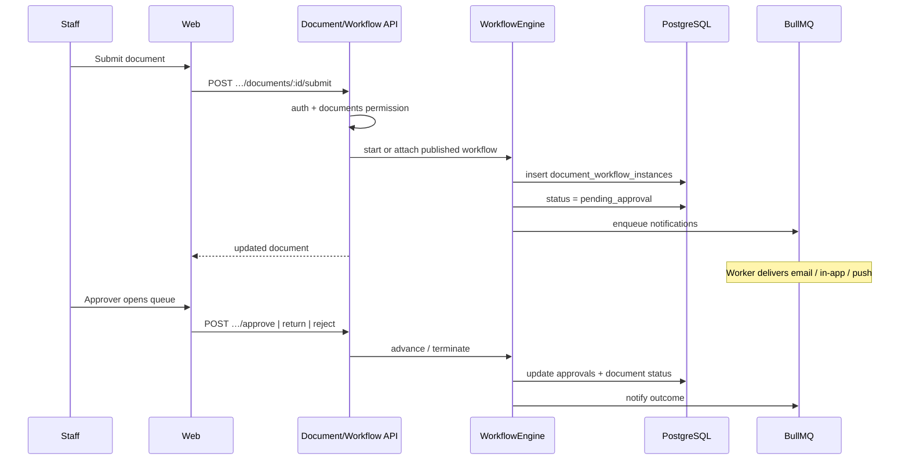

**Workflow graph:** JSON definition in `workflows.definition`; steps in `workflow_steps`; runtime in `document_workflow_instances.current_node_id` + `state` JSON.

**Step assignment modes:** role, named user, department head.

---

### 6. SLA breach workflow

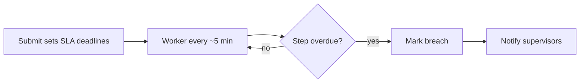

| Step | Detail |
|------|--------|
| 1 | Per-step SLA hours configured on workflow |
| 2 | SLA worker scans open instances |
| 3 | Breach writes ops signal + notification job |
| 4 | Dashboard / reports surface at-risk and breached counts |

---

### 7. Records desk workflows

#### 7.1 Record request / release

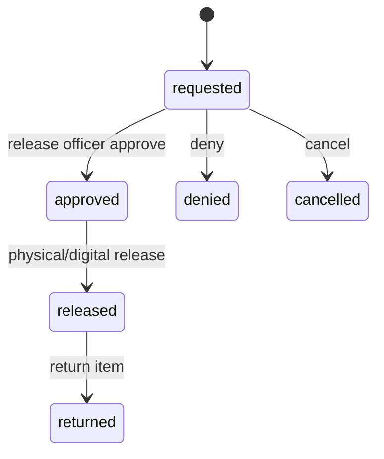

#### 7.2 Digitization QA

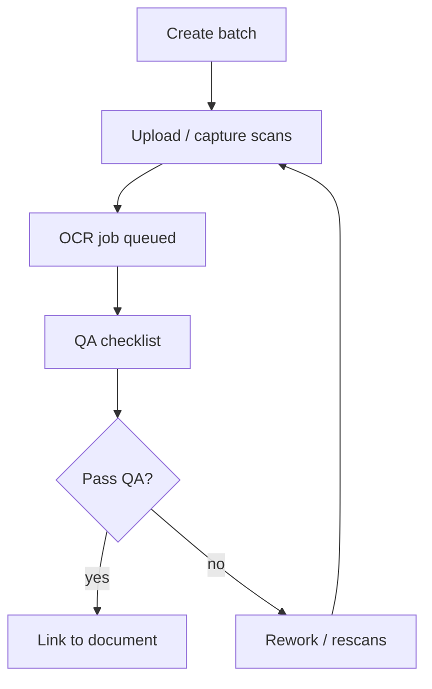

#### 7.3 Disposal with legal hold

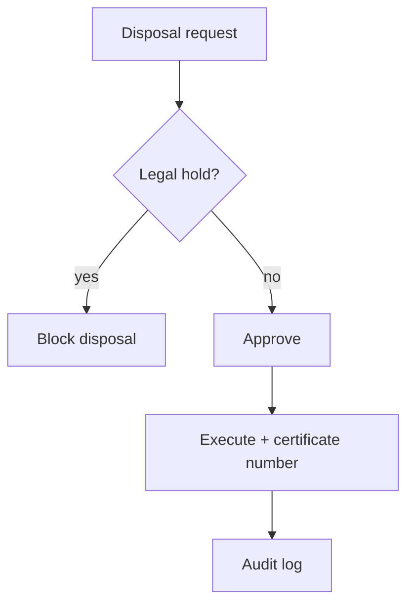

---

### 8. Async intelligence & notifications

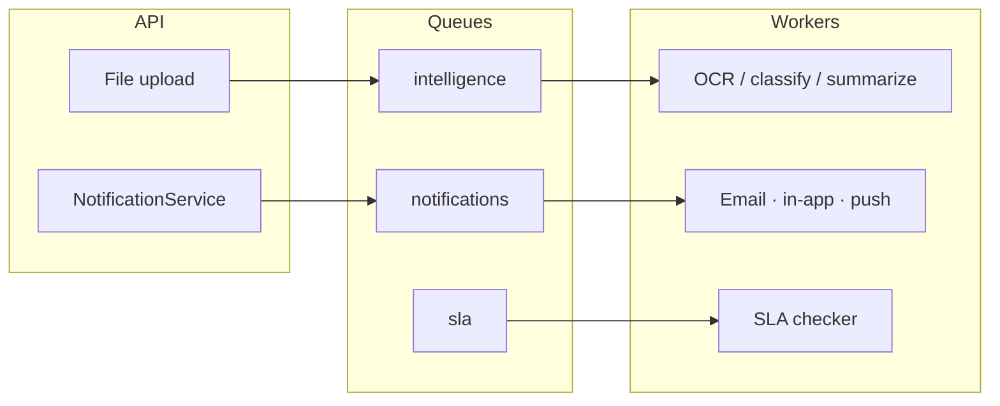

---

### 9. Public tracking workflow

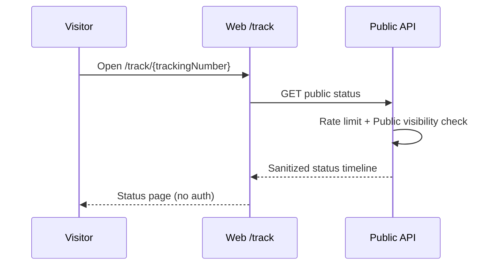

---

### 10. Error / edge cases

| Case | Expected behavior |
|------|-------------------|
| Submit non-draft | Rejected (Draft-only submit) |
| Approver not assignee | 403 |
| Worker down | Approvals persist; notifications/SLA/OCR lag |
| Plan quota exceeded | Block create user/document/storage |
| Restricted document | Watermark / print limits where configured |

---

**End of LLD — UDMS**

---
