# UFMS — Complete System Specification

| Field | Value |
|-------|-------|
| **Product** | UFMS — University Financial Management System |
| **Document type** | Complete System Specification (SRS + Architecture + Features + LLD) |
| **Date** | November 2026 |
| **Classification** | Proprietary |

## Document contents

1. System Requirements Specification (SRS)
2. Architecture Design
3. Features & Requirements
4. Low-Level Design (LLD) Workflows

---

## Part 1 — System Requirements Specification (SRS)

### University Financial Management System (UFMS)

| Field | Value |
|-------|-------|
| **Document ID** | SRS-UFMS-001 |
| **Product** | UFMS (University Financial Management System) |
| **Repository** | `WMSU/wmsu-platform` (`apps/finance-web`, `apps/base-api` module `finance`) |
| **Version** | 1.0 |
| **Date** | November 2026 |
| **Classification** | Proprietary |
| **TOR reference** | VI.E.3 (finance consolidation under CIS) |

---

### 1. Introduction

#### 1.1 Purpose

This Software Requirements Specification defines functional and non-functional requirements for **UFMS**, the comprehensive campus financial operations system managing budgeting, government-style accounting (JEV/GL), tuition fee schedules and payment plans, cashiering and receivables, accounts payable and disbursement, procurement, point-of-sale operations — with internal APIs for USiS assessment and clearance integration.

#### 1.2 Scope

**In scope**

- Budget management: plans, obligations, availability checks, monitoring, approvals, utilization tracking
- Accounting: journal entry vouchers (JEV), general ledger (GL), trial balance, bank reconciliation, fiscal period close
- Tuition and fees: fee schedules, payment policies, installment plans, assessment generation
- Cashiering and receivables: student payments, official receipt (OR) series, daily collection reports, deposit slips
- Accounts payable: supplier invoices, disbursement vouchers, check/ADA processing
- Procurement: vendor master, purchase requisition (PR), request for quotation (RFQ), purchase order (PO), inspection and acceptance report (IAR)
- Point-of-sale (POS): terminals, catalog, sales transactions, end-of-day closing; read-only stock snapshots from UIMS
- Configuration: chart of accounts (COA), fund structure, bank accounts, fiscal periods, approval workflows
- Reporting and analytics: budget vs actual, trial balance, aging reports, statement of account, dashboard KPIs
- University Platform Access SSO integration (platform code `finance`)
- Internal APIs for USiS assessment/payment handoff and clearance status

**Out of scope**

- Student registration, grades, admissions (owned by **USiS**)
- Transcript of records and certification issuance (owned by **TORMS**)
- Inventory master data and asset lifecycle authorship (owned by **UIMS** — UFMS POS may read stock snapshots)
- Library operations (owned by **ULMIS**)
- Document management repository (owned by **UDMS**)
- Inventing university fee policy amounts in documentation beyond configured schedules

#### 1.3 Definitions

| Term | Definition |
|------|------------|
| **UFMS** | University Financial Management System |
| **JEV** | Journal Entry Voucher — government accounting document |
| **GL** | General Ledger — comprehensive accounting record |
| **COA** | Chart of Accounts — hierarchical account structure |
| **OR** | Official Receipt — government-issued payment receipt |
| **DV** | Disbursement Voucher — payment authorization document |
| **IAR** | Inspection and Acceptance Report — procurement delivery verification |
| **Hard budget stop** | System setting that blocks obligations when funds unavailable |
| **Assessment** | Tuition and fee calculation for a student enrollment period |

#### 1.4 References

- `WMSU/wmsu-platform/README.md`
- `apps/web-portal/public/docs/UFMS-Complete-Guide.html`
- `apps/web-portal/public/docs/UFMS-API-Specs-Manual.html`
- USiS Internal API Specification (assessment handoff)
- UIMS Stock Snapshot API Specification (POS integration)
- University Platform Access Architecture

---

### 2. Overall Description

#### 2.1 Product Perspective

UFMS operates within the WMSU Campus Information System modular architecture:

| Component | Technology | Role |
|-----------|------------|------|
| Finance web | React 19 + Vite | Multi-role financial operations UI |
| Base API finance module | AdonisJS 7 + Lucid ORM | REST services at `/api/v1/finance/*` |
| Database | PostgreSQL schema `finance` | Financial system of record |
| Identity provider | University Platform Access | Authentication, authorization, user management |
| Queue system | BullMQ + Redis | Background jobs (reports, notifications, reconciliation) |

| Surface | Dev port | Production example |
|---------|----------|---------------------|
| Finance web | `http://127.0.0.1:5182` | `https://finance.wmsu.edu.ph` |
| Base API | `http://127.0.0.1:3500` | `https://api.wmsu.edu.ph` |
| Identity API | `http://127.0.0.1:3411` | `https://auth.wmsu.edu.ph` |

**Health endpoint:** `GET /health` → `{ status: 'ok', service: 'base-api', module: 'finance' }`

#### 2.2 User Classes

| Role | Primary capabilities | Access level |
|------|---------------------|--------------|
| **Cashier** | Record student payments, issue official receipts, daily collection, POS operations | Payment processing |
| **Accounting** | Journals, GL, reconciliation, trial balance, period close | Full accounting |
| **Budget Officer** | Budget plans, obligations, monitoring, approval workflows | Budget oversight |
| **Procurement Officer** | PR → RFQ → PO → IAR workflows, vendor management | Procurement processes |
| **Treasury** | Disbursement vouchers, check/ADA processing, bank reconciliation | Payment disbursement |
| **Registrar (limited)** | Read-only access to student account status, clearance verification | Cross-system queries |
| **Identity Administrator** | Full UFMS access when `finance` platform granted | All UFMS permissions |

Frontend permission checks provide user experience; API enforces authorization on every route.

#### 2.3 Constraints

- Platform tile visibility requires Identity platform grant `finance`
- Internal USiS integration routes require service API key protection (browser never receives key)
- Budget availability may enforce hard-stop when configured — blocks obligations if funds insufficient
- Fee schedules are configuration data — this SRS does not invent tariff amounts
- COA structure and fiscal periods must be configured before live posting
- OR series must be activated and assigned to cashiers before receipt issuance
- Government accounting conventions (JEV, GL) follow Philippine GASB/IPSAS-aligned standards
- POS reads stock data from UIMS as snapshots — UFMS does not author inventory masters

#### 2.4 Assumptions

- COA, fund structure, and fiscal periods seeded or configured during deployment
- USiS enrollment system calls UFMS internal APIs for assessment upsert and payment status queries
- SMTP/notification infrastructure configured for approval alerts and reminders
- University seal and authorized signatory images available for document generation
- Bank account details configured for reconciliation
- Cashiers assigned to specific OR series for accountability
- Demo/staging environments provision sample COA, students, transactions
- UIMS inventory system running when POS stock integration enabled

---

### 3. Functional Requirements

#### 3.1 Authentication & Authorization

| ID | Requirement | Priority |
|----|-------------|----------|
| FR-AUTH-001 | System shall authenticate all users via University Platform Access SSO | Must |
| FR-AUTH-002 | System shall resolve user home path based on role (cashier → `/cashier`, accounting → `/accounting`, etc.) | Must |
| FR-AUTH-003 | System shall enforce `finance.*` permission checks on every authenticated API endpoint | Must |
| FR-AUTH-004 | Internal service routes shall require `X-Service-Api-Key` header validation | Must |
| FR-AUTH-005 | Browser clients shall never receive service API keys | Must |

#### 3.2 Configuration Management

| ID | Requirement | Priority |
|----|-------------|----------|
| FR-CFG-001 | Administrators shall configure chart of accounts (COA) with hierarchical structure | Must |
| FR-CFG-002 | System shall support fund structure configuration (general, special, trust, etc.) | Must |
| FR-CFG-003 | Administrators shall configure bank accounts with reconciliation parameters | Must |
| FR-CFG-004 | Administrators shall define fiscal periods with open/closed status | Must |
| FR-CFG-005 | System shall configure OR series with prefix, start number, end number, and cashier assignment | Must |
| FR-CFG-006 | Administrators shall configure approval workflows for budgets, disbursements, procurement | Should |
| FR-CFG-007 | System shall maintain audit log of configuration changes | Must |

#### 3.3 Budget Management

| ID | Requirement | Priority |
|----|-------------|----------|
| FR-BDG-001 | Budget officers shall create budget plans with allocation by fund, account, and period | Must |
| FR-BDG-002 | System shall support budget approval workflow (draft → submitted → approved) | Must |
| FR-BDG-003 | System shall track obligations against approved budget | Must |
| FR-BDG-004 | System shall check budget availability before allowing obligation posting | Must |
| FR-BDG-005 | System shall enforce hard budget stop when configured (block if insufficient funds) | Must |
| FR-BDG-006 | Budget officers shall monitor budget utilization with real-time reports | Must |
| FR-BDG-007 | System shall generate budget vs actual reports by period, fund, account | Must |
| FR-BDG-008 | System shall support budget amendments and realignments with approval | Should |

#### 3.4 Accounting

| ID | Requirement | Priority |
|----|-------------|----------|
| FR-ACC-001 | Accountants shall create journal entry vouchers (JEV) with debit/credit lines | Must |
| FR-ACC-002 | System shall validate JEV balance (total debit = total credit) before posting | Must |
| FR-ACC-003 | System shall post JEV entries to general ledger (GL) with audit trail | Must |
| FR-ACC-004 | System shall maintain GL balances by account, fund, and fiscal period | Must |
| FR-ACC-005 | System shall generate trial balance report for specified period | Must |
| FR-ACC-006 | Accountants shall perform bank reconciliation with imported bank statements | Must |
| FR-ACC-007 | System shall support fiscal period close with validation and lock mechanism | Must |
| FR-ACC-008 | System shall prevent posting to closed periods without administrator override | Must |
| FR-ACC-009 | System shall generate financial statements (income statement, balance sheet) | Should |

#### 3.5 Tuition and Fee Management

| ID | Requirement | Priority |
|----|-------------|----------|
| FR-TUI-001 | Administrators shall configure fee schedules by program, year level, and term | Must |
| FR-TUI-002 | System shall define payment policies (full, installment) with due dates | Must |
| FR-TUI-003 | System shall calculate tuition assessments based on enrolled units and fee schedules | Must |
| FR-TUI-004 | System shall generate assessment documents linked to USiS enrollments | Must |
| FR-TUI-005 | System shall track installment payment schedules with penalty calculations | Should |
| FR-TUI-006 | System shall support scholarships and discounts with GL posting rules | Should |

#### 3.6 Cashiering and Receivables

| ID | Requirement | Priority |
|----|-------------|----------|
| FR-CSH-001 | Cashiers shall look up student accounts by student number or name | Must |
| FR-CSH-002 | System shall display outstanding assessments and payment history | Must |
| FR-CSH-003 | Cashiers shall record student payments with payment mode (cash, check, online) | Must |
| FR-CSH-004 | System shall reject invalid payments (unknown student, zero amount, negative amount) | Must |
| FR-CSH-005 | System shall issue official receipt (OR) from assigned series upon payment | Must |
| FR-CSH-006 | System shall generate OR PDF with payment details, OR number, and QR code | Must |
| FR-CSH-007 | System shall post payment to GL automatically (debit cash, credit receivable) | Must |
| FR-CSH-008 | Cashiers shall generate daily collection report at end of shift | Must |
| FR-CSH-009 | System shall create deposit slip for bank remittance | Must |
| FR-CSH-010 | System shall track OR series usage and alert when nearing end | Should |

#### 3.7 Accounts Payable and Disbursement

| ID | Requirement | Priority |
|----|-------------|----------|
| FR-APY-001 | Accountants shall register supplier invoices with amount, due date, and terms | Must |
| FR-APY-002 | System shall create disbursement vouchers (DV) linked to invoices or obligations | Must |
| FR-APY-003 | System shall support DV approval workflow with authorization limits | Must |
| FR-APY-004 | Treasury shall process approved DVs with check or ADA (advice to debit account) | Must |
| FR-APY-005 | System shall post disbursement to GL (debit expense/asset, credit payable/cash) | Must |
| FR-APY-006 | System shall track check status (issued, cleared, stale, cancelled) | Should |
| FR-APY-007 | System shall generate aging report for accounts payable | Must |

#### 3.8 Procurement

| ID | Requirement | Priority |
|----|-------------|----------|
| FR-PRC-001 | System shall maintain supplier/vendor master with contact and tax details | Must |
| FR-PRC-002 | Requestors shall create purchase requisitions (PR) with item details and justification | Must |
| FR-PRC-003 | System shall support PR approval workflow | Must |
| FR-PRC-004 | Procurement officers shall issue request for quotation (RFQ) to suppliers | Should |
| FR-PRC-005 | Procurement officers shall award supplier and create purchase order (PO) | Must |
| FR-PRC-006 | System shall track PO status (issued, partially received, fully received, cancelled) | Must |
| FR-PRC-007 | Receiving officers shall create inspection and acceptance report (IAR) upon delivery | Must |
| FR-PRC-008 | System shall link IAR to PO and trigger accounts payable invoice creation | Must |
| FR-PRC-009 | System shall enforce budget availability check before PO creation | Must |

#### 3.9 Point-of-Sale (POS)

| ID | Requirement | Priority |
|----|-------------|----------|
| FR-POS-001 | Cashiers shall configure POS terminals with assigned location and cashier | Must |
| FR-POS-002 | System shall maintain POS catalog with items and prices | Must |
| FR-POS-003 | System shall query UIMS for real-time stock availability (read-only snapshot) | Should |
| FR-POS-004 | Cashiers shall build sale transaction with multiple line items | Must |
| FR-POS-005 | System shall calculate sale total with taxes/discounts if configured | Should |
| FR-POS-006 | System shall complete sale with payment and issue OR/receipt | Must |
| FR-POS-007 | System shall post POS sale to GL (debit cash, credit revenue) | Must |
| FR-POS-008 | Cashiers shall perform end-of-day (EOD) closing with summary report | Must |
| FR-POS-009 | System shall prevent further sales on closed terminal until new day started | Must |

#### 3.10 Internal API for USiS Integration

| ID | Requirement | Priority |
|----|-------------|----------|
| FR-INT-001 | USiS shall upsert student assessments via internal API (service key protected) | Must |
| FR-INT-002 | System shall accept assessment data (student number, term, fee line items) and generate assessment document | Must |
| FR-INT-003 | USiS shall query payment status via internal API | Must |
| FR-INT-004 | System shall return payment status (pending, partial, verified) with amounts | Must |
| FR-INT-005 | USiS/TORMS shall query financial clearance status via internal API | Must |
| FR-INT-006 | System shall return clearance status (cleared if no outstanding balance, otherwise balance amount) | Must |

#### 3.11 Dashboard and Reporting

| ID | Requirement | Priority |
|----|-------------|----------|
| FR-DSH-001 | Finance dashboard shall display KPIs: total collections, outstanding receivables, disbursements, budget utilization | Must |
| FR-DSH-002 | Dashboard shall show recent transactions and pending approvals | Should |
| FR-RPT-001 | System shall generate trial balance report by period and fund | Must |
| FR-RPT-002 | System shall generate budget vs actual report with variance analysis | Must |
| FR-RPT-003 | System shall generate accounts receivable aging report | Must |
| FR-RPT-004 | System shall generate accounts payable aging report | Must |
| FR-RPT-005 | System shall generate statement of account for students | Must |
| FR-RPT-006 | System shall generate daily collection report by cashier | Must |
| FR-RPT-007 | System shall export all reports in CSV, Excel, and PDF formats | Must |
| FR-RPT-008 | System shall log all report exports with user and timestamp for audit | Must |

---

### 4. External Interface Requirements

#### 4.1 Integration Interfaces

| Interface | Direction | Protocol | Purpose |
|-----------|-----------|----------|---------|
| University Platform Access | Inbound | OIDC/JWKS | SSO authentication, JWT verification, role resolution |
| USiS Enrollment API | Inbound | REST+JSON | Assessment upsert, payment status query, clearance verification |
| TORMS Records API | Inbound | REST+JSON | Clearance verification for TOR requests |
| UIMS Inventory API | Outbound (optional) | REST+JSON | POS stock availability snapshots |
| SMTP/SMS Gateway | Outbound | SMTP/HTTP | Approval notifications, payment reminders |
| Bank API | Outbound (optional) | SFTP/API | Bank statement import for reconciliation |
| Object Storage | Outbound | S3-compatible | OR PDF archival, report storage |

#### 4.2 API Specifications

**Finance API base:** `/api/v1/finance/*`

**Internal service routes:** `/api/v1/finance/internal/*` (service key protected)

**OpenAPI documentation:** Available at `/api/v1/finance/docs` (Swagger UI)

**Authentication:** Bearer JWT from University Platform Access in `Authorization` header

#### 4.3 User Interface Requirements

- Responsive design supporting desktop (≥1280px), tablet (768-1023px), and mobile (360-767px)
- Browser compatibility: Chrome/Edge (latest 2), Firefox (latest 2), Safari (latest 2)
- Accessibility: WCAG 2.1 Level AA for public-facing payment status pages
- Print-optimized views for OR, financial statements, reports
- Real-time budget availability indicators
- Bulk transaction processing interfaces for accounting
- POS terminal optimized for touch/barcode scanner input

---

### 5. Non-Functional Requirements

#### 5.1 Performance

| ID | Requirement | Target |
|----|-------------|--------|
| NFR-PERF-001 | API response time (p95) for standard queries | ≤ 2 seconds |
| NFR-PERF-002 | Payment recording and OR generation | ≤ 3 seconds |
| NFR-PERF-003 | Budget availability check | ≤ 1 second |
| NFR-PERF-004 | Health check endpoint response time | ≤ 500 ms |
| NFR-PERF-005 | Trial balance generation for 10,000 transactions | ≤ 30 seconds |

#### 5.2 Scalability

| ID | Requirement |
|----|-------------|
| NFR-SCAL-001 | Support ≥20,000 student accounts |
| NFR-SCAL-002 | Support ≥100,000 transactions per academic year |
| NFR-SCAL-003 | Horizontal scaling of API replicas |
| NFR-SCAL-004 | Background job queue processing with worker pools |

#### 5.3 Security

| ID | Requirement |
|----|-------------|
| NFR-SEC-001 | TLS 1.2+ required for all client-server communication |
| NFR-SEC-002 | RBAC enforcement on every authenticated API endpoint using `finance.*` permissions |
| NFR-SEC-003 | Service-to-service communication via API keys for internal routes |
| NFR-SEC-004 | Financial data encryption at rest for sensitive fields (bank accounts, OR numbers) |
| NFR-SEC-005 | Audit logging of all financial transactions, posting, and configuration changes |
| NFR-SEC-006 | CORS allowlist limited to authorized web client origins |
| NFR-SEC-007 | Non-root container execution in production |
| NFR-SEC-008 | Budget and disbursement approval workflows with authorization limits |
| NFR-SEC-009 | OR series accountability tracking by cashier |
| NFR-SEC-010 | Password/MFA enforcement for privileged financial roles |

#### 5.4 Reliability

| ID | Requirement |
|----|-------------|
| NFR-REL-001 | System availability ≥99.5% during business hours |
| NFR-REL-002 | Automated database backups (daily incremental, weekly full) |
| NFR-REL-003 | Point-in-time recovery capability ≤15 minutes RPO |
| NFR-REL-004 | Graceful degradation when USiS/UIMS temporarily unavailable |
| NFR-REL-005 | Posted GL entries immutable — corrections via reversing JEV only |
| NFR-REL-006 | Fiscal period close prevents accidental posting to closed periods |

#### 5.5 Maintainability

| ID | Requirement |
|----|-------------|
| NFR-MAIN-001 | Modular domain architecture with separation of concerns |
| NFR-MAIN-002 | Comprehensive API documentation (OpenAPI 3.0+) |
| NFR-MAIN-003 | Structured logging with correlation IDs |
| NFR-MAIN-004 | Database schema migrations versioned and reversible |
| NFR-MAIN-005 | COA and configuration hot-reloading without deployment |

#### 5.6 Compliance

| ID | Requirement |
|----|-------------|
| NFR-COMP-001 | RA 10173 (Data Privacy Act) compliance for student financial data |
| NFR-COMP-002 | Philippine government accounting standards alignment (GASB/IPSAS) |
| NFR-COMP-003 | Audit trail retention ≥7 years per government records management |
| NFR-COMP-004 | OR series accountability and reconciliation |
| NFR-COMP-005 | Financial statement accuracy and timeliness |

---

### 6. Verification Criteria

#### 6.1 Functional Verification

| Scenario | Expected result | Test type |
|----------|----------------|-----------|
| Cashier login via SSO | Redirect to `/cashier` dashboard | Integration |
| Record student payment | Payment saved, OR issued, GL posted | E2E |
| Record payment with invalid student number | HTTP 422 rejection | Unit |
| Record payment with zero amount | HTTP 422 rejection | Unit |
| Budget obligation exceeds available with hard stop | HTTP 422 rejection | Unit |
| Budget obligation without hard stop | Allowed with warning | Unit |
| Post JEV with unbalanced debit/credit | HTTP 422 validation error | Unit |
| USiS upsert assessment via internal API | Assessment created, linked to student | Integration |
| USiS query payment status | Returns pending/partial/verified accurately | Integration |
| Query clearance with outstanding balance | Returns not cleared with balance amount | Integration |
| Query clearance with zero balance | Returns cleared | Integration |
| POS query UIMS stock | Returns available quantity | Integration (optional) |
| Generate trial balance | Balanced report with all accounts | Integration |
| Fiscal period close | Period locked, posting prevented | E2E |

#### 6.2 Non-Functional Verification

| Scenario | Expected result | Test type |
|----------|----------------|-----------|
| 100 concurrent payment recordings | p95 response ≤3s, no errors | Load test |
| Trial balance for 10K transactions | Completes in ≤30s | Performance test |
| Unauthorized access to internal API | HTTP 401/403 | Security test |
| Database failover | Recovery within 15 minutes | DR drill |

---

### 7. Document Control

| Version | Date | Description |
|---------|------|-------------|
| 1.0 | November 2026 | Complete System Specification from wmsu-platform finance module |

#### Related Design Documents

- **[UFMS-Architecture.md](./UFMS-Architecture.md)** — Architecture design (containers, domains, security, deployment)
- **[UFMS-Features-Requirements.md](./UFMS-Features-Requirements.md)** — Feature catalog + requirements traceability
- **[UFMS-LLD.md](./UFMS-LLD.md)** — Low-level design workflows (cashiering, budget, procurement, disbursement, POS, USiS integration)

**End of SRS — UFMS**

---

## Part 2 — Architecture Design

### UFMS — University Financial Management System Architecture

| Field | Value |
|-------|-------|
| **Document ID** | AD-UFMS-001 |
| **Product** | UFMS |
| **Companions** | [UFMS-SRS.md](./UFMS-System-Specification.md) · [UFMS-Features-Requirements.md](./UFMS-Features-Requirements.md) · [UFMS-LLD.md](./UFMS-LLD.md) |
| **Date** | November 2026 |

---

### 1. Purpose

Architecture design for UFMS within WMSU CIS modular monolith — covering system context, container architecture, domain module organization, security architecture, deployment topology, integration patterns, and quality attributes for university financial management.

---

### 2. System Context

UFMS integrates with Identity for SSO, USiS for assessment/payment handoff, and optional UIMS for POS stock:

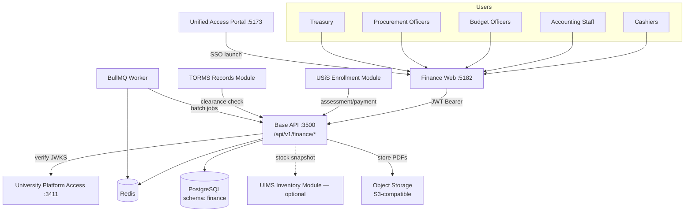

**Key relationships:**
- Financial staff authenticate via Portal SSO
- All UI interactions flow through Base API finance module
- USiS enrollment system calls UFMS internal APIs for assessment upsert and payment verification
- TORMS records system calls UFMS for clearance checks
- UFMS may query UIMS for POS stock availability (optional integration)
- Background jobs (reports, reconciliation, notifications) run via BullMQ worker
- OR PDFs and financial reports archived to object storage

---

### 3. Container View

| Container | Technology | Port | Purpose |
|-----------|------------|------|---------|
| **Finance web** | React 19 + Vite | 5182 | Multi-role financial operations UI |
| **Base API (finance module)** | AdonisJS 7 + Lucid ORM | 3500 | Domain services, controllers, business logic |
| **PostgreSQL** | PostgreSQL 15+ | 5432 | Schema `finance` — financial system of record |
| **Redis** | Redis 7+ | 6379 | Cache, queue backend, rate limiting |
| **BullMQ Worker** | Node.js + BullMQ | N/A | Background jobs (reports, reconciliation) |
| **Object Storage** | S3-compatible | N/A | OR PDF archival, report storage |
| **University Platform Access** | Identity service | 3411 | Authentication, authorization |
| **USiS Enrollment** | CIS module | 3500 | Assessment/payment client |

**Deployment notes:**
- Finance web served statically from CDN or Vite dev server
- Base API runs in containerized Node.js (non-root)
- PostgreSQL schema `finance` isolated within `wmsu_cis` database
- Redis persistent (AOF + RDB) for queue durability
- Worker pool for concurrent job processing

---

### 4. Domain Module Architecture

UFMS finance module organized by financial operation domains:

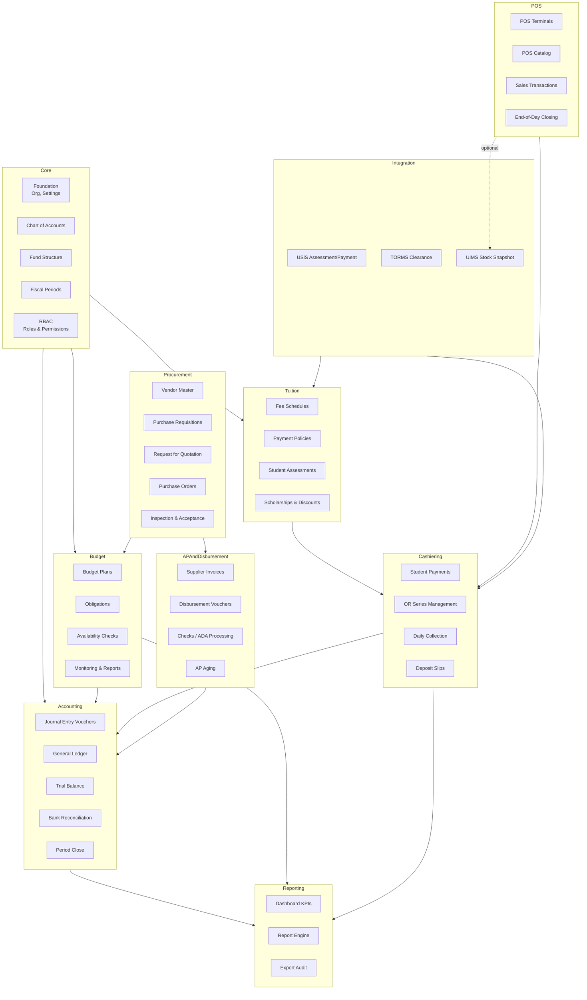

**Domain responsibilities:**

| Domain | Key entities | Services |
|--------|-------------|----------|
| **Core** | Organization, Campus, COA, Fund, FiscalPeriod, Settings | Foundation config, COA management |
| **Budget** | BudgetPlan, BudgetLine, Obligation | Budget planning, obligation tracking, availability checks |
| **Accounting** | JournalEntry, GLAccount, GLBalance, BankReconciliation | JEV posting, GL maintenance, trial balance, period close |
| **Tuition** | FeeSchedule, PaymentPolicy, Assessment, Scholarship | Fee configuration, assessment generation |
| **Cashiering** | Payment, OfficialReceipt, ORSeries, CollectionReport | Payment processing, OR issuance, daily collection |
| **AP & Disbursement** | Invoice, DisbursementVoucher, Check, ADA | Supplier invoices, payment disbursement |
| **Procurement** | Vendor, PurchaseRequisition, PurchaseOrder, InspectionReport | Procurement lifecycle |
| **POS** | POSTerminal, POSCatalogItem, Sale, SaleLine | Point-of-sale operations |
| **Integration** | AssessmentSync, PaymentStatusQuery, ClearanceCheck, StockSnapshot | External system integration |
| **Reporting** | Report, ReportExport, DashboardMetric | Analytics, export audit |

---

### 5. Security Architecture

#### 5.1 Authentication Flow

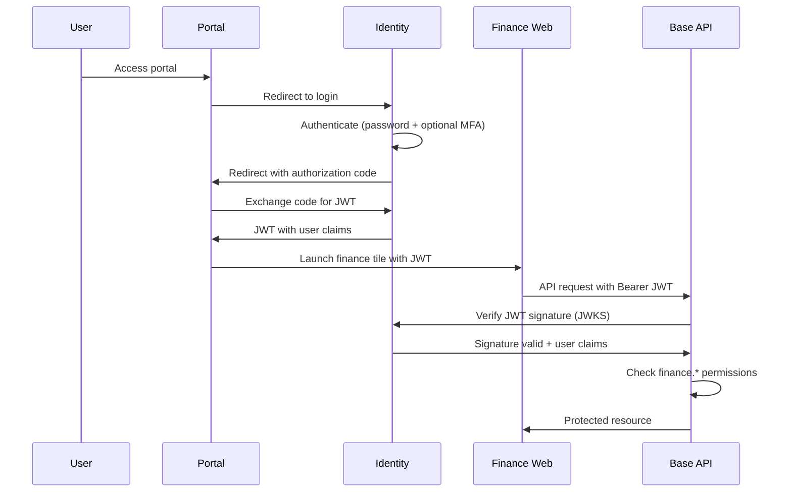

**Internal API flow (USiS):**
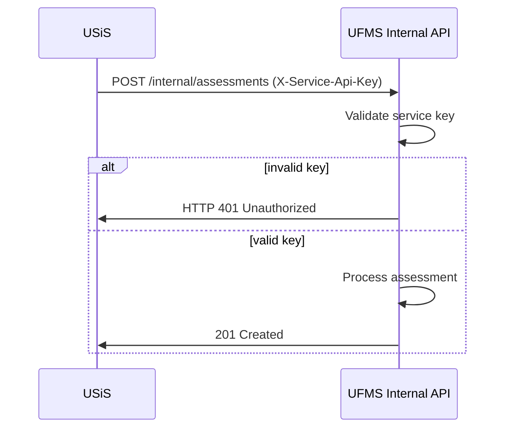

**Security controls:**

| Layer | Control | Implementation |
|-------|---------|----------------|
| Transport | TLS 1.2+ | Reverse proxy termination |
| Authentication | OIDC/JWT | Identity service RS256 tokens |
| Authorization | RBAC | `finance.*` permission checks |
| Internal APIs | Service keys | `X-Service-Api-Key` header |
| Financial data | Encryption at rest | Sensitive fields encrypted (bank accounts, OR) |
| Approval workflows | Authorization limits | Role-based approval authority |
| OR accountability | Cashier assignment | OR series tracked by cashier |

#### 5.2 Permission Model

UFMS permission categories:
- `finance.cashier.*` — Payment processing, OR issuance
- `finance.accounting.*` — JEV, GL, reconciliation, period close
- `finance.budget.*` — Budget planning, obligations, monitoring
- `finance.procurement.*` — PR, PO, IAR workflows
- `finance.treasury.*` — Disbursement vouchers, checks/ADA
- `finance.pos.*` — POS operations
- `finance.reports.*` — Report generation and export
- `finance.config.*` — System configuration

**Role mappings:**
- `cashier` → `finance.cashier.*`, `finance.pos.*`
- `accountant` → `finance.accounting.*`, `finance.reports.view`
- `budget_officer` → `finance.budget.*`, `finance.reports.budget`
- `procurement_officer` → `finance.procurement.*`
- `treasurer` → `finance.treasury.*`, `finance.accounting.view`
- `finance_admin` → All `finance.*` permissions

---

### 6. Data Architecture

#### 6.1 Schema Organization

PostgreSQL schema **`finance`** contains:

**Core tables:**
- `organizations`, `campuses`, `settings`
- `chart_of_accounts`, `funds`, `fiscal_periods`

**Budget:**
- `budget_plans`, `budget_lines`, `obligations`

**Accounting:**
- `journal_entries`, `journal_entry_lines`, `gl_accounts`, `gl_balances`
- `bank_accounts`, `bank_reconciliations`

**Tuition:**
- `fee_schedules`, `payment_policies`, `assessments`, `assessment_lines`
- `scholarships`, `scholarship_grants`

**Cashiering:**
- `payments`, `official_receipts`, `or_series`
- `collection_reports`, `deposit_slips`

**AP & Disbursement:**
- `vendors`, `invoices`, `disbursement_vouchers`
- `checks`, `ada_records`

**Procurement:**
- `purchase_requisitions`, `purchase_orders`, `inspection_reports`

**POS:**
- `pos_terminals`, `pos_catalog_items`, `sales`, `sale_lines`

**Integration:**
- `assessment_syncs` (USiS)
- `payment_status_queries` (USiS)
- `clearance_checks` (TORMS)
- `stock_snapshots` (UIMS)

**Reporting:**
- `report_exports` (audit log)

#### 6.2 Integration Strategy

**USiS → UFMS integration:**
- **Assessment upsert:** USiS posts assessment data to UFMS when enrollment submitted
- **Payment status query:** USiS queries UFMS for real-time payment verification
- **Clearance query:** USiS/TORMS check student financial clearance status
- **Authentication:** Service API key in `X-Service-Api-Key` header
- **Frequency:** Real-time on-demand

**UFMS → UIMS integration (optional POS stock):**
- **Stock query:** UFMS queries UIMS for item availability during POS transaction
- **Pattern:** Read-only snapshot, no write-back to UIMS
- **Frequency:** Real-time during POS operations

---

### 7. Deployment Topology

#### 7.1 Production Architecture

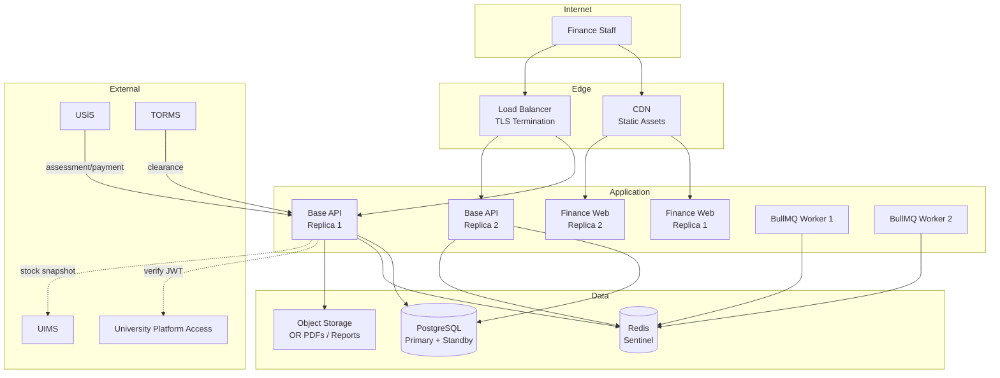

**Sizing guidance:**
- API: 2–3 replicas, 2 vCPU / 4 GB RAM each
- Worker: 2 replicas, 1 vCPU / 2 GB RAM each
- PostgreSQL: 4–8 vCPU / 16–32 GB RAM (financial workload)
- Redis: 2 vCPU / 4 GB RAM
- Object Storage: S3-compatible managed service

#### 7.2 Local Development

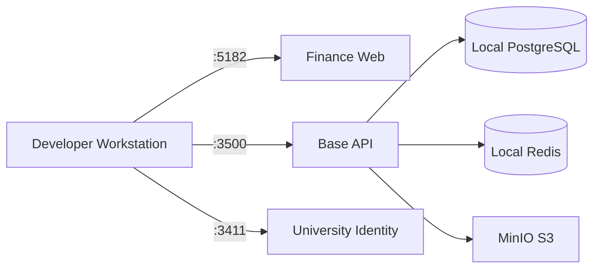

---

### 8. Integration Architecture

#### 8.1 USiS Assessment Handoff

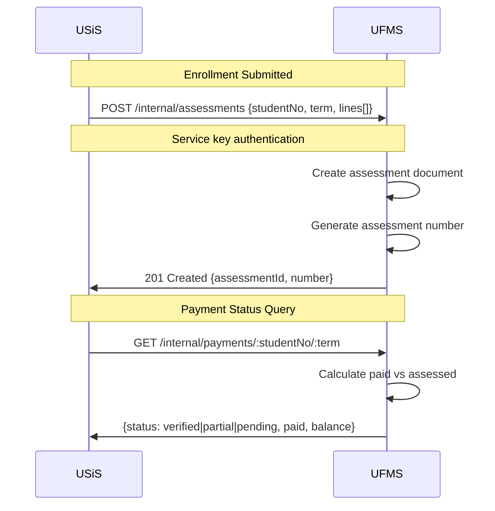

#### 8.2 TORMS Clearance Check

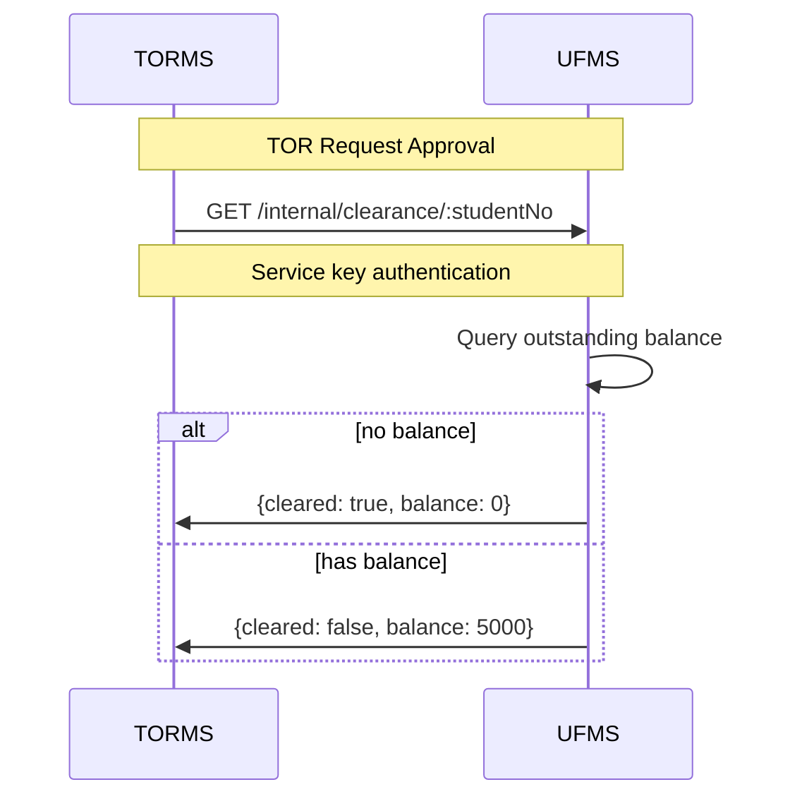

#### 8.3 UIMS Stock Snapshot (Optional POS)

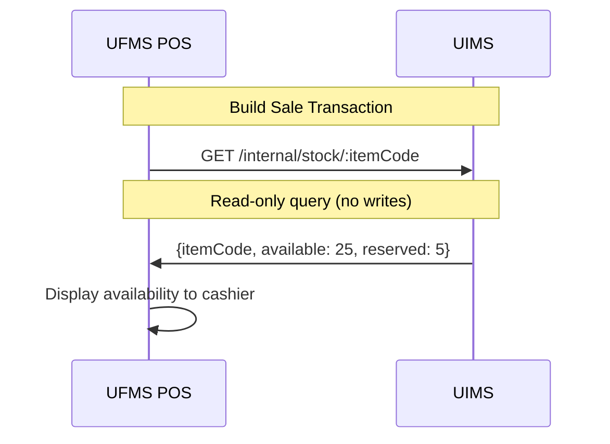

---

### 9. Quality Attributes

#### 9.1 Performance

**Optimization strategies:**
- Database indexing on student_no, account_code, fiscal_period, status
- Redis caching for COA structure, fee schedules, OR series
- Background report generation (async job queue) for large datasets
- Lazy loading in finance web UI
- Paginated API responses (default 25, max 100)
- Read replicas for reporting queries

**Monitoring:**
- APM (Sentry/OpenTelemetry) for request tracing
- Payment processing time metrics
- Budget availability check latency
- GL posting performance
- Report generation duration

#### 9.2 Scalability

**Horizontal scaling:**
- Stateless API design
- Load balancer with health checks
- Worker pool for concurrent job processing
- Database connection pooling (PgBouncer)

**Data growth:**
- Partitioning for large tables (journal_entry_lines, payments) by fiscal year
- Archival strategy for old fiscal periods (closed > 7 years)

#### 9.3 Reliability

**Failure handling:**
- Graceful degradation when USiS/UIMS unavailable (cache last-known status, warn users)
- Retry logic for internal API calls (exponential backoff)
- Circuit breaker for external service calls
- Immutable posted GL entries — corrections via reversing JEV only
- Fiscal period close prevents accidental posting

**Data integrity:**
- Foreign key constraints
- Transaction management with rollback
- JEV debit/credit balance validation
- Budget availability checks before obligations
- OR series sequence integrity

#### 9.4 Maintainability

**Code organization:**
- Domain-driven design with bounded contexts
- Service layer abstraction
- Shared validation schemas
- OpenAPI documentation

**Operational:**
- Structured JSON logging
- Feature flags
- Blue-green deployment
- Automated schema migrations
- COA hot-reloading

#### 9.5 Compliance

**Data privacy (RA 10173):**
- Student financial data access restricted by role
- Audit logging of payment access and modifications
- Retention policies configurable

**Financial accountability:**
- Posted GL entries immutable (reversing JEV for corrections)
- OR series accountability by cashier
- 7-year audit trail retention
- Budget vs actual transparency
- Fiscal period integrity

---

**End of Architecture Design — UFMS**

---

## Part 3 — Features & Requirements

### UFMS — University Financial Management System Features & Requirements

| Field | Value |
|-------|-------|
| **Document ID** | FEAT-UFMS-001 |
| **Product** | UFMS |
| **Companions** | [UFMS-SRS.md](./UFMS-System-Specification.md) · [UFMS-LLD.md](./UFMS-LLD.md) |
| **Date** | November 2026 |

---

### 1. Feature Summary

UFMS provides comprehensive campus financial operations management:

| Area | Features | Status |
|------|----------|--------|
| **Authentication** | University Platform Access SSO, role-based routing | Delivered |
| **Configuration** | COA, funds, fiscal periods, OR series, approval workflows | Delivered |
| **Budget** | Planning, obligations, availability checks, monitoring, reports | Delivered |
| **Accounting** | JEV, GL, trial balance, bank reconciliation, period close | Delivered |
| **Tuition** | Fee schedules, payment policies, assessments, scholarships | Delivered |
| **Cashiering** | Student payments, OR issuance, daily collection, deposit slips | Delivered |
| **AP & Disbursement** | Invoices, disbursement vouchers, checks/ADA, aging reports | Delivered |
| **Procurement** | Vendor master, PR, RFQ, PO, IAR workflows | Delivered |
| **POS** | Terminals, catalog, sales, EOD closing, UIMS stock integration | Delivered |
| **USiS Integration** | Assessment upsert, payment status query, clearance verification | Delivered |
| **Dashboard** | KPIs, recent transactions, pending approvals | Delivered |
| **Reporting** | Trial balance, budget vs actual, aging, SOA, export audit | Delivered |

---

### 2. Feature Catalog

| Feature ID | Feature | Description | Priority | Actors |
|------------|---------|-------------|----------|--------|
| **F-AUTH-01** | SSO Authentication | University Platform Access OIDC/JWT | Must | All |
| **F-AUTH-02** | Role Routing | Home path by role (cashier/accounting/budget/procurement) | Must | All |
| **F-AUTH-03** | Permission Enforcement | `finance.*` checks on all endpoints | Must | System |
| **F-AUTH-04** | Service Key Protection | Internal API routes require service key | Must | System |
| **F-CFG-01** | COA Management | Configure chart of accounts with hierarchy | Must | Admin |
| **F-CFG-02** | Fund Structure | Configure funds (general, special, trust) | Must | Admin |
| **F-CFG-03** | Bank Accounts | Configure bank accounts with reconciliation parameters | Must | Admin |
| **F-CFG-04** | Fiscal Periods | Define periods with open/closed status | Must | Admin |
| **F-CFG-05** | OR Series Management | Configure OR series with cashier assignment | Must | Admin |
| **F-CFG-06** | Approval Workflows | Configure approval workflows with limits | Should | Admin |
| **F-CFG-07** | Config Audit Log | Log configuration changes | Must | System |
| **F-BDG-01** | Budget Planning | Create budget plans with allocations | Must | Budget Officer |
| **F-BDG-02** | Budget Approval | Workflow: draft → submitted → approved | Must | Budget Officer |
| **F-BDG-03** | Obligation Tracking | Track obligations against budget | Must | System |
| **F-BDG-04** | Availability Check | Verify funds before obligation | Must | System |
| **F-BDG-05** | Hard Budget Stop | Block obligations if insufficient funds (configurable) | Must | System |
| **F-BDG-06** | Budget Monitoring | Real-time utilization reports | Must | Budget Officer |
| **F-BDG-07** | Budget vs Actual | Generate variance reports | Must | Budget Officer |
| **F-BDG-08** | Budget Amendments | Support realignments with approval | Should | Budget Officer |
| **F-ACC-01** | JEV Creation | Create journal entry vouchers | Must | Accountant |
| **F-ACC-02** | JEV Validation | Validate debit/credit balance | Must | System |
| **F-ACC-03** | GL Posting | Post JEV to general ledger | Must | System |
| **F-ACC-04** | GL Balances | Maintain balances by account/fund/period | Must | System |
| **F-ACC-05** | Trial Balance | Generate trial balance report | Must | Accountant |
| **F-ACC-06** | Bank Reconciliation | Import and reconcile bank statements | Must | Accountant |
| **F-ACC-07** | Period Close | Close fiscal period with lock | Must | Accountant |
| **F-ACC-08** | Closed Period Protection | Prevent posting to closed periods | Must | System |
| **F-ACC-09** | Financial Statements | Generate income statement, balance sheet | Should | Accountant |
| **F-TUI-01** | Fee Schedules | Configure fees by program/level/term | Must | Admin |
| **F-TUI-02** | Payment Policies | Define payment policies with due dates | Must | Admin |
| **F-TUI-03** | Assessment Calculation | Calculate tuition from enrolled units | Must | System |
| **F-TUI-04** | Assessment Generation | Generate assessment documents | Must | System |
| **F-TUI-05** | Installment Tracking | Track installment schedules with penalties | Should | System |
| **F-TUI-06** | Scholarships & Discounts | Support scholarship application to assessments | Should | Admin |
| **F-CSH-01** | Student Account Lookup | Look up by student number or name | Must | Cashier |
| **F-CSH-02** | Payment History Display | Show assessments and payment history | Must | Cashier |
| **F-CSH-03** | Payment Recording | Record payments with payment mode | Must | Cashier |
| **F-CSH-04** | Payment Validation | Reject invalid payments | Must | System |
| **F-CSH-05** | OR Issuance | Issue official receipt from assigned series | Must | System |
| **F-CSH-06** | OR PDF Generation | Generate OR PDF with QR code | Must | System |
| **F-CSH-07** | GL Auto-Posting | Post payment to GL automatically | Must | System |
| **F-CSH-08** | Daily Collection Report | Generate end-of-shift report | Must | Cashier |
| **F-CSH-09** | Deposit Slip Creation | Create bank remittance deposit slip | Must | Cashier |
| **F-CSH-10** | OR Series Alert | Alert when series nearing end | Should | System |
| **F-APY-01** | Invoice Registration | Register supplier invoices | Must | Accountant |
| **F-APY-02** | DV Creation | Create disbursement vouchers | Must | Accountant |
| **F-APY-03** | DV Approval | Workflow with authorization limits | Must | Treasury |
| **F-APY-04** | Check/ADA Processing | Process approved DVs | Must | Treasury |
| **F-APY-05** | Disbursement GL Posting | Post disbursement to GL | Must | System |
| **F-APY-06** | Check Status Tracking | Track check lifecycle | Should | Treasury |
| **F-APY-07** | AP Aging Report | Generate aging report | Must | Accountant |
| **F-PRC-01** | Vendor Master | Maintain supplier/vendor records | Must | Procurement |
| **F-PRC-02** | PR Creation | Create purchase requisitions | Must | Requestor |
| **F-PRC-03** | PR Approval | Approval workflow | Must | Procurement |
| **F-PRC-04** | RFQ Issuance | Issue request for quotation | Should | Procurement |
| **F-PRC-05** | PO Creation | Award supplier and create PO | Must | Procurement |
| **F-PRC-06** | PO Status Tracking | Track PO lifecycle | Must | Procurement |
| **F-PRC-07** | IAR Creation | Create inspection and acceptance report | Must | Receiving |
| **F-PRC-08** | IAR-to-AP Link | Link IAR to PO and create AP invoice | Must | System |
| **F-PRC-09** | Budget Check for PO | Verify budget before PO | Must | System |
| **F-POS-01** | Terminal Configuration | Configure POS terminals | Must | Admin |
| **F-POS-02** | POS Catalog | Maintain POS catalog with prices | Must | Admin |
| **F-POS-03** | Stock Availability | Query UIMS for stock (optional) | Should | System |
| **F-POS-04** | Sale Transaction | Build sale with multiple items | Must | Cashier |
| **F-POS-05** | Sale Calculation | Calculate total with taxes/discounts | Should | System |
| **F-POS-06** | Sale Completion | Complete sale with OR issuance | Must | Cashier |
| **F-POS-07** | POS GL Posting | Post sale to GL | Must | System |
| **F-POS-08** | EOD Closing | End-of-day closing with summary | Must | Cashier |
| **F-POS-09** | Closed Terminal Protection | Prevent sales on closed terminal | Must | System |
| **F-INT-01** | Assessment Upsert | USiS posts assessments via internal API | Must | System |
| **F-INT-02** | Assessment Document | Generate assessment from USiS data | Must | System |
| **F-INT-03** | Payment Status Query | USiS queries payment status | Must | System |
| **F-INT-04** | Payment Status Response | Return pending/partial/verified status | Must | System |
| **F-INT-05** | Clearance Query | TORMS/USiS query financial clearance | Must | System |
| **F-INT-06** | Clearance Response | Return cleared status with balance | Must | System |
| **F-DSH-01** | Finance Dashboard | Display KPIs, recent transactions, pending approvals | Must | All Finance |
| **F-DSH-02** | Dashboard Widgets | Collections, receivables, disbursements, budget utilization | Should | All Finance |
| **F-RPT-01** | Trial Balance Report | By period and fund | Must | Accountant |
| **F-RPT-02** | Budget vs Actual Report | With variance analysis | Must | Budget Officer |
| **F-RPT-03** | AR Aging Report | Accounts receivable aging | Must | Cashier, Accountant |
| **F-RPT-04** | AP Aging Report | Accounts payable aging | Must | Accountant |
| **F-RPT-05** | Statement of Account | Student SOA | Must | Cashier |
| **F-RPT-06** | Daily Collection Report | By cashier | Must | Cashier |
| **F-RPT-07** | Report Export | CSV, Excel, PDF formats | Must | All Finance |
| **F-RPT-08** | Export Audit Log | Log exports with user/timestamp | Must | System |

---

### 3. Requirements Traceability Matrix

#### 3.1 Functional Requirements Mapping

| Requirement ID | Requirement | Related Features | Priority | Implementation Status |
|----------------|-------------|------------------|----------|----------------------|
| FR-AUTH-001..005 | Authentication and authorization | F-AUTH-01..04 | Must | Delivered |
| FR-CFG-001..007 | Configuration management | F-CFG-01..07 | Must/Should | Delivered |
| FR-BDG-001..008 | Budget management | F-BDG-01..08 | Must/Should | Delivered |
| FR-ACC-001..009 | Accounting | F-ACC-01..09 | Must/Should | Delivered |
| FR-TUI-001..006 | Tuition and fees | F-TUI-01..06 | Must/Should | Delivered |
| FR-CSH-001..010 | Cashiering and receivables | F-CSH-01..10 | Must/Should | Delivered |
| FR-APY-001..007 | Accounts payable and disbursement | F-APY-01..07 | Must/Should | Delivered |
| FR-PRC-001..009 | Procurement | F-PRC-01..09 | Must/Should | Delivered |
| FR-POS-001..009 | Point-of-sale | F-POS-01..09 | Must/Should | Delivered |
| FR-INT-001..006 | USiS integration (internal APIs) | F-INT-01..06 | Must | Delivered |
| FR-DSH-001..002 | Dashboard | F-DSH-01..02 | Must/Should | Delivered |
| FR-RPT-001..008 | Reporting | F-RPT-01..08 | Must | Delivered |

#### 3.2 Non-Functional Requirements Mapping

| NFR Category | Requirement ID | Related Features | Implementation Approach |
|--------------|----------------|------------------|------------------------|
| Performance | NFR-PERF-001..005 | All features | Database indexing, Redis caching, async jobs, pagination |
| Scalability | NFR-SCAL-001..004 | All features | Horizontal API scaling, worker pools, table partitioning |
| Security | NFR-SEC-001..010 | F-AUTH-*, F-CFG-*, F-CSH-05 | TLS, RBAC, service keys, encryption, audit logging, OR accountability |
| Reliability | NFR-REL-001..006 | All features | HA deployment, backups, DR procedures, immutable GL, period close |
| Maintainability | NFR-MAIN-001..005 | All features | Modular architecture, OpenAPI, structured logs, versioned migrations |
| Compliance | NFR-COMP-001..005 | Financial data | RA 10173, GASB/IPSAS alignment, 7-year audit retention, OR accountability |

#### 3.3 Source Requirements Traceability

**WMSU TOR VI.E.3 compliance matrix:**

| TOR Requirement | Feature IDs | Implementation Notes | Compliance Status |
|-----------------|-------------|---------------------|-------------------|
| Budget management and monitoring | F-BDG-01..08 | Planning, obligations, availability checks, utilization | Delivered |
| Journal entry and general ledger | F-ACC-01..09 | JEV, GL posting, trial balance, reconciliation, period close | Delivered |
| Tuition fee management | F-TUI-01..06 | Fee schedules, payment policies, assessments | Delivered |
| Cashiering and receivables | F-CSH-01..10 | Payments, OR issuance, daily collection, deposits | Delivered |
| Accounts payable and disbursement | F-APY-01..07 | Invoices, DVs, checks/ADA, aging | Delivered |
| Procurement workflows | F-PRC-01..09 | PR, RFQ, PO, IAR, vendor management | Delivered |
| Point-of-sale operations | F-POS-01..09 | Terminals, sales, EOD, UIMS integration | Delivered |
| USiS integration | F-INT-01..06 | Assessment handoff, payment status, clearance | Delivered |
| Financial reporting | F-RPT-01..08 | Trial balance, budget vs actual, aging, SOA, export audit | Delivered |
| Configuration and setup | F-CFG-01..07 | COA, funds, periods, OR series, workflows | Delivered |

**Deferred/Out of scope:**
- Student registration and admissions → USiS responsibility
- TOR issuance → TORMS responsibility
- Inventory masters → UIMS responsibility
- Library operations → ULMIS

---

### 4. Non-Functional Requirements Summary

#### 4.1 Performance Targets

| Metric | Target | Measurement |
|--------|--------|-------------|
| API response (p95) | ≤2s standard queries | APM monitoring |
| Payment + OR | ≤3s | Performance profiling |
| Budget availability check | ≤1s | Real-time testing |
| Trial balance (10K txns) | ≤30s | Job duration metrics |

#### 4.2 Security Controls

| Control | Implementation | Verification |
|---------|----------------|-------------|
| TLS enforcement | Reverse proxy/ingress | SSL Labs scan |
| RBAC | `finance.*` permission checks | Automated security tests |
| Service keys | Internal API protection | Integration tests |
| Encryption at rest | Bank accounts, OR numbers | Security audit |
| Audit logging | All transactions, posting, config | Log review |
| OR accountability | Cashier assignment | Reconciliation reports |

#### 4.3 Reliability Measures

| Measure | Target | Method |
|---------|--------|--------|
| Availability | ≥99.5% business hours | SLA monitoring |
| Backup frequency | Daily incremental, weekly full | Automated verification |
| RPO | ≤15 minutes | DR drill testing |
| GL immutability | Reversing JEV only | Business rule enforcement |
| Period close integrity | Posting prevention on closed | Automated tests |

---

### 5. Actors & Feature Access

| Actor | Primary Features | Restricted Features |
|-------|------------------|---------------------|
| **Cashier** | F-CSH-01..10, F-POS-01..09 | Own cashier operations |
| **Accountant** | F-ACC-01..09, F-APY-01..07, F-RPT-01, F-RPT-04 | Full accounting |
| **Budget Officer** | F-BDG-01..08, F-RPT-02 | Budget oversight |
| **Procurement Officer** | F-PRC-01..09 | Procurement processes |
| **Treasury** | F-APY-03..06, F-ACC-06 | Disbursement authority |
| **Finance Admin** | F-CFG-01..07, All reports | System configuration |
| **USiS (System)** | F-INT-01..06 | Internal API only (service key) |
| **TORMS (System)** | F-INT-05..06 | Clearance API only (service key) |

---

**End of Features & Requirements — UFMS**

---

## Part 4 — Low-Level Design (LLD) Workflows

### UFMS — University Financial Management System Low-Level Design

| Field | Value |
|-------|-------|
| **Document ID** | LLD-UFMS-001 |
| **Product** | UFMS |
| **Companion** | [UFMS-SRS.md](./UFMS-System-Specification.md) |
| **Date** | November 2026 |

---

### 1. Purpose

This Low-Level Design documents critical workflows for UFMS cashiering, budget management, procurement, disbursement, POS operations, and USiS integration — providing sequence diagrams, state machines, and implementation details.

---

### 2. System Context (Multi-Role Architecture)

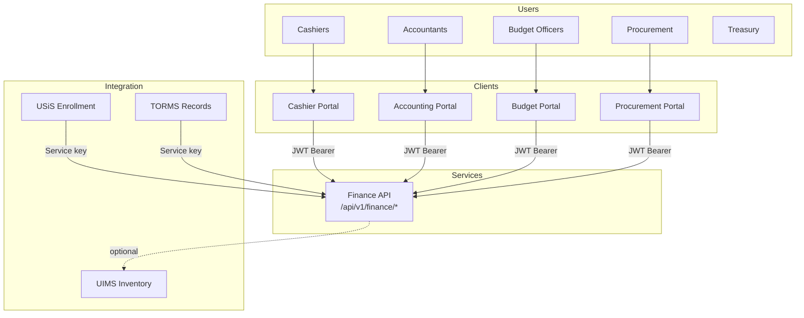

**Role-specific routes:**
- Cashier: `/cashier/*`
- Accounting: `/accounting/*`
- Budget: `/budget/*`
- Procurement: `/procurement/*`
- Treasury: `/treasury/*`

---

### 3. Cashiering Workflow

#### 3.1 Student Payment Processing

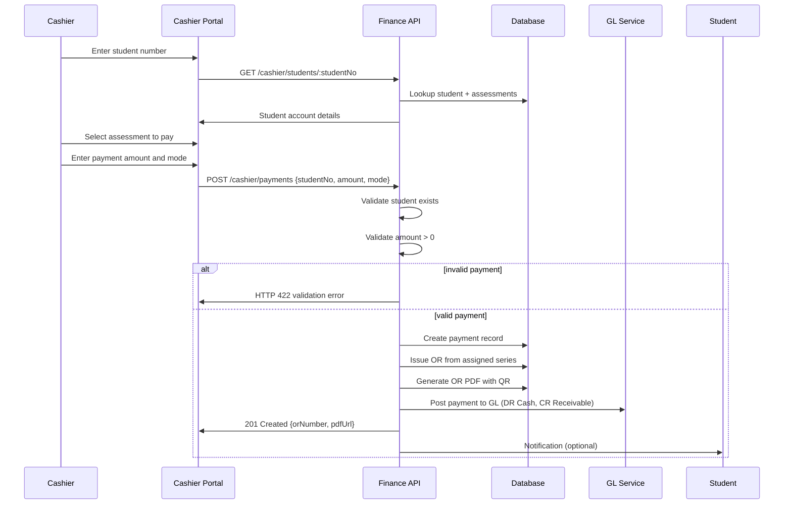

#### 3.2 Official Receipt Issuance

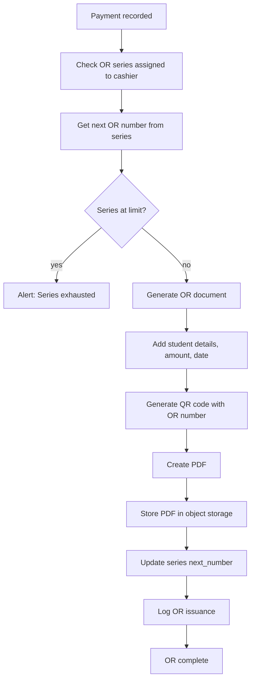

#### 3.3 Daily Collection Report

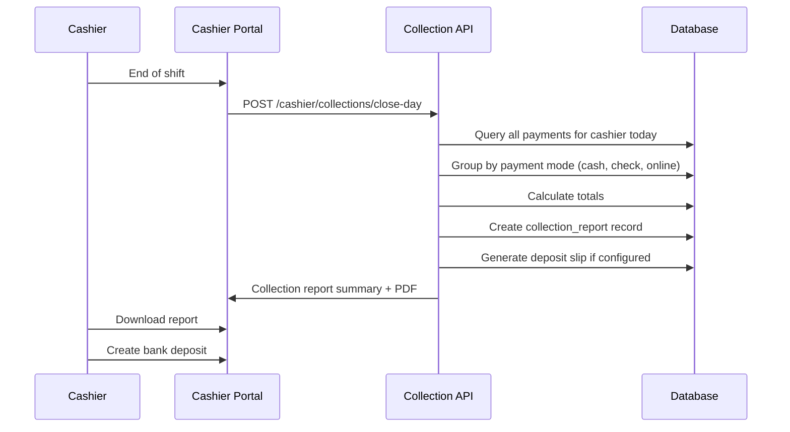

---

### 4. Budget Workflow

#### 4.1 Budget Planning and Approval

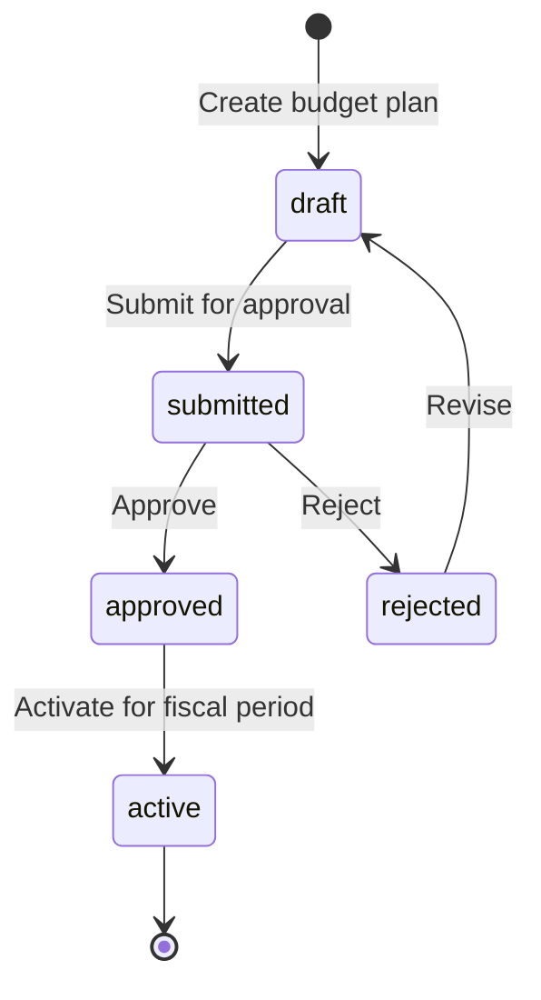

#### 4.2 Budget Obligation and Availability Check

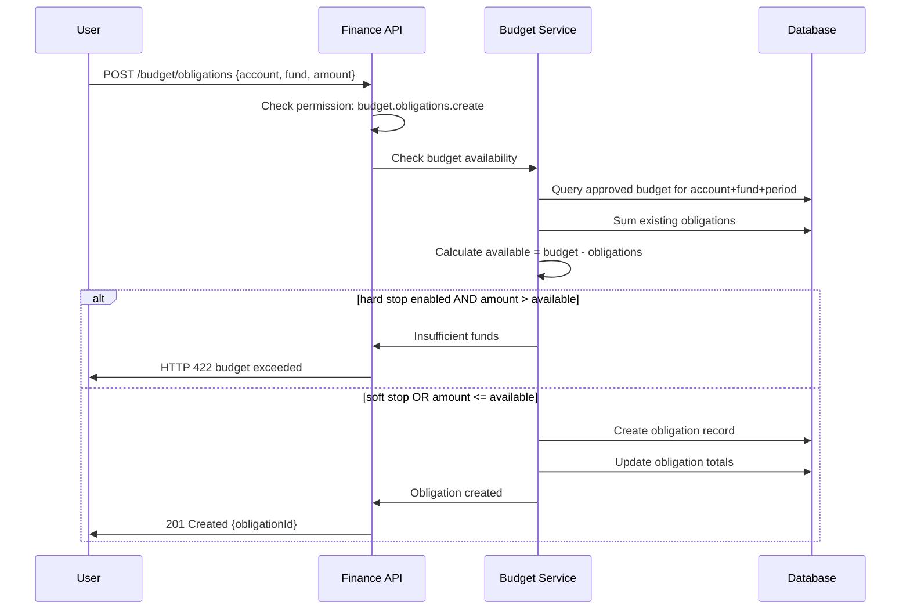

#### 4.3 Budget Monitoring Dashboard

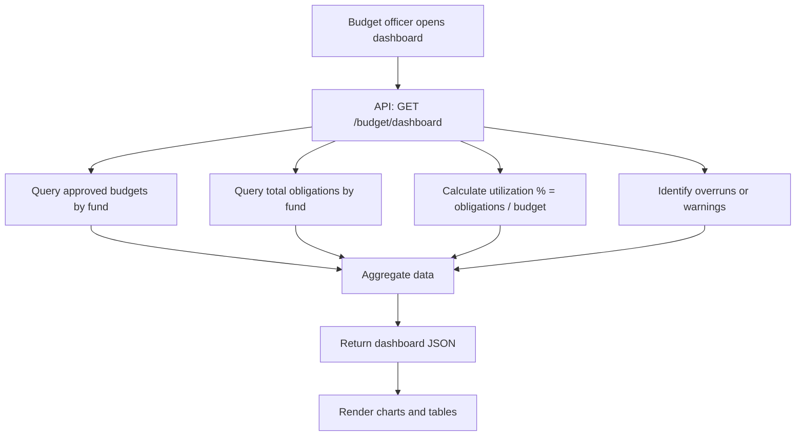

---

### 5. Procurement Workflow

#### 5.1 Procurement Lifecycle State Machine

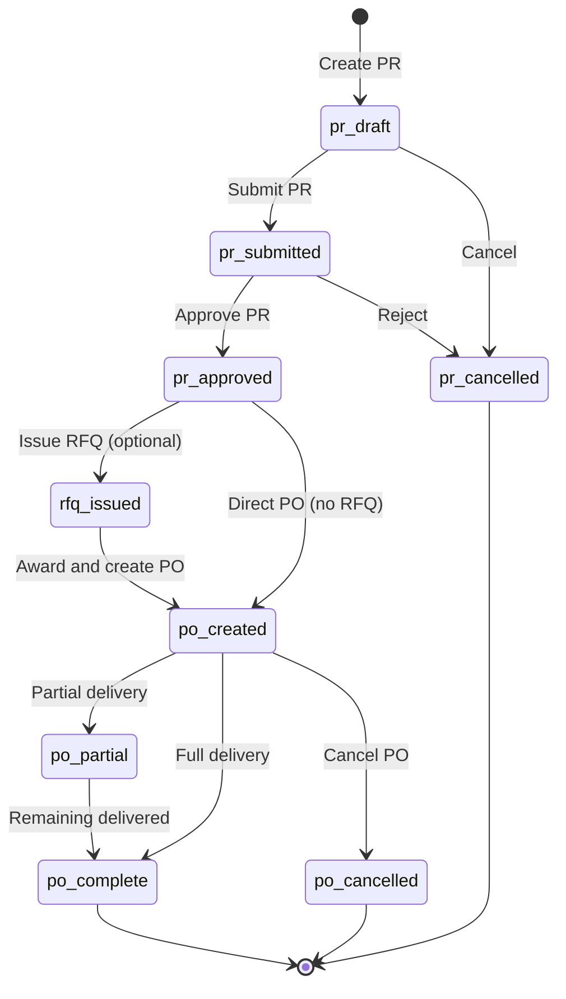

#### 5.2 Purchase Order Creation and Budget Check

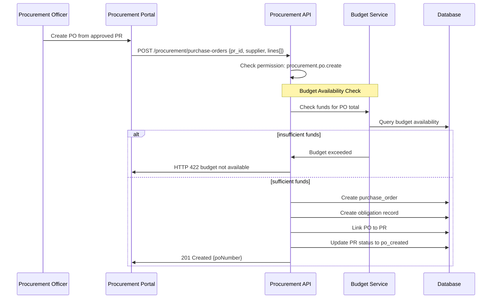

#### 5.3 Inspection and Acceptance Report (IAR)

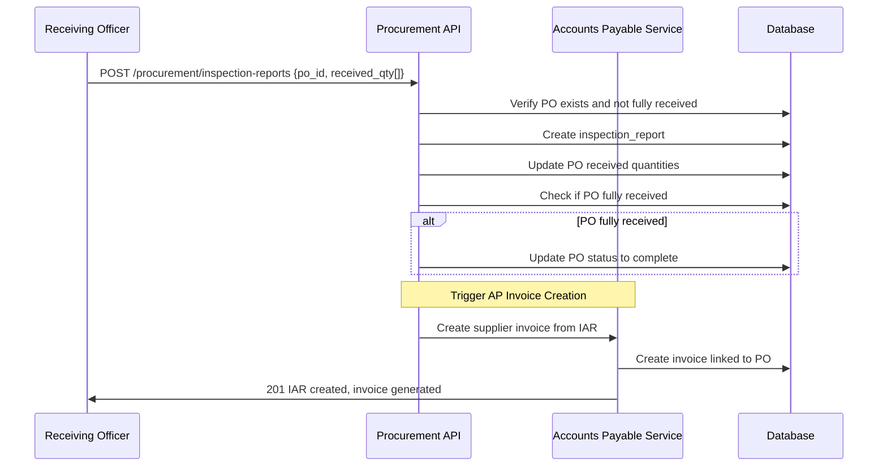

---

### 6. Accounting Workflow

#### 6.1 Journal Entry Voucher (JEV) Posting

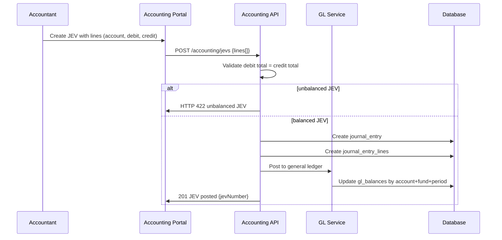

#### 6.2 Trial Balance Generation

```mermaid
flowchart TD
    A[Accountant requests trial balance] --> B[API: GET /accounting/trial-balance?period=2026-Q4]
    B --> C[Query gl_balances for period]
    C --> D[Filter by fund if specified]
    D --> E[Group by account]
    E --> F[Sum debits and credits]
    F --> G[Calculate account balances]
    G --> H{Total debits = Total credits?}
    H -->|no| WARN[Flag imbalance warning]
    H -->|yes| I[Format report]
    WARN --> I
    I --> J[Return trial balance data]
    J --> K[Render or export]
```

#### 6.3 Fiscal Period Close

```mermaid
sequenceDiagram
    participant A as Accountant
    participant UI as Accounting Portal
    participant API as Period Close API
    participant DB as Database
    
    A->>UI: Initiate period close
    UI->>API: POST /accounting/periods/:id/close
    API->>API: Check permission: accounting.period.close
    API->>DB: Validate all required entries posted
    API->>DB: Validate trial balance balanced
    
    alt validation fails
        API->>UI: HTTP 422 cannot close (reason)
    else validation passes
        API->>DB: Update fiscal_period status to closed
        API->>DB: Log period close event
        API->>DB: Lock period (posting prevented)
        API->>UI: 200 Period closed
    end
```

---

### 7. USiS Integration Workflows

#### 7.1 Assessment Upsert from USiS

```mermaid
sequenceDiagram
    participant USiS
    participant API as UFMS Internal API
    participant DB as Database
    
    Note over USiS: Enrollment submitted
    USiS->>API: POST /finance/internal/assessments
    Note over API: Service key authentication
    API->>API: Validate X-Service-Api-Key
    
    alt invalid key
        API->>USiS: HTTP 401 Unauthorized
    else valid key
        API->>DB: Upsert assessment record
        API->>DB: Create assessment_lines
        API->>DB: Generate assessment number
        API->>DB: Audit log
        API->>USiS: 201 Created {assessmentId, number}
    end
```

#### 7.2 Payment Status Query from USiS

```mermaid
sequenceDiagram
    participant USiS
    participant API as UFMS Internal API
    participant DB as Database
    
    Note over USiS: Enrollment workflow (payment gate)
    USiS->>API: GET /finance/internal/payments/:studentNo/:term
    Note over API: Service key authentication
    API->>API: Validate X-Service-Api-Key
    
    API->>DB: Query assessment for student+term
    API->>DB: Sum payments for assessment
    API->>API: Calculate paid, balance
    
    alt fully paid
        API->>USiS: {status: verified, paid, assessed, balance: 0}
    else partial payment
        API->>USiS: {status: partial, paid, assessed, balance}
    else no payment
        API->>USiS: {status: pending, paid: 0, assessed, balance}
    end
```

#### 7.3 Clearance Check from TORMS

```mermaid
sequenceDiagram
    participant TORMS
    participant API as UFMS Internal API
    participant DB as Database
    
    Note over TORMS: TOR request approval
    TORMS->>API: GET /finance/internal/clearance/:studentNo
    Note over API: Service key authentication
    API->>API: Validate X-Service-Api-Key
    
    API->>DB: Query outstanding balance for student
    API->>DB: Sum all unpaid assessments
    
    alt no outstanding balance
        API->>TORMS: {cleared: true, balance: 0}
    else has outstanding balance
        API->>TORMS: {cleared: false, balance: 12500}
    end
```

---

### 8. Point-of-Sale (POS) Workflow

#### 8.1 POS Sale Transaction

```mermaid
sequenceDiagram
    participant C as Cashier
    participant POS as POS Terminal
    participant API as POS API
    participant UIMS as UIMS (optional)
    participant GL as GL Service
    
    C->>POS: Start new sale
    C->>POS: Scan/add items
    loop For each item
        POS->>API: GET /pos/catalog/:itemCode
        API->>API: Lookup item price
        opt UIMS integration enabled
            API->>UIMS: GET /internal/stock/:itemCode
            UIMS->>API: Available quantity
            API->>POS: Item + availability
        end
    end
    
    C->>POS: Complete sale
    POS->>API: POST /pos/sales {terminal, lines[], payment}
    API->>API: Calculate total
    API->>DB: Create sale record
    API->>DB: Issue OR from POS series
    API->>GL: Post sale to GL (DR Cash, CR Revenue)
    API->>POS: 201 Sale complete {orNumber, total}
```

#### 8.2 POS End-of-Day Closing

```mermaid
flowchart TD
    A[Cashier initiates EOD] --> B[API: POST /pos/terminals/:id/close-day]
    B --> C[Verify no open sales]
    C --> D{Open sales exist?}
    D -->|yes| ERR[Cannot close, complete sales first]
    D -->|no| E[Query all sales for terminal today]
    E --> F[Calculate total sales by payment mode]
    F --> G[Generate EOD report]
    G --> H[Update terminal status to closed]
    H --> I[Lock terminal until next open]
    I --> J[Return EOD summary + PDF]
    ERR --> END
    J --> END[EOD complete]
```

---

### 9. Disbursement Workflow

#### 9.1 Disbursement Voucher (DV) Processing

```mermaid
stateDiagram-v2
    [*] --> dv_draft: Create DV
    dv_draft --> dv_submitted: Submit for approval
    dv_submitted --> dv_approved: Approve (within authority)
    dv_submitted --> dv_rejected: Reject
    dv_approved --> dv_paid: Process payment (check/ADA)
    dv_paid --> [*]
    dv_rejected --> [*]
```

#### 9.2 Check Processing

```mermaid
sequenceDiagram
    participant T as Treasury
    participant API as Treasury API
    participant GL as GL Service
    participant DB as Database
    
    T->>API: POST /treasury/checks {dv_id, check_number, amount}
    API->>DB: Verify DV is approved and not yet paid
    API->>DB: Create check record
    API->>DB: Update DV status to paid
    API->>GL: Post disbursement to GL
    Note over GL: DR Expense/Asset, CR Cash
    API->>T: 201 Check processed {checkNumber}
    
    Note over T,API: Later: Check clears
    T->>API: PUT /treasury/checks/:id/clear
    API->>DB: Update check status to cleared
    API->>T: 200 Check cleared
```

---

### 10. Error Cases & Edge Conditions

| Case | Expected Behavior | HTTP Status | User Message |
|------|-------------------|-------------|--------------|
| Record payment for unknown student | Reject payment | 422 | "Student not found." |
| Record payment with amount ≤ 0 | Reject payment | 422 | "Invalid payment amount." |
| Budget obligation exceeds available (hard stop) | Block obligation | 422 | "Insufficient budget: Available ₱50,000, Requested ₱75,000." |
| Post JEV with unbalanced debit/credit | Block posting | 422 | "JEV unbalanced: Debit ₱100,000, Credit ₱95,000." |
| Post to closed fiscal period | Block posting | 422 | "Cannot post to closed period 2026-Q3." |
| USiS calls internal API without service key | Block request | 401 | "Service key required." |
| Create PO without approved PR | Block PO creation | 422 | "PR must be approved before PO." |
| IAR for non-existent PO | Reject IAR | 404 | "Purchase order not found." |
| POS sale on closed terminal | Block sale | 422 | "Terminal is closed. Start new day first." |
| Close EOD with open sales | Block close | 422 | "Cannot close. {N} sales still open." |
| OR series exhausted | Alert + block payment | 422 | "OR series exhausted. Request new series." |
| UIMS unavailable during POS stock check | Log warning, allow sale without stock check | 200 | "(Stock check unavailable)" |

---

### 11. Background Job Workflows

#### 11.1 Bank Reconciliation Import

```mermaid
flowchart TD
    A[Scheduled: Daily 6:00 AM] --> B[Check for new bank statement file]
    B --> C{File exists?}
    C -->|no| END[Skip]
    C -->|yes| D[Download bank statement]
    D --> E["Parse statement CSV/OFX"]
    E --> F[Match transactions to payments/checks]
    F --> G[Flag unmatched transactions]
    G --> H[Generate reconciliation report]
    H --> I[Notify accountant]
    I --> END
```

#### 11.2 Payment Reminder Notifications

```mermaid
flowchart TD
    A[Scheduled: Daily 8:00 AM] --> B[Query unpaid assessments]
    B --> C[Calculate days until due date]
    C --> D{Due within 3 days?}
    D -->|yes| E[Queue email/SMS reminder]
    D -->|no| F[Skip]
    E --> G[BullMQ job: Send notification]
    F --> END
    G --> END
```

---

**End of LLD — UFMS**

---
