# UIMS — Complete System Specification

| Field | Value |
|-------|-------|
| **Product** | UIMS — University Inventory Management System |
| **Document type** | Complete System Specification (SRS + Architecture + Features + LLD) |
| **Date** | August 2026 |
| **Classification** | Proprietary |

## Document contents

1. System Requirements Specification (SRS)
2. Architecture Design
3. Features & Requirements
4. Low-Level Design (LLD) Workflows

---

## Part 1 — System Requirements Specification (SRS)

### University Inventory Management System (UIMS)

| Field | Value |
|-------|-------|
| **Document ID** | SRS-UIMS-001 |
| **Product** | University Inventory Management System (UIMS) |
| **Repository** | `UIMS_SERVICE` |
| **Version** | 1.0 |
| **Date** | August 2026 |
| **Classification** | Proprietary |

---

### 1. Introduction

#### 1.1 Purpose

This SRS defines requirements for **UIMS**, a university-focused inventory and property accountability platform for Philippine government institutions. It supports Supply Office workflows: master catalog, warehouse stock, PPE assets, COA-aligned forms, physical counts, GAM depreciation, requisitions, reporting, and audit compliance.

#### 1.2 Scope

**In scope**

- Organization hierarchy, RBAC, item catalog, warehouses/bins, stock ledger
- Assets lifecycle, QR labels, custodianship
- COA forms: ICS, PAR, RPCPPE, IIRUP, WMR
- Physical count sessions and field PWA scanning
- GAM straight-line depreciation and property ledger
- Requisitions and supplier master
- Reports (CSV + print-to-PDF) and append-only audit log
- Local auth and University Platform Access SSO (`AUTH_MODE` local | dual | platform)
- Internal custodianship feed for UHRIS (M2M)

**Out of scope / deferred**

- GSIS insurance API; Bluetooth/Wi-Fi label printer and RFID sled SDKs
- Formal OCR of paper archives; dedicated procurement/DMS vendor connectors
- Formal Supply Office UAT sign-off and campus load certification
- Audit log rich web UI (API available)

#### 1.3 Definitions

| Term | Definition |
|------|------------|
| **PPE** | Property, Plant, and Equipment |
| **COA forms** | Commission on Audit–aligned accountability documents |
| **GAM** | Government Accounting Manual depreciation practice |
| **ICS / PAR / RPCPPE / IIRUP / WMR** | Inventory Custodian Slip, Property Acknowledgement Receipt, Report on Physical Count of PPE, Inventory and Inspection Report of Unserviceable Property, Waste Material Report |

#### 1.4 References

- `UIMS_SERVICE/README.md`
- `docs/ARCHITECTURE.md`
- `docs/UIMS-Complete-Guide.md`
- `docs/PRODUCTION-READINESS.md`
- `docs/CAPACITY-AND-SECURITY.md`

---

### 2. Overall Description

#### 2.1 Product Perspective

Standalone sibling of University Platform Access, UHRIS, ULMIS, and UDMS — **not embedded in UHRIS**, but may share the same PostgreSQL host under schema **`uims`**.

| Surface | Port (dev) | Purpose |
|---------|------------|---------|
| Staff web (`apps/web`) | 5200 | Supply Office SPA (optional PWA) |
| Field PWA | 5200 `/field` | Physical count barcode scanning |
| API (`apps/api`) | 3334 | REST + OpenAPI |

Health: `GET /health` → `{ status: 'ok', service: 'uims' }`

#### 2.2 User Classes / Roles

| Role | Summary |
|------|---------|
| Administrator | All permissions |
| Supply Officer | Stock, warehouses, assets, COA, counts, depreciation, reports, audit |
| Property Custodian | Assets, COA, counts, depreciation read, reports |
| Supply Clerk | Stock write, requisitions, counts; limited catalog/warehouse |
| Staff | Read-oriented permissions |
| Viewer | Org/items/assets/reports read |

Frontend permission checks are UX only; API enforces on every authenticated route.

#### 2.3 Constraints

- Philippine government university context (COA + GAM)
- `DB_SCHEMA=uims`; separate migration history from UHRIS
- Browser never receives `SERVICE_API_KEY`
- Idempotency store requires Redis for multi-replica production
- RA 10173 applies to personal data in users, custodianships, and audits

---

### 3. Functional Requirements

#### 3.1 Organization & Catalog

| ID | Requirement | Priority |
|----|-------------|----------|
| FR-ORG-001 | Hierarchy: Organization → Campus → Office → Department | Must |
| FR-CAT-001 | Item master: SKU, UOM, barcode, category, stock thresholds, expiry flag | Must |
| FR-CAT-002 | Default valuation weighted average; CSV import ≤2,000 rows upsert by SKU | Must |

#### 3.2 Inventory & Requisitions

| ID | Requirement | Priority |
|----|-------------|----------|
| FR-INV-001 | Warehouses/bins; movements: beginning, receive, issue, transfer, adjust, return, disposal, reserve, release | Must |
| FR-INV-002 | Immutable ledger with on-hand, reserved, available balances | Must |
| FR-INV-003 | Idempotent stock writes via `Idempotency-Key` | Must |
| FR-REQ-001 | Requisition workflow draft → submitted → approved/rejected → fulfilled | Must |
| FR-REQ-002 | Document numbers `REQ-{YYYYMM}-{SEQ}`; fulfill posts stock issue | Must |

#### 3.3 Assets & COA

| ID | Requirement | Priority |
|----|-------------|----------|
| FR-AST-001 | Asset types and lifecycle: register → assign → return → maintenance → retire → dispose | Must |
| FR-AST-002 | QR label payload generation; custodianship assignment | Must |
| FR-COA-001 | Forms ICS, PAR, RPCPPE, IIRUP, WMR | Must |
| FR-COA-002 | Status draft → pending → approved \| void; auto document numbers | Must |
| FR-COA-003 | Approvals audited; export CSV; RPCPPE aligns with property counts | Must |

#### 3.4 Physical Count & Depreciation

| ID | Requirement | Priority |
|----|-------------|----------|
| FR-CNT-001 | Count types stock and property; session open → counting → reconciling → reconciled → closed | Must |
| FR-CNT-002 | Field PWA scan with offline queue, geo/photo evidence, sync | Must |
| FR-CNT-003 | Reconcile posts stock adjust for variances | Must |
| FR-DEP-001 | Straight-line GAM profiles and period entries; idempotent per asset/period | Must |
| FR-DEP-002 | Lapsing schedule and property ledger views | Must |

#### 3.5 Audit, UHRIS Feed, Reports

| ID | Requirement | Priority |
|----|-------------|----------|
| FR-AUD-001 | Append-only audit for stock, COA, depreciation, users, report exports | Must |
| FR-UHRIS-001 | `GET /api/v1/internal/custodianships` protected by service API key | Must |
| FR-RPT-001 | Reports: stock-inventory, property-ledger, consumption, depreciation | Must |
| FR-RPT-002 | View requires `reports.read`; export requires `reports.export` (audited) | Must |
| FR-DSH-001 | Dashboard KPIs, near-expiry alerts, recent movements | Should |

---

### 4. External Interface Requirements

| Interface | Detail |
|-----------|--------|
| REST API | `/api/v1/*`; Swagger `/api/v1/docs` |
| University Platform Access SSO | Platform code `uims`; launch `/sso/callback` |
| UHRIS | M2M custodianship feed; shared Postgres host optional |
| Object storage | S3-compatible for attachments |
| Observability | Optional Sentry / OpenTelemetry |

---

### 5. Non-Functional Requirements

| ID | Category | Requirement |
|----|----------|-------------|
| NFR-CAP-001 | Capacity | ≥500 named users; interactive API p95 ≤3s under normal campus load |
| NFR-CAP-002 | Capacity | Health &lt;500 ms; support physical-count burst from field tablets |
| NFR-SEC-001 | Security | TLS at edge; CORS locked; RBAC least privilege; non-root container |
| NFR-SEC-002 | Privacy | RA 10173 purpose limitation, access control, retention alignment |
| NFR-REL-001 | Reliability | Daily incremental + weekly full backups; quarterly restore drill |
| NFR-PERF-001 | Performance | Lazy SPA routes; paginated lists; heavy jobs off request path when queued |
| NFR-A11Y-001 | Accessibility | Skip link, table captions, aria-live where implemented |

---

### 6. Verification Criteria (Summary)

| Scenario | Expected result |
|----------|-----------------|
| Stock receive/issue | Ledger and balances update; idempotent retry safe |
| COA approve | Status approved; audit entry; property ledger impact |
| Physical count reconcile | Variances adjusted; session closable |
| Depreciation run | Entries created once per period |
| University Platform Access SSO | Dual mode accepts platform JWT |
| UHRIS custodianship | Service key required; browser cannot call |

---

### 7. Document Control

| Version | Date | Description |
|---------|------|-------------|
| 1.0 | August 2026 | SRS from UIMS architecture and readiness docs |

#### Related design docs

- **[UIMS-Architecture.md](./UIMS-Architecture.md)** — Architecture design (schema isolation, domains, deployment)
- **[UIMS-Features-Requirements.md](./UIMS-Features-Requirements.md)** — Feature catalog + requirements matrix
- **[UIMS-LLD.md](./UIMS-LLD.md)** — Low-level design workflows (stock, requisitions, assets, COA, physical count, depreciation, UHRIS feed)

**End of SRS — UIMS**

---

## Part 2 — Architecture Design

### UIMS — University Inventory Management System

| Field | Value |
|-------|-------|
| **Document ID** | AD-UIMS-001 |
| **Product** | UIMS |
| **Companions** | [UIMS_SERVICE-SRS.md](./UIMS_SERVICE-SRS.md) · [UIMS-Features-Requirements.md](./UIMS-Features-Requirements.md) · [UIMS-LLD.md](./UIMS-LLD.md) |
| **Date** | August 2026 |

---

### 1. Purpose

Architecture Design for university Supply Office inventory and property accountability (COA/GAM), standalone from UHRIS but optionally sharing the same Postgres host under schema `uims`.

---

### 2. System context

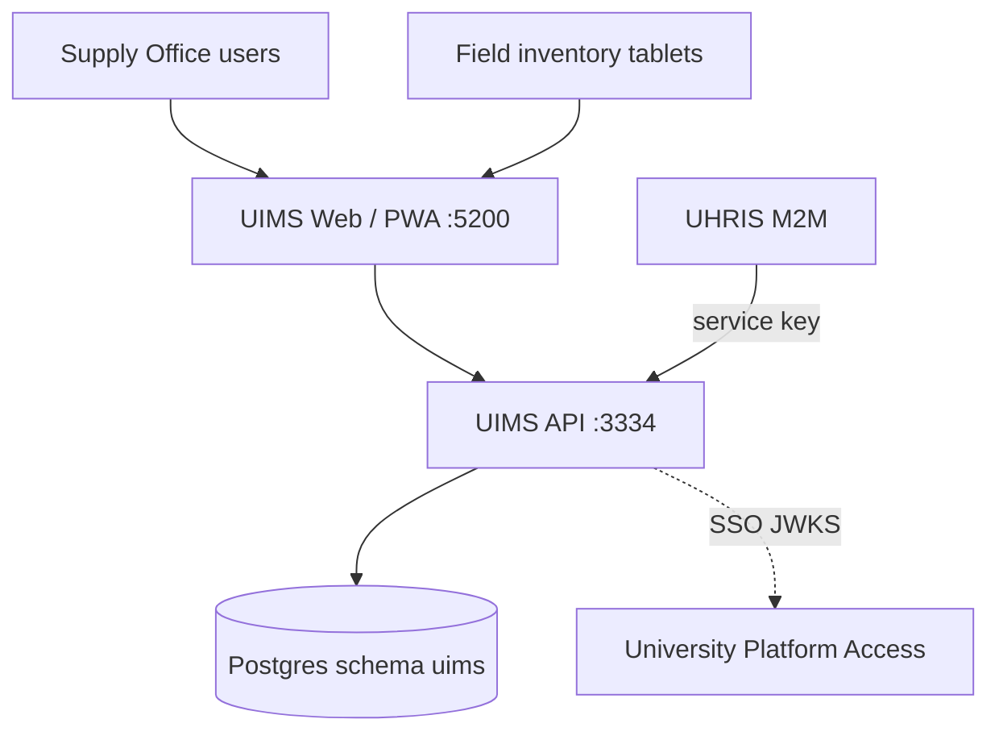

Health: `GET /health` → `{ status: 'ok', service: 'uims' }`.

---

### 3. Container view

| Container | Technology | Notes |
|-----------|------------|-------|
| Web SPA / Field PWA | React 19 + Vite | Staff UI + `/field` offline-capable scans |
| API | AdonisJS 7, Lucid | Port 3334 |
| Postgres | Schema `uims`; migration table `uims_adonis_schema` | Isolated from HRIS migrations |
| Auth | Local tokens and/or UPA JWKS | `AUTH_MODE` local\|dual\|platform |

---

### 4. Domain module architecture

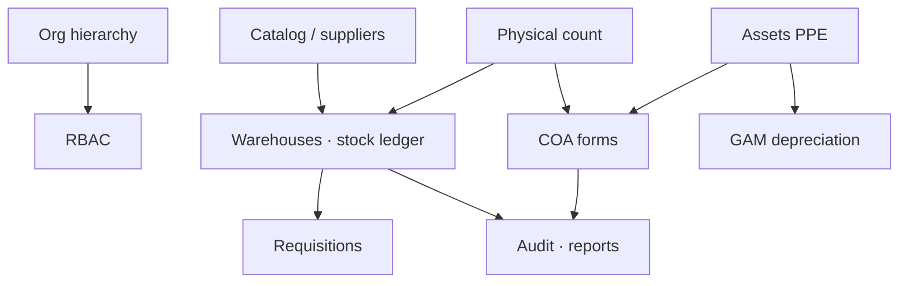

| Module | Responsibility |
|--------|----------------|
| Org | Organization → Campus → Office → Department |
| Catalog | Items, categories, CSV import |
| Inventory | Bins, movements, balances, idempotent writes |
| Requisitions | Request → approve → fulfill (issue) |
| Assets | Lifecycle, QR, custodianship |
| COA | ICS, PAR, RPCPPE, IIRUP, WMR |
| Count | Sessions + Field PWA sync |
| Depreciation | Straight-line profiles/entries |
| Internal API | Custodianships for UHRIS |

---

### 5. Security architecture

| Control | Detail |
|---------|--------|
| RBAC | 27 permission codes; API enforces every route |
| Browser trust | UX checks only; no `SERVICE_API_KEY` in clients |
| CORS | Locked to production web origin |
| Idempotency | `Idempotency-Key` on stock writes (Redis for multi-replica) |
| Privacy | RA 10173 purpose limitation for custodianship/audit data |

---

### 6. Deployment topology

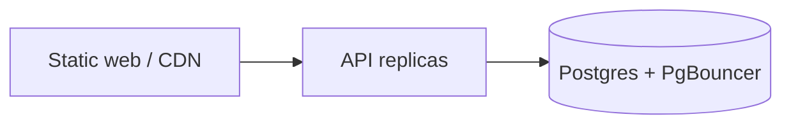

| Guidance | Detail |
|----------|--------|
| Sizing (500 users) | 2–3 API replicas; Postgres 2–4 vCPU / 8 GB class |
| Backup | Daily incremental, weekly full, offsite |
| Observability | Optional Sentry / OpenTelemetry `uims-api` |

---

### 7. Integration architecture

| Peer | Direction | Pattern |
|------|-----------|---------|
| University Platform Access | Inbound SSO | JWKS + `/sso/callback` |
| UHRIS | Outbound read | `GET /api/v1/internal/custodianships` |
| Object storage | Attachments | S3-compatible |
| Hardware printers/RFID | — | Out of software scope |

---

### 8. Quality attributes

| Attribute | Approach |
|-----------|----------|
| Capacity | ≥500 users; p95 ≤3s target |
| Integrity | Immutable stock ledger; audited COA/depreciation |
| Resilience | Documented RTO/RPO; quarterly restore drills |
| Accessibility | Skip link, table captions, aria-live |

---

**End of Architecture Design — UIMS**

---

## Part 3 — Features & Requirements

### UIMS — University Inventory Management System

| Field | Value |
|-------|-------|
| **Document ID** | FR-UIMS-001 |
| **Product** | UIMS |
| **Companions** | [UIMS_SERVICE-SRS.md](./UIMS_SERVICE-SRS.md) · [UIMS-LLD.md](./UIMS-LLD.md) |
| **Date** | August 2026 |

---

### 1. Feature summary

| Area | Features |
|------|----------|
| **Organization** | Organization → Campus → Office → Department |
| **Catalog** | Items, categories, SKU/barcode, thresholds, CSV import |
| **Inventory** | Warehouses, bins, ledger movements, balances, idempotent writes |
| **Suppliers & requisitions** | Supplier master; REQ workflow to stock issue |
| **Assets (PPE)** | Register, assign, maintain, retire, QR labels |
| **COA forms** | ICS, PAR, RPCPPE, IIRUP, WMR |
| **Physical count** | Stock/property sessions + Field PWA offline scan |
| **Depreciation** | GAM straight-line profiles + period runs |
| **Reports & audit** | Stock, property ledger, consumption, depreciation; append-only audit |
| **Integrations** | University Platform Access SSO; UHRIS custodianship M2M |

---

### 2. Feature catalog

| Feature ID | Feature | Description | Priority |
|------------|---------|-------------|----------|
| F-ORG-01 | Org hierarchy | Org / campus / office / department | Must |
| F-RBAC-01 | Roles & permissions | 27 permission codes; seeded roles | Must |
| F-CAT-01 | Item master | SKU, UOM, barcode, category, thresholds, expiry flag | Must |
| F-CAT-02 | CSV import | ≤2,000 rows; upsert by SKU | Must |
| F-INV-01 | Warehouses & bins | Campus warehouses; aisle/rack/shelf bins | Must |
| F-INV-02 | Stock movements | beginning, receive, issue, transfer, adjust, return, disposal, reserve, release | Must |
| F-INV-03 | Ledger & balances | Immutable ledger; on-hand/reserved/available | Must |
| F-INV-04 | Idempotency | `Idempotency-Key` on stock writes | Must |
| F-SUP-01 | Suppliers | Supplier master + contacts | Must |
| F-REQ-01 | Requisitions | draft → submitted → approved/rejected → fulfilled | Must |
| F-REQ-02 | Auto numbering | `REQ-{YYYYMM}-{SEQ}` | Must |
| F-AST-01 | PPE register | Types, statuses, lifecycle actions | Must |
| F-AST-02 | Custodianship | Assign/return; feeds COA + UHRIS | Must |
| F-AST-03 | QR labels | JSON payload for printing/scan | Must |
| F-COA-01 | COA form types | ICS, PAR, RPCPPE, IIRUP, WMR | Must |
| F-COA-02 | COA workflow | draft → pending → approved \| void | Must |
| F-COA-03 | COA export | CSV export; audited approve | Must |
| F-CNT-01 | Physical count | stock + property sessions | Must |
| F-CNT-02 | Field PWA | Offline queue, geo/photo, sync scans | Must |
| F-CNT-03 | Reconcile | Variance adjust + close | Must |
| F-DEP-01 | GAM profiles | Straight-line useful life / residual | Must |
| F-DEP-02 | Period runs | Idempotent entries per asset/period | Must |
| F-RPT-01 | Operational reports | stock-inventory, property-ledger, consumption, depreciation | Must |
| F-AUD-01 | Audit log | Append-only; API list | Must |
| F-DSH-01 | Dashboard | KPIs, near-expiry, recent movements | Should |
| F-AUTH-01 | Local + UPA SSO | dual/platform modes | Must |
| F-UHRIS-01 | Custodianship feed | Internal M2M for UHRIS | Must |
| F-CNT-04 | Found-at-station | Register untagged asset discovered during Field count; create/link asset + photo/geo | Must |
| F-COA-04 | Mobile ICS/PAR sign-off | Stylus/touch accountability signature on Field device for issued items | Should |
| F-DIS-01 | Disposal & appraisal | Unserviceable flag → appraisal (appraised vs acquisition) → mode (bidding / donate / destroy) → WMR/IIRUP | Must |
| F-RPT-02 | PDF layout | Export PDF with user-defined page size and orientation | Should |
| F-RPT-03 | Valuation & lapsing | Inventory valuation + lapsing schedule (book value, accum. dep., remaining life) | Should |
| F-AST-04 | Maintenance tracking | Repair/maintenance events on PPE | Should |
| F-INT-01 | Procurement/finance/DMS APIs | Deferred connectors; UPA + UHRIS delivered | Could |
| F-MIG-01 | Legacy OCR ingest | Digitization/OCR of legacy asset documents (5-year retention of history) | Could |
| F-INS-01 | GSIS insurance tracking | Deferred insurance module for high-value PPE | Could |

---

### 3. Requirements matrix

| Req ID | Requirement | Related features | Priority |
|--------|-------------|------------------|----------|
| FR-ORG-001 | Four-level org hierarchy | F-ORG-01 | Must |
| FR-CAT-001 | Item master fields | F-CAT-01 | Must |
| FR-CAT-002 | CSV import ≤2000 upsert by SKU | F-CAT-02 | Must |
| FR-INV-001 | Warehouses/bins + movement types | F-INV-01, F-INV-02 | Must |
| FR-INV-002 | Immutable ledger + balances | F-INV-03 | Must |
| FR-INV-003 | Idempotent stock writes | F-INV-04 | Must |
| FR-REQ-001 | Requisition status workflow | F-REQ-01 | Must |
| FR-REQ-002 | Numbering + fulfill issues stock | F-REQ-02, F-INV-02 | Must |
| FR-AST-001 | Asset lifecycle | F-AST-01 | Must |
| FR-AST-002 | QR + custodianship | F-AST-02, F-AST-03 | Must |
| FR-COA-001 | Five COA form types | F-COA-01 | Must |
| FR-COA-002 | Status + auto numbers | F-COA-02 | Must |
| FR-COA-003 | Approve audited + export | F-COA-03 | Must |
| FR-CNT-001..003 | Count sessions, Field PWA, reconcile | F-CNT-01..03 | Must |
| FR-DEP-001..002 | GAM profiles + idempotent runs | F-DEP-01, F-DEP-02 | Must |
| FR-AUD-001 | Append-only audit | F-AUD-01 | Must |
| FR-UHRIS-001 | Service-key custodianship API | F-UHRIS-01 | Must |
| FR-RPT-001..002 | Reports view/export permissions | F-RPT-01 | Must |
| FR-DSH-001 | Dashboard KPIs | F-DSH-01 | Should |
| FR-CNT-004 | Found-at-station untagged asset | F-CNT-04 | Must |
| FR-COA-004 | Mobile ICS/PAR digital sign-off | F-COA-04 | Should |
| FR-DIS-001 | Disposal appraisal + mode of disposal | F-DIS-01 | Must |
| FR-RPT-003 | PDF page size/orientation + valuation/lapsing | F-RPT-02, F-RPT-03 | Should |
| FR-AST-003 | Maintenance tracking | F-AST-04 | Should |

#### Source DOCX traceability (UNIVERSITY Inventory Management System.docx) — 100%

| Source requirement | Feature / ID | Status |
|--------------------|--------------|--------|
| Central supplies/assets lifecycle for Supply Office | Purpose + F-* | Delivered |
| COA / GAM / RA 10173 compliance | F-COA-*, F-DEP-*, NFR | Delivered |
| Multi-campus org + RBAC | F-ORG-01, F-RBAC-01 | Delivered |
| Item master + CSV/Excel import | F-CAT-01, F-CAT-02 | Delivered |
| Warehouses / bins / movements / audit | F-INV-*, F-AUD-01 | Delivered |
| Min/reorder/safety + near-expiry alerts | F-CAT-01, F-DSH-01 | Delivered |
| Suppliers + requisitions | F-SUP-01, F-REQ-* | Delivered |
| Asset lifecycle + custodianship + QR | F-AST-01..03 | Delivered |
| Repair/maintenance tracking | F-AST-04 | Delivered |
| Physical count + Field offline PWA + geo/photo | F-CNT-01..03 | Delivered |
| Found-at-station untagged asset | F-CNT-04 | Delivered |
| Digital ICS/PAR sign-off on mobile | F-COA-04 | Planned |
| COA forms ICS/PAR/RPCPPE/IIRUP/WMR | F-COA-01..03 | Delivered |
| GAM straight-line depreciation + lapsing | F-DEP-*, F-RPT-03 | Delivered |
| Reports stock/property/consumption/depreciation PDF/CSV | F-RPT-01, F-RPT-02 | Delivered |
| Disposal appraisal + mode of disposal | F-DIS-01 | Delivered |
| UPA SSO + UHRIS custodianship feed | F-AUTH-01, F-UHRIS-01 | Delivered |
| ≥500 users / ≤3s | NFR-PERF | Delivered (target) |
| DR daily/weekly/offsite backups | NFR-REL | Delivered |
| Procurement/finance/DMS connectors | F-INT-01 | Excluded (deferred) |
| OCR of 5-year paper archives | F-MIG-01 | Excluded (deferred) |
| GSIS insurance module | F-INS-01 | Excluded (deferred) |
| Rugged handheld / RFID sled / Bluetooth printers | Hardware | Excluded |
| Training / UAT / migration / PM SLAs | SVC-UIMS-* | Service |

---

### 4. Non-functional requirements (summary)

| ID | Category | Requirement |
|----|----------|-------------|
| NFR-CAP-001 | Capacity | ≥500 users; p95 ≤3s normal load |
| NFR-CAP-002 | Capacity | Health &lt;500 ms; count burst support |
| NFR-SEC-001 | Security | TLS, CORS, RBAC, non-root container |
| NFR-SEC-002 | Privacy | RA 10173 purpose limitation + retention |
| NFR-REL-001 | Reliability | Daily/weekly backups; restore drills |
| NFR-PERF-001 | Performance | Lazy SPA; pagination; heavy jobs off path |

---

### 5. Actors & feature access

| Role | Primary features |
|------|------------------|
| Administrator | All |
| Supply Officer | F-INV-*, F-REQ-*, F-AST-*, F-COA-*, F-CNT-*, F-DEP-*, F-RPT-*, F-AUD-* |
| Property Custodian | F-AST-*, F-COA-*, F-CNT-*, depreciation read, reports |
| Supply Clerk | Stock write, requisitions, counts; limited catalog |
| Staff / Viewer | Read-oriented org/items/assets/reports |
| UHRIS (M2M) | F-UHRIS-01 |

---

**End of Features & Requirements — UIMS**

---

## Part 4 — Low-Level Design (LLD) Workflows

### UIMS (University Inventory Management System)

| Field | Value |
|-------|-------|
| **Document ID** | LLD-UIMS-001 |
| **Product** | UIMS |
| **Companion** | [UIMS_SERVICE-SRS.md](./UIMS_SERVICE-SRS.md) |
| **Date** | August 2026 |

---

### 1. Purpose

This LLD covers stock movements, requisitions, asset custodianship, COA forms, physical count (including Field PWA), depreciation runs, and UHRIS custodianship feed.

---

### 2. System context

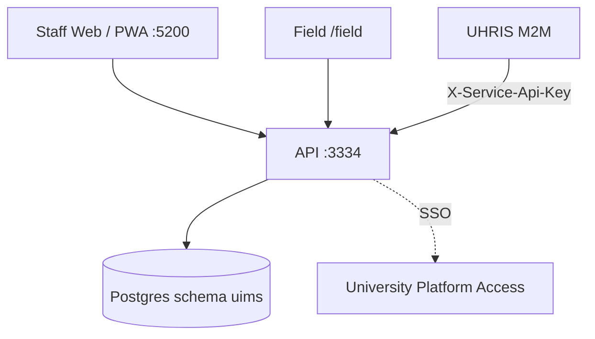

---

### 3. Stock movement workflow

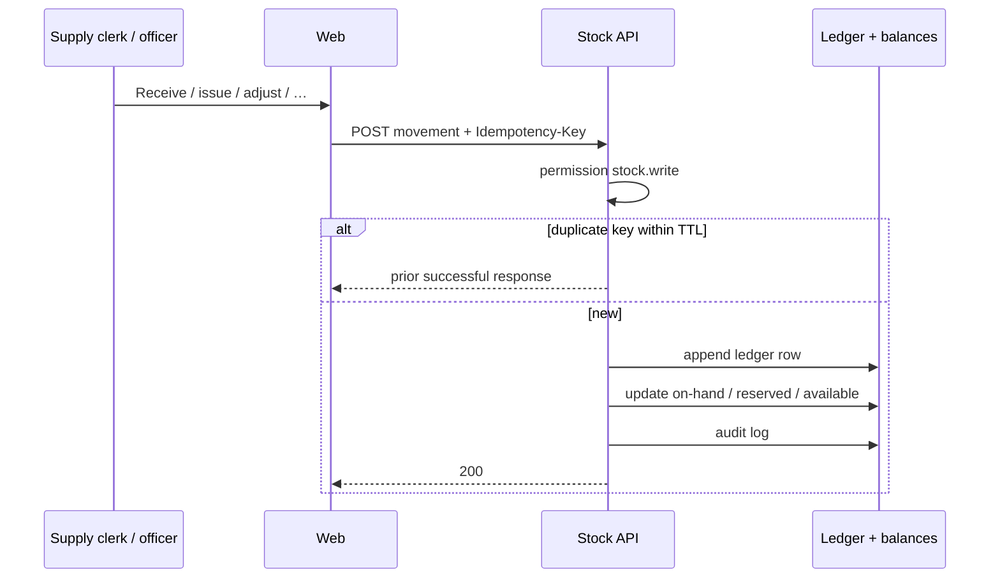

**Movement types:** beginning, receive, issue, transfer, adjust, return, disposal, reserve, release.

---

### 4. Requisition workflow

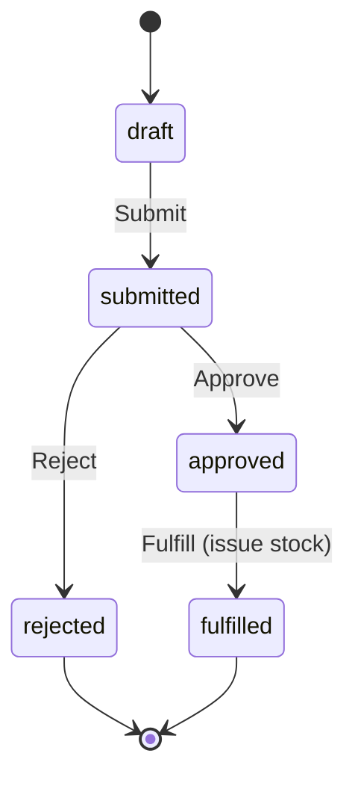

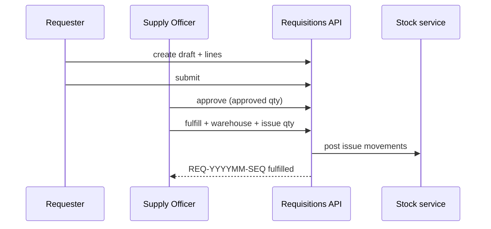

---

### 5. Asset lifecycle

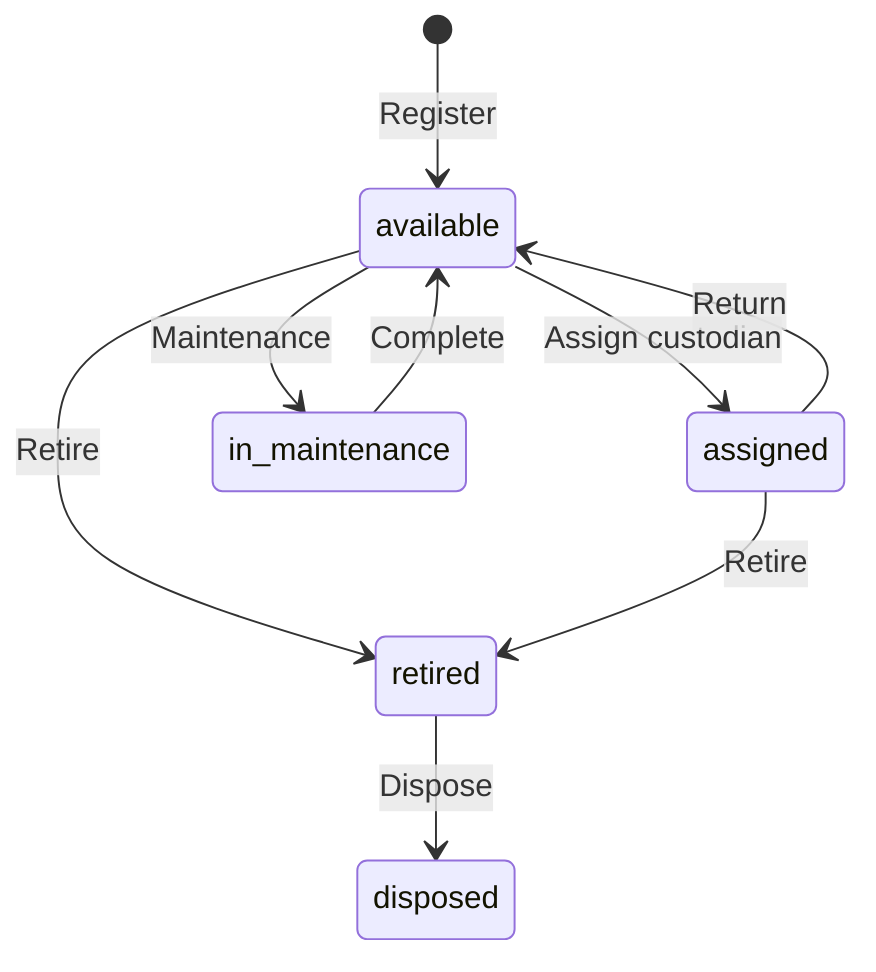

**QR:** Generate JSON payload for label print → Field / count scan.

---

### 6. COA form workflow

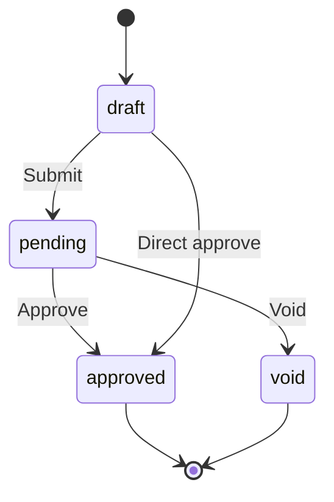

| Form | Typical use |
|------|-------------|
| ICS | Semi-expendable to custodian |
| PAR | PPE acknowledgement |
| RPCPPE | Physical count of PPE |
| IIRUP | Unserviceable inspection |
| WMR | Waste material |

**On approve:** audit (`coa_approve`); property ledger entries for asset-linked forms; number `{FORM}-{YEAR}-{SEQ}`.

---

### 7. Physical count + Field PWA

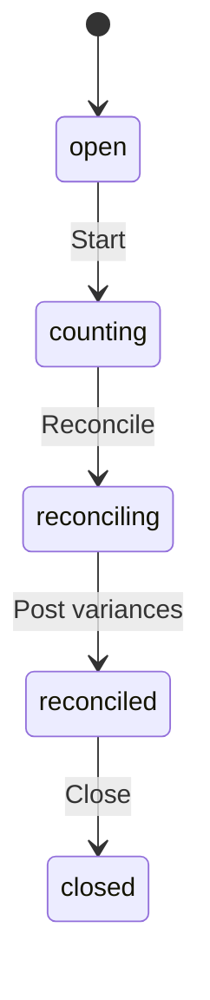

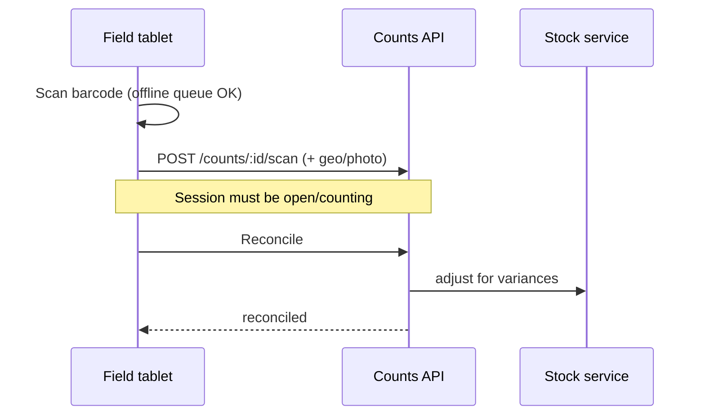

**Types:** `stock` (consumables) · `property` (PPE → RPCPPE alignment).

---

### 8. GAM depreciation run

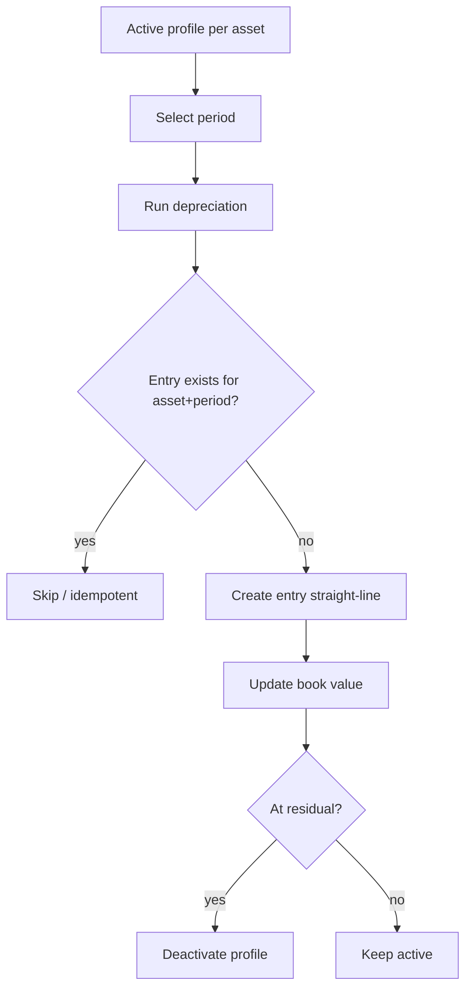

---

### 9. UHRIS custodianship feed

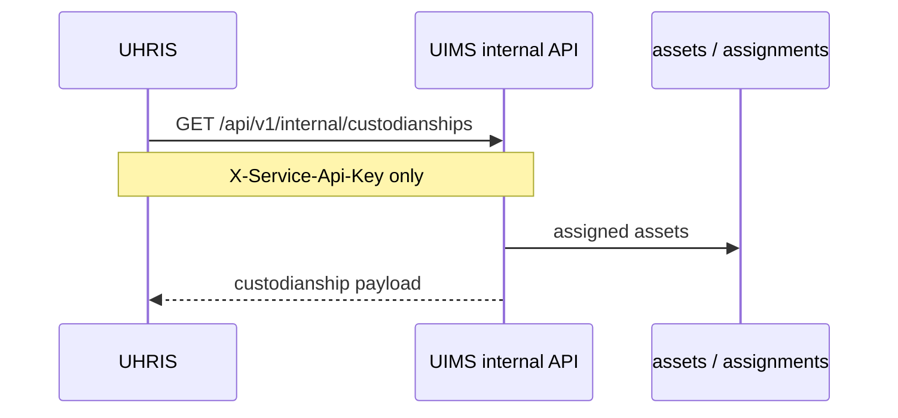

Browser clients must never receive `SERVICE_API_KEY`.

---

### 10. Error / edge cases

| Case | Expected behavior |
|------|-------------------|
| Missing Idempotency-Key on retry storm | Possible duplicate without key |
| Fulfill qty &gt; approved | Rejected |
| Count closed | Scans rejected |
| COA void after approve | Use void transition where supported; audit retained |
| Wrong CORS origin | Browser blocked |

---

**End of LLD — UIMS**

---
