# ULMIS — Complete System Specification

| Field | Value |
|-------|-------|
| **Product** | ULMIS — University Library Management Information System |
| **Document type** | Complete System Specification (SRS + Architecture + Features + LLD) |
| **Date** | August 2026 |
| **Classification** | Proprietary |

## Document contents

1. System Requirements Specification (SRS)
2. Architecture Design
3. Features & Requirements
4. Low-Level Design (LLD) Workflows

---

## Part 1 — System Requirements Specification (SRS)

### University Library Management Information System (ULMIS)

| Field | Value |
|-------|-------|
| **Document ID** | SRS-ULMIS-001 |
| **Product** | University Library Management Information System (ULMIS / LibraStack) |
| **Repository** | `LibraryManagementSystem` |
| **Version** | 1.0 |
| **Date** | August 2026 |
| **Classification** | Proprietary |

---

### 1. Introduction

#### 1.1 Purpose

This SRS defines requirements for **ULMIS**, a single-institution university library platform for cataloging, inventory, members, circulation, OPAC/self-service, digital holdings, kiosk platform, queue/locator boards, reporting, notifications, and campus integration adapters.

#### 1.2 Scope

**In scope (software)**

- Modules 2.1–2.9 and 2.11–2.15 per ULMIS requirements matrix
- Attendance logging and staff Users/Settings
- Staff web, public OPAC, and kiosk clients on one REST API
- Borrow blocks and six mandated report exports
- Local JWT auth and University Platform Access SSO (`AUTH_MODE` local | dual | platform)

**Explicitly excluded**

- **§2.10 RFID Library Automation** (gates, handhelds, RFID checkout) — hardware/vendor out of this delivery
- Biometric/smartcard wall appliances, turnstile hardware, 55" display hardware
- Live LDAP binds / unverified SSO assertions (return 501 until verified)
- Certified ≥300 concurrent / ≤3s proof (architecture ready; load test separate)

#### 1.3 Definitions

| Term | Definition |
|------|------------|
| **OPAC** | Online Public Access Catalog |
| **Copy** | Physical inventory unit (barcode-level circulation) |
| **Kiosk Platform** | Staff admin + self-service terminal software |
| **University mode** | Single-institution deployment (default) |

#### 1.4 References

- `LibraryManagementSystem/README.md`
- `docs/compliance/ULMIS_SCOPE.md`
- `docs/compliance/ULMIS_REQUIREMENTS_MATRIX.md`
- `docs/compliance/ULMIS_NFR.md`
- `docs/ULMIS-Complete-Guide.md`

---

### 2. Overall Description

#### 2.1 Product Perspective

| App | Port (dev) | Audience | Auth |
|-----|------------|----------|------|
| Staff web (`apps/web`) | 5173 | Librarians, admins | JWT |
| Public OPAC (`apps/opac`) | 5174 | Public / patrons | Tenant-scoped read |
| Kiosk (`apps/kiosk`) | 5175 | Self-service terminals | Device code + API key |
| API (`apps/api`) | 3333 | All clients | JWT / kiosk / public |

Default: `DEPLOYMENT_MODE=university`, `ALLOW_PUBLIC_REGISTER=false`, fixed `DEFAULT_TENANT_SLUG`.

#### 2.2 User Classes

| Class | Capabilities |
|-------|--------------|
| Administrator | Full tenant permissions |
| Librarian | Catalog, members, circulation, fines, digital, reports |
| Staff | Desk checkout/return/reservations |
| Member (portal) | Loans, renew, reservations, reading lists, digital access |
| Public OPAC user | Read-only search/citations; queue board without PII |
| Kiosk patron | Borrow/return/account/history via device credentials |

Member types: `student` | `faculty` | `employee` | `researcher` | `guest` | `alumni`

#### 2.3 Constraints

- Not multi-customer SaaS by default
- RFID excluded from readiness claim
- Public OPAC read-only; public queue must not expose patron identity
- Kiosk API keys hashed at rest; plaintext shown once on create/rotate
- Fines in Philippine pesos (₱)

---

### 3. Functional Requirements

#### 3.1 Core Modules

| Module | ID range | Key requirements | Status |
|--------|----------|------------------|--------|
| Dashboard & monitoring | FR-2.1.* | KPIs, widgets, summary PDF | Ready |
| Catalog | FR-2.2.* | MARC/Dublin Core fields; CSV/MARC JSON/Excel import; versions | Ready |
| Item & inventory | FR-2.3.* | Copies, barcodes, statuses, locate, history | Ready |
| User management | FR-2.4.* | Members, staff users, RBAC, digital card; ARIS/UHRIS adapters | Ready |
| Circulation | FR-2.5.* | Desk + kiosk borrow/return/renew; fines; reservations | Ready |
| OPAC | FR-2.6.* | Staff + public OPAC; citations; reading lists; page size cap 25 | Ready |
| Digital repository | FR-2.7.* | Create/list/search; view/download; PDF view | Ready |
| Digital resources | FR-2.8.* | E-resource registry + discovery | Ready |
| E-library portal | FR-2.9.* | `/portal` loans/fines/lists; `/digital` | Ready |
| RFID | FR-2.10.* | **Excluded** | Excluded |
| Self-service kiosk | FR-2.11.* | Admin platform + kiosk client; device keys; idle timeout | Ready |
| Resource locator | FR-2.12.* | Shelf locations; locate UI | Ready |
| Queue management | FR-2.13.* | Issue/call; public board without PII | Ready |
| Reporting | FR-2.14.* | Six mandated reports CSV/PDF | Ready |
| Notifications | FR-2.15.* | In-app; SMTP/Twilio when configured | Ready |
| Attendance | FR-ATT.* | Card visit log + daily summary | Ready |

#### 3.2 Borrow Blocks (Must Enforce)

| ID | Block condition |
|----|-----------------|
| FR-BLK-001 | Not enrolled / inactive academic status |
| FR-BLK-002 | Blacklisted |
| FR-BLK-003 | Overdue items |
| FR-BLK-004 | Unpaid fines/charges |
| FR-BLK-005 | Suspended or expired membership |

#### 3.3 Mandated Reports

| Report | Endpoint |
|--------|----------|
| Collections | `GET /api/v1/reports/collections` |
| Borrowed books | `GET /api/v1/reports/borrowed` |
| Overdue books | `GET /api/v1/reports/overdue` |
| Book ledger | `GET /api/v1/reports/book_ledger` |
| Patron ledger | `GET /api/v1/reports/patron_ledger` |
| Charges / penalties | `GET /api/v1/reports/charges` |

Exports require `reports:export`. Scheduled email when SMTP and queue worker are enabled.

#### 3.4 Security Rules (Functional)

| ID | Requirement | Priority |
|----|-------------|----------|
| FR-SEC-001 | No public write for circulation/member data without kiosk device credentials | Must |
| FR-SEC-002 | Public OPAC tenant-scoped and read-only | Must |
| FR-SEC-003 | Integration sync admin-only, batch-limited, card-ID match | Must |
| FR-SEC-004 | Do not accept unverified directory passwords or SSO assertions in stubs | Must |

---

### 4. External Interface Requirements

| Interface | Detail |
|-----------|--------|
| REST API | `/api/v1/*`; Swagger `/api/v1/docs` |
| University Platform Access SSO | `PLATFORM_*` env; platform codes for Library stack |
| ARIS / UHRIS | Inbound patron sync adapters (credentials required for live pull) |
| SMTP / Twilio | Notifications when configured |
| Kiosk APIs | `/api/v1/hardware/kiosks*`, `/api/v1/kiosk/*` |

---

### 5. Non-Functional Requirements

| ID | Requirement | Notes |
|----|-------------|-------|
| NFR-G4-001 | ≥300 concurrent users; ≤3s standard transactions | Target; not load-proven in-repo |
| NFR-G4-002 | Stateless JWT API; Postgres + Redis | Ready |
| NFR-OPS-001 | CI typecheck/build; Redis for rate limits and jobs | Documented |
| NFR-OPS-002 | Managed Postgres backups; `DB_SSL=true` for hosted | Ops checklist |
| NFR-SEC-001 | CORS includes staff, OPAC, and kiosk origins | Must |

---

### 6. Verification Criteria (Summary)

| Scenario | Expected result |
|----------|-----------------|
| University bootstrap | Admin login without org slug field |
| Checkout with overdue/fines | Blocked per FR-BLK rules |
| Public OPAC | Read-only search; no member writes |
| Kiosk borrow/return | Works with device credentials |
| Mandated reports | CSV/PDF export with permission |
| RFID claim | Not asserted for this delivery |

---

### 7. Document Control

| Version | Date | Description |
|---------|------|-------------|
| 1.0 | August 2026 | SRS from ULMIS compliance matrix and guides |

#### Related design docs

- **[ULMIS-Architecture.md](./ULMIS-Architecture.md)** — Architecture design (multi-client, domains, security)
- **[ULMIS-Features-Requirements.md](./ULMIS-Features-Requirements.md)** — Feature catalog + requirements matrix
- **[ULMIS-LLD.md](./ULMIS-LLD.md)** — Low-level design workflows (circulation, borrow blocks, kiosk, OPAC/queue, reports)

**End of SRS — ULMIS**

---

## Part 2 — Architecture Design

### ULMIS — University Library Management Information System

| Field | Value |
|-------|-------|
| **Document ID** | AD-ULMIS-001 |
| **Product** | ULMIS |
| **Companions** | [LibraryManagementSystem-SRS.md](./LibraryManagementSystem-SRS.md) · [ULMIS-Features-Requirements.md](./ULMIS-Features-Requirements.md) · [ULMIS-LLD.md](./ULMIS-LLD.md) |
| **Date** | August 2026 |

---

### 1. Purpose

Architecture Design for single-institution university library mode: one API, three client apps (staff, OPAC, kiosk).

---

### 2. System context

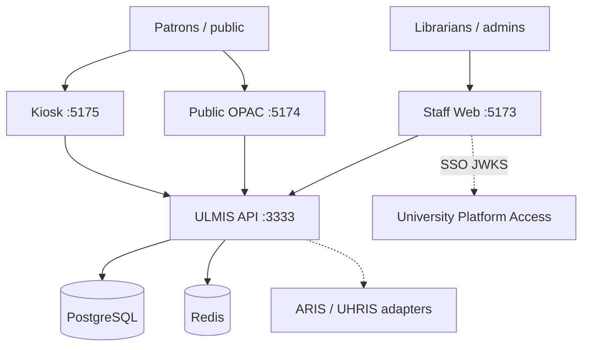

---

### 3. Container view

| Container | Auth model | Capabilities |
|-----------|------------|--------------|
| Staff web | JWT + RBAC | Catalog, circulation, members, reports, kiosk admin |
| Public OPAC | Tenant-scoped read | Search, citations, queue board (no PII) |
| Kiosk | Device code + API key | Borrow/return/account/history |
| API | JWT / kiosk / public | `/api/v1/*` |
| Postgres | — | Bibliographic, copies, loans, members |
| Redis | — | Rate limits, scheduled report jobs |

**Deployment mode:** `DEPLOYMENT_MODE=university`, `ALLOW_PUBLIC_REGISTER=false`, fixed `DEFAULT_TENANT_SLUG`.

---

### 4. Shared packages

| Package | Role |
|---------|------|
| `@librastack/client-config` | Shared Vite client helpers |
| `@librastack/permissions` | Shared RBAC constants |

---

### 5. Domain architecture

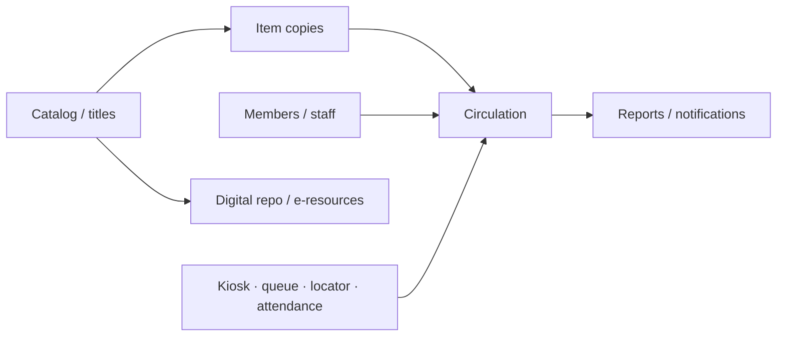

| Domain | Notes |
|--------|-------|
| Catalog | MARC/Dublin Core fields; bulk import |
| Copies | Barcode-level status & history |
| Circulation | Desk + kiosk; fines ₱; reservations; borrow blocks |
| Digital | Repository + e-resource registry |
| Hardware software | Kiosk platform APIs; RFID **excluded** |

---

### 6. Security architecture

| Rule | Enforcement |
|------|-------------|
| No public write for circulation/members | Kiosk writes require device credentials |
| Public OPAC read-only | Tenant-scoped |
| Queue board | Strip patron identity |
| Report export | `reports:export` |
| Sync | Admin-only, batch-limited |
| Kiosk keys | Hashed at rest; plaintext once |

---

### 7. Deployment topology

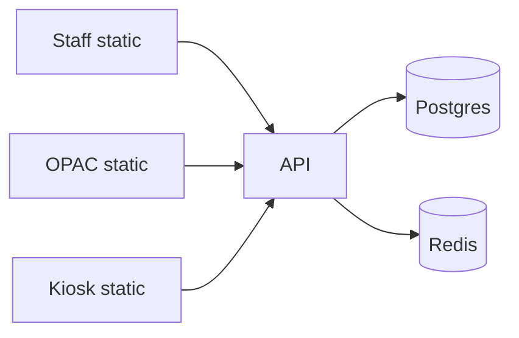

Supports on-prem, hybrid, or cloud. CORS must include staff, OPAC, and kiosk origins.

---

### 8. Integration architecture

| Peer | Pattern |
|------|---------|
| University Platform Access | `AUTH_MODE` local\|dual\|platform; JWKS |
| ARIS / UHRIS | Inbound patron sync adapters |
| SMTP / Twilio | Notifications when configured |
| LDAP/AD | Stubbed until verified (501) |

---

### 9. Quality attributes

| Attribute | Approach |
|-----------|----------|
| Concurrency target | ≥300 users / ≤3s (prove in staging) |
| HA readiness | Stateless JWT API + managed Postgres/Redis |
| University scope | Single tenant; not multi-customer SaaS by default |

---

**End of Architecture Design — ULMIS**

---

## Part 3 — Features & Requirements

### ULMIS — University Library Management Information System

| Field | Value |
|-------|-------|
| **Document ID** | FR-ULMIS-001 |
| **Product** | ULMIS |
| **Companions** | [LibraryManagementSystem-SRS.md](./LibraryManagementSystem-SRS.md) · [ULMIS-LLD.md](./ULMIS-LLD.md) |
| **Date** | August 2026 |

---

### 1. Feature summary

| Module | Features | Status |
|--------|----------|--------|
| **2.1 Dashboard** | KPIs, widgets, summary PDF | Ready |
| **2.2 Catalog** | MARC/Dublin Core fields; CSV/MARC JSON/Excel import; versions | Ready |
| **2.3 Inventory** | Copies, barcodes, statuses, locate, history | Ready |
| **2.4 Users** | Members, staff RBAC, digital card; ARIS/UHRIS adapters | Ready |
| **2.5 Circulation** | Desk + kiosk borrow/return/renew; fines; reservations | Ready |
| **2.6 OPAC** | Staff + public OPAC; citations; reading lists | Ready |
| **2.7 Digital repository** | Create/list/search; view/download; PDF view | Ready |
| **2.8 Digital resources** | E-resource registry + discovery | Ready |
| **2.9 E-library portal** | Loans, fines, lists, digital access | Ready |
| **2.10 RFID** | — | **Excluded** |
| **2.11 Kiosk** | Admin platform + self-service client | Ready |
| **2.12 Locator** | Shelf locations; locate UI | Ready |
| **2.13 Queue** | Issue/call; public board without PII | Ready |
| **2.14 Reporting** | Six mandated reports CSV/PDF | Ready |
| **2.15 Notifications** | In-app; SMTP/Twilio when configured | Ready |
| **Attendance** | Card visit log + daily summary | Ready |

---

### 2. Feature catalog

| Feature ID | Feature | Description | Priority |
|------------|---------|-------------|----------|
| F-2.1-01 | Dashboard KPIs | Loans, overdue, requests, attendance | Must |
| F-2.1-02 | Widget toggles + PDF summary | Configurable widgets; export | Should |
| F-2.2-01 | Bibliographic catalog | MARC/Dublin Core–compatible fields | Must |
| F-2.2-02 | Bulk import | CSV, MARC JSON, Excel | Must |
| F-2.2-03 | Catalog versions | Version history panel | Should |
| F-2.2-04 | Authority control | Authors, subjects, publishers authority lists; batch update/delete with active-loan safeguards | Should |
| F-2.3-01 | Copy inventory | Barcodes, statuses, locate, history | Must |
| F-2.3-02 | Inventory audit | Barcode scan audits + discrepancy reports (RFID hardware excluded) | Should |
| F-2.4-01 | Member management | Register, approve, digital card | Must |
| F-2.4-02 | Staff users + RBAC | Invite/edit roles | Must |
| F-2.4-03 | Campus sync adapters | ARIS/UHRIS inbound mapping | Should |
| F-2.5-01 | Desk circulation | Checkout, return, renew, mark lost | Must |
| F-2.5-02 | Fines (₱) | Assess and manage charges | Must |
| F-2.5-03 | Reservations | Place/fulfill holds | Must |
| F-2.5-04 | Borrow blocks | Enforce eligibility rules | Must |
| F-2.5-05 | Due dates & penalties | Auto compute due dates and penalties from policy | Must |
| F-2.6-01 | Public OPAC | Read-only search (page size ≤25) | Must |
| F-2.6-02 | Citations & reading lists | Generate citations; lists | Should |
| F-2.7-01 | Digital repository | Access-controlled digital items | Must |
| F-2.8-01 | E-resources | Registry + discovery UI | Must |
| F-2.9-01 | Member portal | Loans, fines, lists, digital | Must |
| F-2.11-01 | Kiosk Platform admin | Devices, keys, enable/disable, logs | Must |
| F-2.11-02 | Self-service kiosk | Borrow/return/account/history | Must |
| F-2.11-03 | Kiosk session timeout | Self-service idle timeout | Must |
| F-2.11-04 | Server time only | Use API/server clock; never trust kiosk local clock | Must |
| F-2.12-01 | Resource locator | Shelf locations + locate UI (software; 55" board hardware excluded) | Should |
| F-2.13-01 | Queue management | Staff console + public board | Must |
| F-2.14-01 | Mandated reports | Six reports; CSV/PDF; schedule email | Must |
| F-2.14-02 | Print layout | PDF export with user-defined page size/orientation where printer allows | Should |
| F-2.15-01 | Notifications | In-app + optional SMTP/SMS | Must |
| F-ATT-01 | Attendance log | Card visits + dashboard count | Should |
| F-AUTH-01 | Local JWT + UPA SSO | University login / dual SSO | Must |
| F-AUTH-02 | LDAP/AD campus SSO | Deferred until campus directory verified (HTTP 501); UPA OAuth SSO is primary | Could |

---

### 3. Requirements matrix

| Req ID | Requirement | Related features | Priority |
|--------|-------------|------------------|----------|
| FR-2.1.* | Dashboard monitoring | F-2.1-* | Must |
| FR-2.2.* | Catalog + import | F-2.2-* | Must |
| FR-2.3.* | Copy-level inventory | F-2.3-01 | Must |
| FR-2.4.* | Members + staff RBAC | F-2.4-* | Must |
| FR-2.5.* | Circulation + fines + reservations | F-2.5-* | Must |
| FR-BLK-001..005 | Borrow blocks (enrolled, blacklist, overdue, fines, membership) | F-2.5-04 | Must |
| FR-2.6.* | OPAC read-only public + staff | F-2.6-* | Must |
| FR-2.7.* / FR-2.8.* | Digital repo + e-resources | F-2.7-01, F-2.8-01 | Must |
| FR-2.9.* | E-library portal | F-2.9-01 | Must |
| FR-2.10.* | RFID | — | Excluded |
| FR-2.11.* | Kiosk platform + client | F-2.11-* | Must |
| FR-2.12.* | Locator | F-2.12-01 | Should |
| FR-2.13.* | Queue without PII on public board | F-2.13-01 | Must |
| FR-2.14.* | Six mandated reports + `reports:export` | F-2.14-01 | Must |
| FR-2.15.* | Notifications | F-2.15-01 | Must |
| FR-ATT.* | Attendance | F-ATT-01 | Should |
| FR-SEC-001..004 | Public write ban; OPAC read-only; sync admin-only; no unverified SSO | — | Must |
| FR-2.2-AUTH | Authority control + batch safeguards | F-2.2-04 | Should |
| FR-2.5-DUE | Auto due dates and penalties | F-2.5-05 | Must |
| FR-2.11-TIME | Kiosk timeout + server clock | F-2.11-03, F-2.11-04 | Must |
| FR-AUTH-LDAP | LDAP/AD until verified | F-AUTH-02 | Could |

#### Source DOCX traceability (Library-Management-Information-System.docx) — 100%

| Source requirement | Feature / ID | Status |
|--------------------|--------------|--------|
| Web LMS modular modules 2.1–2.9, 2.11–2.15 | F-2.* summary | Delivered |
| ≥300 concurrent / ≤3s | NFR-G4-001 | Delivered (target) |
| MARC21 / Dublin Core / bulk CSV-Excel-MARC | F-2.2-01, F-2.2-02 | Delivered |
| Authority control + version history | F-2.2-03, F-2.2-04 | Delivered |
| Item/copy inventory + statuses + history | F-2.3-01 | Delivered |
| Borrow blocks (unenrolled, blacklist, overdue, unpaid) | F-2.5-04 | Delivered |
| Auto due dates & penalties | F-2.5-05 | Delivered |
| Six mandated reports | F-2.14-01 | Delivered |
| OPAC + portal + digital repo/resources | F-2.6..2.9 | Delivered |
| Kiosk self-service + timeout + server time | F-2.11-* | Delivered |
| Queue management (no public PII) | F-2.13-01 | Delivered |
| Notifications email/SMS/in-app | F-2.15-01 | Delivered |
| ARIS / UHRIS sync adapters | F-2.4-03 | Delivered |
| Entry/attendance monitoring | F-ATT-01 | Delivered |
| SSO via University Platform Access | F-AUTH-01 | Delivered |
| LDAP/AD campus SSO | F-AUTH-02 | Excluded (until verified) |
| RFID module / gates / handhelds | FR-2.10.* | Excluded |
| Biometric/smartcard wall kiosk hardware | — | Excluded |
| 55" interactive locator board hardware | F-2.12-01 note | Excluded |
| Nationwide SaaS marketplace mode | University single-tenant | Excluded |
| PDF user-defined page size/orientation | F-2.14-02 | Delivered |
| Training / install / UAT services | SVC-ULMIS-* | Service |

#### Mandated reports

| Report | Endpoint |
|--------|----------|
| Collections | `GET /api/v1/reports/collections` |
| Borrowed | `GET /api/v1/reports/borrowed` |
| Overdue | `GET /api/v1/reports/overdue` |
| Book ledger | `GET /api/v1/reports/book_ledger` |
| Patron ledger | `GET /api/v1/reports/patron_ledger` |
| Charges | `GET /api/v1/reports/charges` |

---

### 4. Non-functional requirements (summary)

| ID | Requirement | Notes |
|----|-------------|-------|
| NFR-G4-001 | ≥300 concurrent; ≤3s transactions | Target; load-prove in staging |
| NFR-G4-002 | Stateless JWT; Postgres + Redis | Ready |
| NFR-OPS-001 | CI; Redis for limits/jobs | Documented |
| NFR-SEC-001 | CORS for staff, OPAC, kiosk | Must |

---

### 5. Actors & feature access

| Actor | Primary features |
|-------|------------------|
| Administrator | All ready modules |
| Librarian | Catalog, members, circulation, digital, reports |
| Desk staff | F-2.5-*, F-2.13-* |
| Member | F-2.9-01, portal renew/holds |
| Public | F-2.6-01, queue board |
| Kiosk patron | F-2.11-02 |

---

**End of Features & Requirements — ULMIS**

---

## Part 4 — Low-Level Design (LLD) Workflows

### ULMIS (University Library Management Information System)

| Field | Value |
|-------|-------|
| **Document ID** | LLD-ULMIS-001 |
| **Product** | ULMIS |
| **Companion** | [LibraryManagementSystem-SRS.md](./LibraryManagementSystem-SRS.md) |
| **Date** | August 2026 |

---

### 1. Purpose

This LLD documents circulation, OPAC, kiosk, queue, borrow-block enforcement, and reporting workflows for university-mode ULMIS.

---

### 2. System context (multi-client)

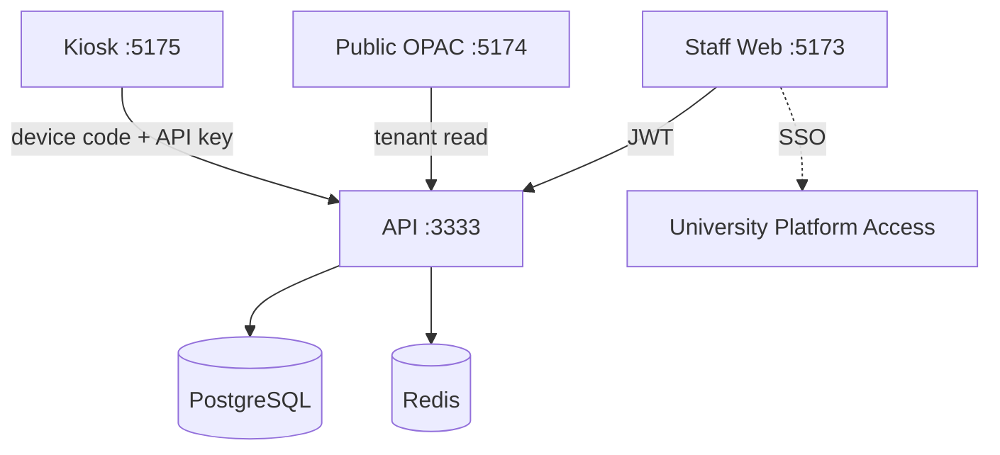

| Client | Write circulation? | Auth |
|--------|--------------------|------|
| Staff web | Yes | JWT + RBAC |
| Public OPAC | No | Tenant-scoped read |
| Kiosk | Yes (self-service) | Device credentials |

---

### 3. Staff circulation workflow

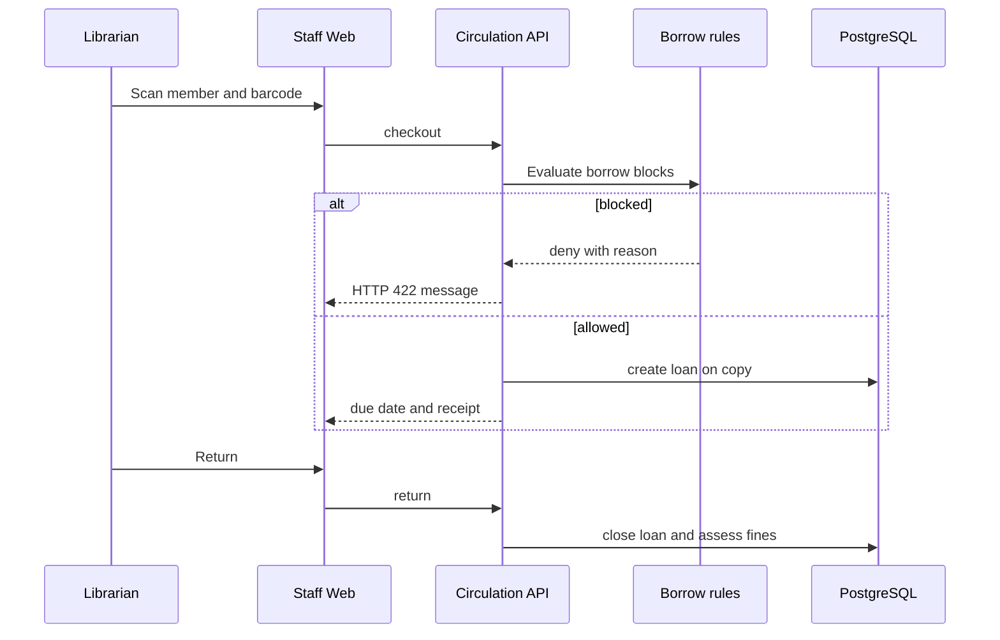

---

### 4. Borrow blocks (decision tree)

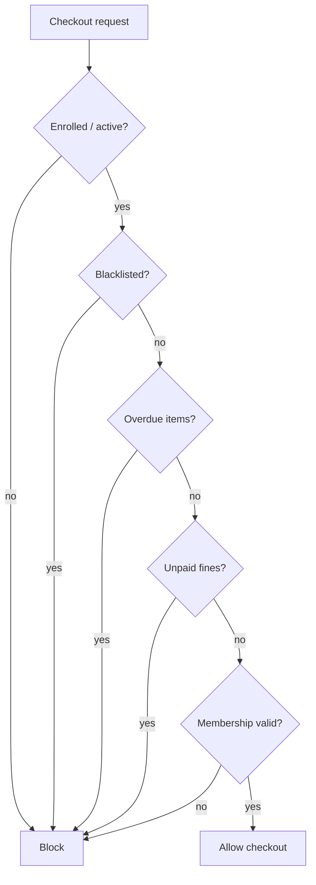

---

### 5. Kiosk self-service workflow

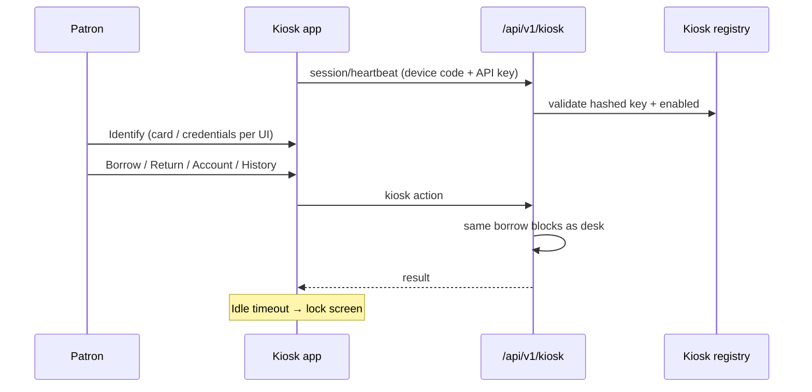

**Admin (`/kiosk-platform`):** register device, enable/disable, rotate key (plaintext once), view logs.

---

### 6. Public OPAC & queue board

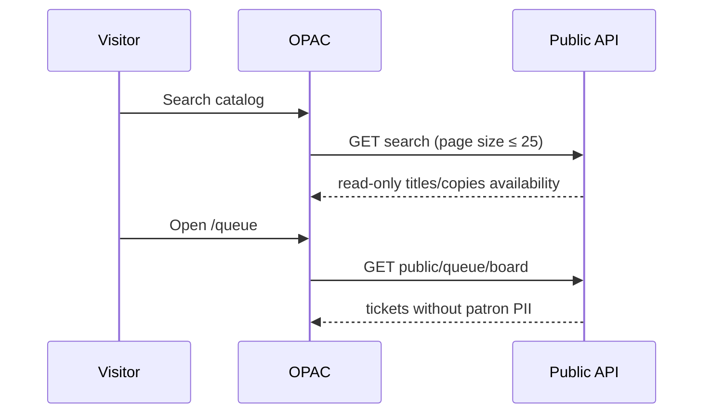

---

### 7. Reservation & renew

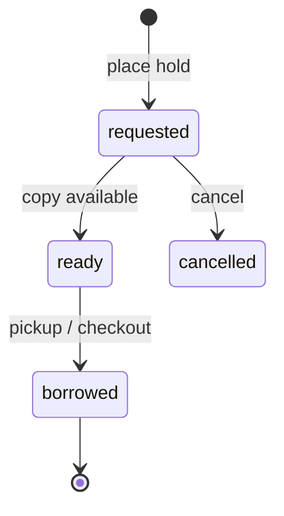

**Renew:** staff or portal/kiosk renew if policy allows and no blocks/holds conflict.

---

### 8. Mandated report generation

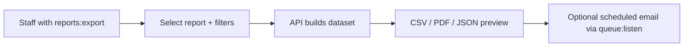

Reports: collections · borrowed · overdue · book_ledger · patron_ledger · charges.

---

### 9. Member sync (ARIS / UHRIS adapters)

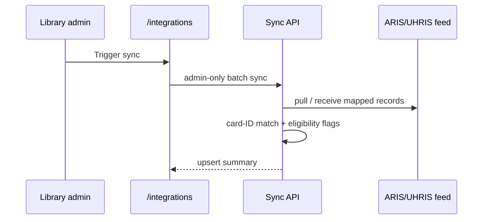

LDAP/SSO campus stubs return **501** until verified.

---

### 10. Error / edge cases

| Case | Expected behavior |
|------|-------------------|
| Public write to circulation | Denied |
| Invalid kiosk key | 401; no plaintext key recovery |
| Queue board | No patron identity exposed |
| RFID paths | Out of scope for this delivery |
| CORS missing OPAC/kiosk origin | Browser blocked |

---

**End of LLD — ULMIS**

---
