# USiS — Complete System Specification

| Field | Value |
|-------|-------|
| **Product** | USiS — University Student Information System |
| **Document type** | Complete System Specification (SRS + Architecture + Features + LLD) |
| **Date** | November 2026 |
| **Classification** | Proprietary |

## Document contents

1. System Requirements Specification (SRS)
2. Architecture Design
3. Features & Requirements
4. Low-Level Design (LLD) Workflows

---

## Part 1 — System Requirements Specification (SRS)

### University Student Information System (USiS)

| Field | Value |
|-------|-------|
| **Document ID** | SRS-USIS-001 |
| **Product** | USiS (University Student Information System) |
| **Repository** | `WMSU/wmsu-platform` (`apps/enrollment-web`, `apps/base-api` module `enrollment`) |
| **Version** | 1.0 |
| **Date** | November 2026 |
| **Classification** | Proprietary |

---

### 1. Introduction

#### 1.1 Purpose

This Software Requirements Specification defines functional and non-functional requirements for **USiS**, the comprehensive student information system managing the complete academic lifecycle from admissions through graduation — including student registration, enrollment, advising, scheduling, academic records, grade management, assessment coordination, clearance processing, faculty evaluation, and student support services.

#### 1.2 Scope

**In scope**

- Student self-service portal: profile management, enrollment workflow, schedule viewing, assessment/payment status, certificate of registration (COR), grades, academic history, support request submission
- Faculty portal: class rosters, grade encoding/submission, advising sessions, academic dashboards
- Registrar portal: applicant management, student admission, enrollment approval workflows, academic structure configuration (programs, curricula, sections), registration oversight, comprehensive reporting
- Office staff portals: Admissions (entrance exam coordination, applicant tracking), Office of Student Affairs (OSA: discipline, organizations, activities), Guidance (counseling sessions, assessments), Student Health Services (medical records, clearance), Scholarship Office (awards, disbursements, monitoring)
- Internal integration APIs for UFMS (assessment/payment handoff) and TORMS (grade projections)
- University Platform Access SSO integration (platform code `enrollment`)
- Queue management system for student services
- Faculty evaluation module with anonymous submissions
- Clearance certificate generation with public QR verification
- Academic calendar and enrollment window management
- Real-time enrollment conflict detection and waitlist management

**Out of scope**

- Public guest application forms and entrance exam delivery (hosted in Unified Access Portal `/apply*`)
- Financial cashiering, official receipt issuance, general ledger posting (**UFMS**)
- Transcript of Records (TOR) issuance and alumni registry management (**TORMS**)
- Library, document management, inventory operations (**ULMIS**, **UDMS**, **UIMS**)
- Learning management system and course content delivery (external LMS integration ready)

#### 1.3 Definitions

| Term | Definition |
|------|------------|
| **USiS** | University Student Information System — enrollment and academic lifecycle platform |
| **COR** | Certificate of Registration — official enrollment document issued to students |
| **Assessment** | Tuition and fee calculation prepared for an enrollment period and synchronized with UFMS for payment processing |
| **Role pack** | Collection of USiS permission codes mapped from University Platform Access Identity role |
| **Enrollment workflow** | State-based process from draft enrollment through advising, payment verification, registrar approval, to registered status |
| **Clearance graph** | Network of office-specific clearance requirements and status checks across university departments |
| **Grade projection** | Academic grade record synchronized from USiS to TORMS for transcript generation |
| **Section** | Class offering with instructor, schedule, room, and enrollment capacity |

#### 1.4 References

- `WMSU/wmsu-platform/README.md`
- `apps/web-portal/public/docs/USIS-Complete-Guide.html`
- `apps/web-portal/public/docs/USIS-API-Specs-Manual.html`
- University Platform Access Architecture (Identity integration)
- UFMS Internal API Specification (assessment handoff)
- TORMS Sync Protocol (grade projections)

---

### 2. Overall Description

#### 2.1 Product Perspective

USiS operates within the WMSU Campus Information System (CIS) modular architecture:

| Component | Technology | Role |
|-----------|------------|------|
| Enrollment web | React 19 + Vite | Multi-role portal UI (student, faculty, registrar, offices) |
| Base API enrollment module | AdonisJS 7 domain module | REST services at `/api/v1/enrollment/*` |
| Database | PostgreSQL schema `enrollment` | Academic system of record (SoR) |
| Identity provider | University Platform Access | Authentication, authorization, MFA, role management |
| Queue system | BullMQ + Redis | Background jobs (notifications, batch processing, reports) |

| Surface | Dev port | Production access |
|---------|----------|-------------------|
| Enrollment web | `http://127.0.0.1:5180` | `https://enrollment.wmsu.edu.ph` (example) |
| Base API | `http://127.0.0.1:3500` | `https://api.wmsu.edu.ph` |
| Identity API | `http://127.0.0.1:3411` | `https://auth.wmsu.edu.ph` |
| Portal launcher | `http://127.0.0.1:5173` | `https://portal.wmsu.edu.ph` |

**Health endpoint:** `GET /health` → `{ status: 'ok', service: 'base-api', module: 'enrollment' }`

#### 2.2 User Classes

| Role | Primary capabilities | Access level |
|------|---------------------|--------------|
| **Student** | View profile, enroll in courses, view schedules/grades, submit support requests, download COR, track payments, evaluate faculty | Own data only |
| **Faculty** | View assigned classes, encode/submit grades, conduct advising sessions, generate class reports, manage attendance | Assigned classes |
| **Adviser** | Review advisee enrollments, approve/recommend course selections, monitor academic progress | Assigned students |
| **Registrar** | Manage applicants, approve enrollments, configure academic structures, oversee all registrations, generate institutional reports | System-wide academic data |
| **Admissions Officer** | Manage entrance exam schedules, process applications, track admission workflows | Applicant records |
| **OSA Staff** | Manage student discipline, organization accreditations, event coordination | Student conduct records |
| **Guidance Counselor** | Schedule counseling sessions, maintain confidential records, issue clearances | Counseling records |
| **Health Services Staff** | Maintain medical records, manage health clearances, track vaccinations | Student health records |
| **Scholarship Officer** | Manage scholarship awards, track disbursements, monitor academic requirements | Scholarship records |
| **Cashier (read-only)** | View assessment and payment status for student services | Payment status queries |
| **Identity Administrator** | Full system access when `enrollment` platform granted | All USiS permissions |

Frontend permission checks provide user experience only; API enforces authorization on every authenticated route.

#### 2.3 Constraints

- Platform tile visibility requires Identity platform grant `enrollment`
- Menu and feature access controlled by role-specific permission packs
- Guest application forms redirect to Portal; USiS does not host public `/apply*` routes
- Payment verification strictly depends on UFMS internal APIs — USiS never invents "paid" status
- Grade system of record is USiS; TORMS consumes projections read-only
- Multi-campus university structure with hierarchical org units (University → Campus → College → Department → Program)
- Academic calendar windows control enrollment availability
- Real-time section capacity enforcement prevents over-enrollment
- Prerequisite and co-requisite validation enforced at enrollment time
- Assessment amount calculation follows configured fee schedules — amounts not hard-coded in SRS

#### 2.4 Assumptions

- University Platform Access Identity and Base API are running and reachable
- Demo/staging environments provision seed users, academic structures, and sample enrollments
- Fee schedules and assessment rules maintained in UFMS configuration — not independently managed in USiS
- Entrance exam scores and applicant data synced from Portal admission module
- Academic year and term structures configured before enrollment windows open
- Room and schedule data available for conflict checking
- Email/SMS notification infrastructure configured for enrollment alerts

---

### 3. Functional Requirements

#### 3.1 Authentication & Authorization

| ID | Requirement | Priority |
|----|-------------|----------|
| FR-AUTH-001 | System shall authenticate all users via University Platform Access SSO JWKS verification | Must |
| FR-AUTH-002 | System shall resolve user home path based on role packs (student → `/student`, registrar → `/registrar`, faculty → `/faculty`) | Must |
| FR-AUTH-003 | System shall enforce permission checks on every API endpoint using role-specific permission codes | Must |
| FR-AUTH-004 | System shall support MFA for privileged roles (registrar, office heads) when Identity enforces | Must |
| FR-AUTH-005 | System shall provide graceful error handling when Identity service unavailable | Must |

#### 3.2 Student Portal

| ID | Requirement | Priority |
|----|-------------|----------|
| FR-STU-001 | Students shall view and update demographic profile information with field-level validation | Must |
| FR-STU-002 | Students shall initiate enrollment for available academic terms within enrollment windows | Must |
| FR-STU-003 | Students shall search available sections by subject, instructor, schedule, and available seats | Must |
| FR-STU-004 | Students shall add sections to enrollment with real-time conflict detection (schedule, prerequisite) | Must |
| FR-STU-005 | Students shall view total units and enforcement of minimum/maximum load limits | Must |
| FR-STU-006 | Students shall submit enrollment for advising approval when required by program | Must |
| FR-STU-007 | Students shall view assessment amounts after enrollment submission with line-item breakdown | Must |
| FR-STU-008 | Students shall view payment status synchronized from UFMS without locally caching paid state | Must |
| FR-STU-009 | Students shall download PDF Certificate of Registration (COR) after enrollment approval | Must |
| FR-STU-010 | Students shall view class schedules in calendar and list formats with room/instructor details | Must |
| FR-STU-011 | Students shall view posted grades by term with GPA calculation | Must |
| FR-STU-012 | Students shall view academic history including all prior enrollments and grades | Must |
| FR-STU-013 | Students shall submit support requests to designated offices (OSA, Guidance, Health, Scholarship) | Must |
| FR-STU-014 | Students shall submit organization accreditation applications with file attachments | Should |
| FR-STU-015 | Students shall request student ID cards through portal | Should |
| FR-STU-016 | Students shall obtain queue tickets for office services | Should |
| FR-STU-017 | Students shall evaluate faculty anonymously during evaluation windows | Must |
| FR-STU-018 | Students shall view clearance status with office-by-office breakdown | Must |
| FR-STU-019 | Students shall download clearance certificates with QR verification codes | Must |

#### 3.3 Faculty Portal

| ID | Requirement | Priority |
|----|-------------|----------|
| FR-FAC-001 | Faculty shall view assigned class sections with enrollment rosters | Must |
| FR-FAC-002 | Faculty shall encode preliminary and final grades for enrolled students | Must |
| FR-FAC-003 | Faculty shall validate grade completeness before submission | Must |
| FR-FAC-004 | Faculty shall submit grades with digital signature/confirmation | Must |
| FR-FAC-005 | Faculty shall view grade submission history and status | Must |
| FR-FAC-006 | Faculty shall request grade corrections with justification after submission | Should |
| FR-FAC-007 | Faculty shall download class rosters as CSV and PDF | Must |
| FR-FAC-008 | Faculty shall mark student attendance by session | Should |
| FR-FAC-009 | Faculty shall view advisee list with enrollment status | Must |
| FR-FAC-010 | Faculty shall approve/reject advisee enrollment plans | Must |
| FR-FAC-011 | Faculty shall add advising notes and recommendations | Must |
| FR-FAC-012 | Faculty shall view evaluation summary results (anonymized) | Should |

#### 3.4 Registrar Portal

| ID | Requirement | Priority |
|----|-------------|----------|
| FR-REG-001 | Registrar shall view and search applicant records from admission pipeline | Must |
| FR-REG-002 | Registrar shall admit applicants with student number assignment and Identity account provisioning | Must |
| FR-REG-003 | Registrar shall view all student enrollments with filtering by term, program, status | Must |
| FR-REG-004 | Registrar shall approve or reject enrollment submissions with reason codes | Must |
| FR-REG-005 | Registrar shall perform batch enrollment approval with selection criteria | Should |
| FR-REG-006 | Registrar shall override enrollment business rules with audit logging | Must |
| FR-REG-007 | Registrar shall manage academic calendar with term dates and enrollment windows | Must |
| FR-REG-008 | Registrar shall configure programs, curricula, and courses | Must |
| FR-REG-009 | Registrar shall define section offerings with instructor, schedule, room, capacity | Must |
| FR-REG-010 | Registrar shall configure prerequisite and co-requisite rules | Must |
| FR-REG-011 | Registrar shall configure grading systems and policies by program | Must |
| FR-REG-012 | Registrar shall generate enrollment reports (summary by program, status, term) | Must |
| FR-REG-013 | Registrar shall generate grade reports (distribution, dean's list, deficiency) | Must |
| FR-REG-014 | Registrar shall export reports as CSV, Excel, and PDF | Must |
| FR-REG-015 | Registrar shall monitor grade submission status across all sections | Must |
| FR-REG-016 | Registrar shall initiate faculty evaluation periods by term | Must |
| FR-REG-017 | Registrar shall view aggregated evaluation results with filtering | Should |
| FR-REG-018 | Registrar shall manage waitlists and process seat releases | Should |

#### 3.5 Office Portals

| ID | Requirement | Priority |
|----|-------------|----------|
| FR-OFF-001 | Admissions officers shall schedule entrance exam sessions with capacity management | Must |
| FR-OFF-002 | Admissions officers shall view exam results and track admission decisions | Must |
| FR-OFF-003 | OSA staff shall manage student discipline cases with confidential records | Must |
| FR-OFF-004 | OSA staff shall process organization accreditation applications with approval workflow | Must |
| FR-OFF-005 | OSA staff shall coordinate campus events and student participation tracking | Should |
| FR-OFF-006 | Guidance counselors shall schedule confidential counseling sessions | Must |
| FR-OFF-007 | Guidance counselors shall maintain counseling records with restricted access | Must |
| FR-OFF-008 | Guidance counselors shall issue guidance clearances | Must |
| FR-OFF-009 | Health services staff shall maintain student medical records | Must |
| FR-OFF-010 | Health services staff shall track vaccinations and health requirements | Must |
| FR-OFF-011 | Health services staff shall issue health clearances | Must |
| FR-OFF-012 | Scholarship officers shall manage scholarship awards by type and amount | Must |
| FR-OFF-013 | Scholarship officers shall track disbursement schedules | Must |
| FR-OFF-014 | Scholarship officers shall monitor scholarship academic requirements | Must |
| FR-OFF-015 | All offices shall contribute to student clearance status graph | Must |

#### 3.6 Assessment & Payment Integration

| ID | Requirement | Priority |
|----|-------------|----------|
| FR-PAY-001 | System shall prepare tuition assessment documents from enrollment data | Must |
| FR-PAY-002 | System shall synchronize assessment data to UFMS via internal API | Must |
| FR-PAY-003 | System shall query UFMS for payment verification status | Must |
| FR-PAY-004 | System shall block enrollment progression when payment pending per business rules | Must |
| FR-PAY-005 | System shall never locally cache or invent "payment verified" status | Must |
| FR-PAY-006 | System shall display assessment line items from configured fee schedules | Must |
| FR-PAY-007 | System shall support installment payment plans tracked in UFMS | Should |

#### 3.7 Grade Management & TORMS Sync

| ID | Requirement | Priority |
|----|-------------|----------|
| FR-GRD-001 | System shall enforce grade encoding deadlines by academic calendar | Must |
| FR-GRD-002 | System shall validate grade values against configured grading system | Must |
| FR-GRD-003 | System shall calculate GPA using weighted credit hours | Must |
| FR-GRD-004 | System shall lock submitted grades from faculty modification | Must |
| FR-GRD-005 | System shall process registrar-approved grade corrections with audit trail | Must |
| FR-GRD-006 | System shall expose grade projection API for TORMS consumption | Must |
| FR-GRD-007 | System shall maintain grade history for all correction cycles | Must |

#### 3.8 Clearance Management

| ID | Requirement | Priority |
|----|-------------|----------|
| FR-CLR-001 | System shall maintain configurable clearance requirements by office and term | Must |
| FR-CLR-002 | System shall aggregate clearance status from multiple office systems | Must |
| FR-CLR-003 | System shall generate clearance certificates with QR verification tokens | Must |
| FR-CLR-004 | System shall provide public unauthenticated clearance verification endpoint | Must |
| FR-CLR-005 | System shall enforce clearance requirements for enrollment, graduation, and document issuance | Must |

#### 3.9 Faculty Evaluation

| ID | Requirement | Priority |
|----|-------------|----------|
| FR-EVL-001 | System shall configure evaluation periods by term with questionnaire templates | Must |
| FR-EVL-002 | System shall require students to evaluate enrolled faculty within evaluation window | Must |
| FR-EVL-003 | System shall enforce anonymous submission (no linkage to student identity in results) | Must |
| FR-EVL-004 | System shall aggregate evaluation responses with statistical summaries | Must |
| FR-EVL-005 | System shall restrict raw evaluation access to authorized administrators | Must |
| FR-EVL-006 | Faculty shall view anonymized aggregated results for own sections | Should |

#### 3.10 Reporting & Analytics

| ID | Requirement | Priority |
|----|-------------|----------|
| FR-RPT-001 | System shall generate enrollment summary reports by term, program, level | Must |
| FR-RPT-002 | System shall generate grade distribution reports by course and section | Must |
| FR-RPT-003 | System shall generate dean's list and academic probation lists | Must |
| FR-RPT-004 | System shall generate graduation candidate lists | Must |
| FR-RPT-005 | System shall export all reports in CSV, Excel, and PDF formats | Must |
| FR-RPT-006 | System shall log all report exports with user and timestamp for audit | Must |

---

### 4. External Interface Requirements

#### 4.1 Integration Interfaces

| Interface | Direction | Protocol | Purpose |
|-----------|-----------|----------|---------|
| University Platform Access | Inbound | OIDC/JWKS | SSO authentication, JWT verification, role resolution |
| UFMS Finance APIs | Outbound | REST+JSON | Assessment upsert, payment status query, clearance verification |
| TORMS Records APIs | Outbound | REST+JSON | Grade projection sync, academic history provision |
| Portal Admissions | Inbound | REST+JSON | Applicant data sync from entrance exam and application system |
| SMTP/SMS Gateway | Outbound | SMTP/HTTP | Enrollment notifications, grade alerts, deadline reminders |
| Object Storage | Outbound | S3-compatible | Document attachments (support requests, ID photos) |

#### 4.2 API Specifications

**Enrollment API base:** `/api/v1/enrollment/*`

**OpenAPI documentation:** Available at `/api/v1/enrollment/docs` (Swagger UI)

**Authentication:** Bearer JWT from University Platform Access in `Authorization` header

**Internal service routes:** `/api/v1/enrollment/internal/*` protected by `X-Service-Api-Key` header

#### 4.3 User Interface Requirements

- Responsive design supporting desktop (≥1280px), tablet (768-1023px), and mobile (360-767px)
- Browser compatibility: Chrome/Edge (latest 2 versions), Firefox (latest 2), Safari (latest 2)
- Accessibility: WCAG 2.1 Level AA conformance for student-facing flows
- Print-optimized views for COR, schedules, clearance certificates
- Real-time updates for enrollment conflicts and seat availability
- Progressive enhancement for offline-capable features (view cached COR/schedule)

---

### 5. Non-Functional Requirements

#### 5.1 Performance

| ID | Requirement | Target |
|----|-------------|--------|
| NFR-PERF-001 | API response time (p95) for standard queries | ≤ 2 seconds |
| NFR-PERF-002 | API response time (p95) for enrollment submission | ≤ 5 seconds |
| NFR-PERF-003 | Concurrent user support during enrollment peak | ≥ 500 active sessions |
| NFR-PERF-004 | Health check endpoint response time | ≤ 500 ms |
| NFR-PERF-005 | Report generation for standard queries | ≤ 10 seconds |
| NFR-PERF-006 | Real-time conflict detection during enrollment | ≤ 1 second |

#### 5.2 Scalability

| ID | Requirement |
|----|-------------|
| NFR-SCAL-001 | Support ≥15,000 enrolled students per term |
| NFR-SCAL-002 | Support ≥1,000 concurrent enrollment transactions |
| NFR-SCAL-003 | Horizontal scaling of API replicas without session affinity |
| NFR-SCAL-004 | Database read replicas for reporting queries |

#### 5.3 Security

| ID | Requirement |
|----|-------------|
| NFR-SEC-001 | TLS 1.2+ required for all client-server communication |
| NFR-SEC-002 | RBAC enforcement on every authenticated API endpoint |
| NFR-SEC-003 | Service-to-service communication via API keys for internal routes |
| NFR-SEC-004 | Sensitive data (grades, discipline, counseling) encrypted at rest |
| NFR-SEC-005 | Password policy and MFA enforcement delegated to Identity service |
| NFR-SEC-006 | CORS allowlist limited to authorized web client origins |
| NFR-SEC-007 | Rate limiting on public clearance verification endpoints |
| NFR-SEC-008 | Audit logging of privileged operations (enrollment override, grade corrections) |
| NFR-SEC-009 | Non-root container execution in production |
| NFR-SEC-010 | Regular dependency vulnerability scanning and patching |

#### 5.4 Reliability

| ID | Requirement |
|----|-------------|
| NFR-REL-001 | System availability ≥99.5% during enrollment periods |
| NFR-REL-002 | Automated database backups (daily incremental, weekly full) |
| NFR-REL-003 | Point-in-time recovery capability ≤15 minutes RPO |
| NFR-REL-004 | Documented disaster recovery procedures with quarterly drill |
| NFR-REL-005 | Graceful degradation when UFMS/TORMS temporarily unavailable |

#### 5.5 Maintainability

| ID | Requirement |
|----|-------------|
| NFR-MAIN-001 | Modular domain architecture with clear separation of concerns |
| NFR-MAIN-002 | Comprehensive API documentation (OpenAPI 3.0+) |
| NFR-MAIN-003 | Structured logging with correlation IDs for request tracing |
| NFR-MAIN-004 | Observability via Sentry/OpenTelemetry when configured |
| NFR-MAIN-005 | Database schema migrations versioned and reversible |

#### 5.6 Compliance

| ID | Requirement |
|----|-------------|
| NFR-COMP-001 | Data privacy compliance with RA 10173 (Data Privacy Act of 2012) |
| NFR-COMP-002 | Purpose limitation for student personal data collection |
| NFR-COMP-003 | Student consent management for optional data uses |
| NFR-COMP-004 | Data retention policies aligned with university records management |
| NFR-COMP-005 | FERPA-equivalent protections for educational records |

---

### 6. Verification Criteria

#### 6.1 Functional Verification

| Scenario | Expected result | Test type |
|----------|----------------|-----------|
| SSO login as student | Redirect to `/student` with profile data | Integration |
| SSO login as registrar | Redirect to `/registrar` with system dashboard | Integration |
| Enroll in section with prerequisite not met | Error message with missing prerequisite details | Unit |
| Enroll in section with schedule conflict | Error message with conflicting section details | Unit |
| Submit enrollment for advising | Status changes to "pending_advising" | Integration |
| Faculty encode grades | Grades saved; submission blocked until complete | E2E |
| Faculty submit grades | Grades locked; visible to student | E2E |
| Query UFMS for verified payment | Enrollment progresses to registrar approval | Integration |
| Query UFMS for pending payment | Enrollment blocked with payment required message | Integration |
| Generate clearance certificate | PDF with QR code generated | E2E |
| Verify valid clearance QR | Public endpoint returns valid clearance data | API test |
| Verify invalid clearance QR | Public endpoint returns not found / invalid | API test |
| Sync grades to TORMS | TORMS receives grade projections via internal API | Integration |

#### 6.2 Non-Functional Verification

| Scenario | Expected result | Test type |
|----------|----------------|-----------|
| 500 concurrent enrollments | p95 response time ≤5s, no errors | Load test |
| Unauthorized API access | HTTP 401/403 with error message | Security |
| Horizontal scaling test | Add replica; traffic balanced; session independent | Scalability |
| Database failover | Recovery within 15 minutes with data integrity | DR drill |

---

### 7. Document Control

| Version | Date | Description |
|---------|------|-------------|
| 1.0 | November 2026 | Complete System Specification from wmsu-platform enrollment module |

#### Related Design Documents

- **[USiS-Architecture.md](./USiS-Architecture.md)** — Architecture design (containers, domains, security, deployment)
- **[USiS-Features-Requirements.md](./USiS-Features-Requirements.md)** — Feature catalog + requirements traceability matrix
- **[USiS-LLD.md](./USiS-LLD.md)** — Low-level design workflows (enrollment, grading, advising, clearance, UFMS/TORMS integration)

**End of SRS — USiS**

---

## Part 2 — Architecture Design

### USiS — University Student Information System Architecture

| Field | Value |
|-------|-------|
| **Document ID** | AD-USIS-001 |
| **Product** | USiS |
| **Companions** | [USiS-SRS.md](./USiS-System-Specification.md) · [USiS-Features-Requirements.md](./USiS-Features-Requirements.md) · [USiS-LLD.md](./USiS-LLD.md) |
| **Date** | November 2026 |

---

### 1. Purpose

Architecture design for USiS within the WMSU Campus Information System modular monolith — covering system context, container architecture, domain module organization, security architecture, deployment topology, integration patterns, and quality attributes.

---

### 2. System Context

USiS operates within the CIS ecosystem, integrating with Identity, UFMS, TORMS, and the Portal:

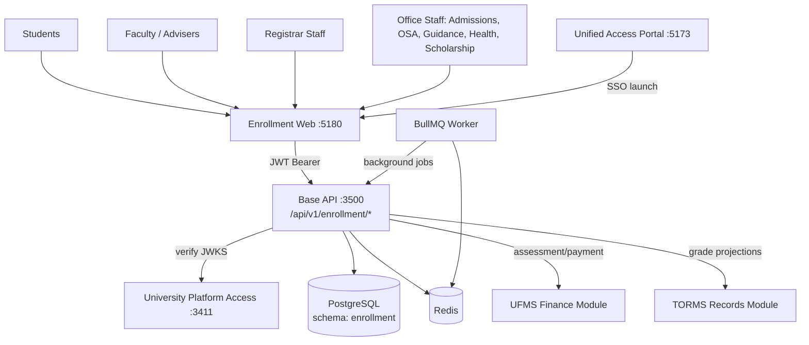

**Key relationships:**
- Students, faculty, and staff authenticate through Portal SSO, launching enrollment web
- All UI interactions flow through Base API enrollment module endpoints
- Identity service provides JWT verification and role resolution
- UFMS owns financial transactions; USiS queries payment status
- TORMS consumes grade projections; USiS remains academic SoR
- Background jobs (notifications, reports) processed by BullMQ worker

---

### 3. Container View

| Container | Technology | Port | Purpose |
|-----------|------------|------|---------|
| **Enrollment web** | React 19 + Vite | 5180 | Multi-role portal UI (student, faculty, registrar, offices) with responsive design |
| **Base API (enrollment module)** | AdonisJS 7 + Lucid ORM | 3500 | Domain services, controllers, validators, business logic |
| **PostgreSQL** | PostgreSQL 15+ | 5432 | Schema `enrollment` — academic system of record |
| **Redis** | Redis 7+ | 6379 | Session cache, queue backend, real-time data |
| **BullMQ Worker** | Node.js + BullMQ | N/A | Background job processor (notifications, reports, sync) |
| **University Platform Access** | Identity service | 3411 | Authentication, authorization, MFA, user management |
| **Unified Access Portal** | React SPA | 5173 | SSO launcher and guest admissions UI |

**Health monitoring:** `GET /health` returns service status and active module checks.

**Deployment notes:**
- Enrollment web statically served from CDN or Vite dev server
- Base API runs in containerized Node.js (non-root)
- Postgres uses schema isolation (`enrollment`) within shared `wmsu_cis` database
- Redis configured for persistence (AOF + RDB) for queue durability
- Worker deployed as separate container/process pool

---

### 4. Domain Module Architecture

USiS enrollment module organized by academic lifecycle domains:

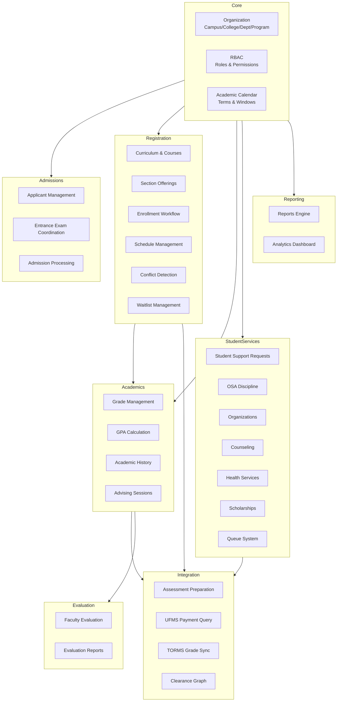

**Domain responsibilities:**

| Domain | Key entities | Services |
|--------|-------------|----------|
| **Core** | Organization, Campus, College, Department, Program, AcademicTerm, EnrollmentWindow | Org hierarchy, calendar management, RBAC |
| **Admissions** | Applicant, EntranceExam, AdmissionDecision | Applicant tracking, exam scheduling, admission workflow |
| **Registration** | Curriculum, Course, Section, Enrollment, EnrollmentItem, Prerequisite | Section offerings, enrollment workflow, conflict detection, waitlist |
| **Academics** | Grade, GradeSubmission, AcademicRecord, AdvisingSession | Grade encoding, submission, GPA calculation, advising |
| **Student Services** | SupportRequest, DisciplineCase, Organization, CounselingSession, HealthRecord, Scholarship | Multi-office student support, clearance contribution |
| **Integration** | Assessment, PaymentStatus, GradeProjection, ClearanceItem | UFMS/TORMS handoff, clearance aggregation |
| **Evaluation** | EvaluationPeriod, EvaluationResponse, EvaluationSummary | Anonymous faculty evaluation |
| **Reporting** | Report, ReportExport, Dashboard | Enrollment/grade reports, analytics |

---

### 5. Security Architecture

#### 5.1 Authentication Flow

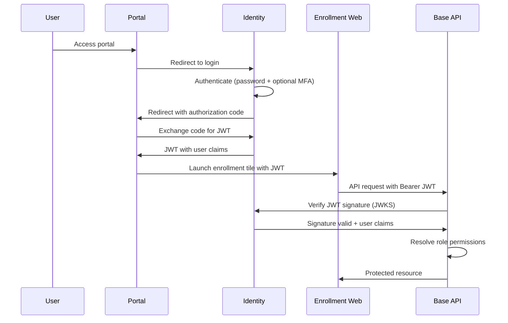

**Security controls:**

| Layer | Control | Implementation |
|-------|---------|----------------|
| Transport | TLS 1.2+ | Reverse proxy/ingress termination |
| Authentication | OIDC/JWT | Identity service RS256 tokens |
| Authorization | RBAC | Permission checks on every API endpoint |
| API protection | Rate limiting | Redis-backed rate limiter |
| Secrets | Environment variables | Never in codebase or client |
| Database | Schema isolation | `enrollment` schema, role-based PG access |
| Internal APIs | Service keys | `X-Service-Api-Key` header validation |
| Public endpoints | Rate limiting | Clearance verification endpoint |

#### 5.2 Permission Model

USiS defines granular permissions mapped to Identity roles:

**Permission categories:**
- `enrollment.*` — Enrollment CRUD and approval
- `grades.*` — Grade encoding, submission, corrections
- `students.*` — Student profile and records
- `sections.*` — Section management
- `advising.*` — Advising workflows
- `offices.*` — Office-specific permissions (OSA, Guidance, Health, Scholarship)
- `reports.*` — Report generation and export
- `evaluation.*` — Faculty evaluation management

**Role examples:**
- `student` role → `enrollment.own`, `grades.view_own`, `clearance.view_own`
- `faculty` role → `grades.encode`, `grades.submit`, `advising.manage`
- `registrar` role → `enrollment.approve`, `students.manage`, `reports.export`
- `osa_staff` role → `offices.osa.*`, `students.discipline`

---

### 6. Data Architecture

#### 6.1 Schema Organization

PostgreSQL schema **`enrollment`** contains all USiS tables:

**Core tables:**
- `organizations`, `campuses`, `colleges`, `departments`, `programs`
- `academic_terms`, `enrollment_windows`
- `users` (Identity reference cache)

**Academic structure:**
- `curricula`, `courses`, `prerequisites`, `sections`
- `instructors`, `room_schedules`

**Enrollment lifecycle:**
- `enrollments`, `enrollment_items`, `enrollment_history`
- `waitlists`

**Grades:**
- `grades`, `grade_submissions`, `grade_history`
- `academic_records` (computed)

**Student services:**
- `support_requests`, `discipline_cases`, `organizations`
- `counseling_sessions`, `health_records`, `scholarships`

**Integration:**
- `assessments`, `payment_status_cache` (UFMS)
- `grade_projections` (TORMS)
- `clearance_items`, `clearance_certificates`

**Evaluation:**
- `evaluation_periods`, `evaluation_responses`

**Reporting:**
- `report_exports` (audit log)

#### 6.2 Migration Strategy

- Migrations tracked in `enrollment.uims_adonis_schema` table
- Schema changes deployed via `node ace migration:run`
- Rollback capability for reversible migrations
- Data seeds for demo/staging environments

---

### 7. Deployment Topology

#### 7.1 Production Architecture

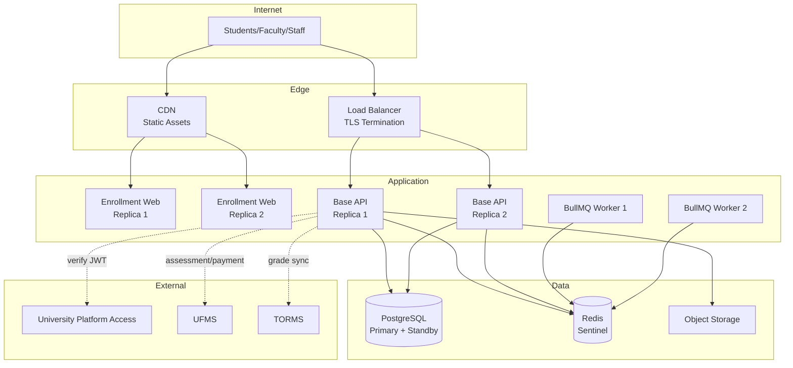

**Sizing guidance (500 concurrent users):**
- API: 2–3 replicas, 2 vCPU / 4 GB RAM each
- Worker: 2 replicas, 1 vCPU / 2 GB RAM each
- PostgreSQL: 4 vCPU / 16 GB RAM, managed service preferred
- Redis: 2 vCPU / 8 GB RAM, Sentinel for HA

**Scalability:**
- Stateless API enables horizontal scaling
- Read replicas for reporting queries
- CDN for static assets reduces origin load

#### 7.2 Local Development

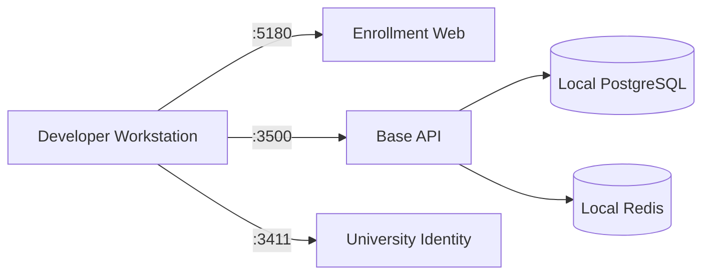

**Local ports:**
- Portal: 5173
- Identity: 3411
- Base API: 3500
- Enrollment web: 5180
- Finance web: 5182 (UFMS)
- Records web: 5181 (TORMS)

**Infrastructure:** Docker Compose for PostgreSQL, Redis, MinIO

---

### 8. Integration Architecture

#### 8.1 Internal Service Communication

**UFMS Integration (Financial):**
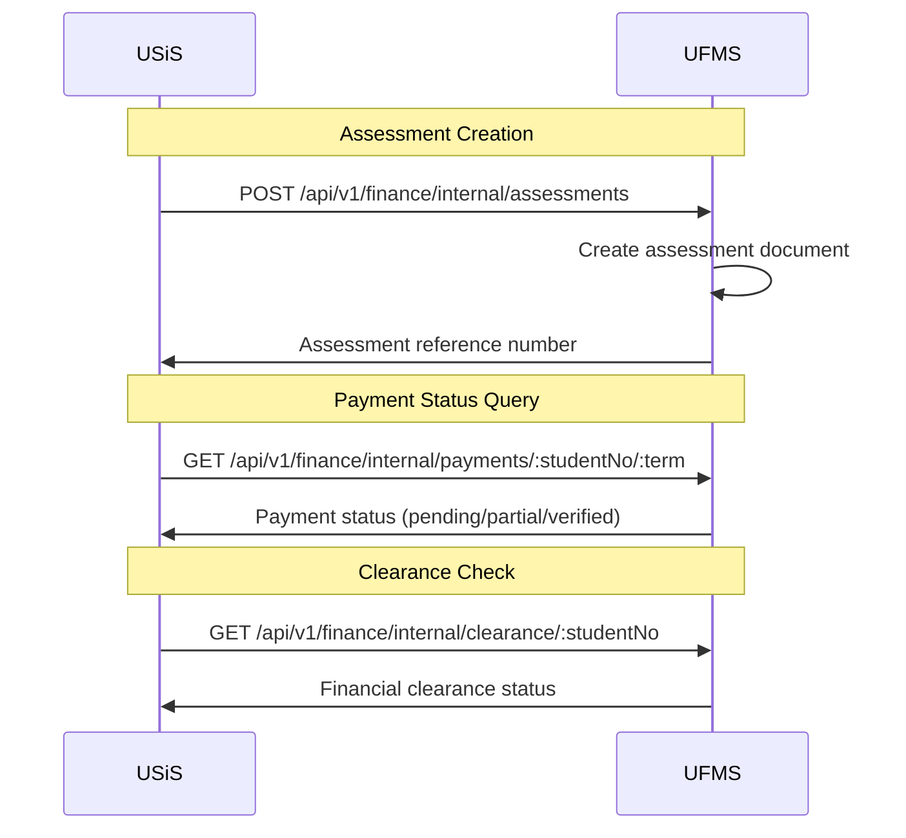

**TORMS Integration (Academic Records):**
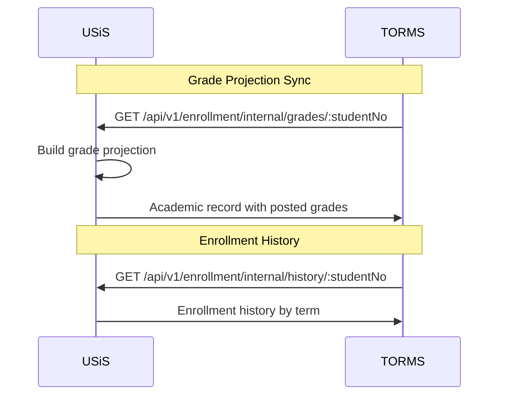

**Service-to-service security:**
- Internal routes protected by `X-Service-Api-Key` header
- Service keys hashed in database, plaintext only in secure config
- Browser clients never receive service keys

#### 8.2 External System Integration

| System | Protocol | Pattern | Frequency |
|--------|----------|---------|-----------|
| Portal Admissions | REST API | Applicant sync | Real-time webhook + nightly batch |
| SMTP Gateway | SMTP | Email notifications | Event-driven |
| SMS Gateway | HTTP API | SMS alerts | Event-driven |
| Object Storage (S3) | S3 API | File uploads | On-demand |

---

### 9. Quality Attributes

#### 9.1 Performance

**Optimization strategies:**
- Database indexing on frequently queried fields (student_no, term, status)
- Query optimization with Lucid eager loading to prevent N+1
- Redis caching for static reference data (programs, courses)
- Lazy loading of enrollment web routes
- Paginated API responses (default 25, max 100 items)
- Background jobs for heavy operations (report generation, bulk notifications)

**Monitoring:**
- APM (Sentry/OpenTelemetry) for request tracing
- Database slow query logging
- API endpoint metrics (response time, error rate)

#### 9.2 Scalability

**Horizontal scaling:**
- Stateless API design (session state in Redis/JWT)
- Load balancer with health check probes
- Database connection pooling (PgBouncer)
- Queue-based job processing prevents request timeout

**Vertical limits:**
- Single PostgreSQL instance supports 15,000 students (tested)
- Read replicas for reporting offload main database

#### 9.3 Reliability

**Failure handling:**
- Graceful degradation when UFMS/TORMS unavailable (cached status, error messaging)
- Retry logic with exponential backoff for transient failures
- Circuit breaker pattern for external service calls
- Database transaction management with rollback on error

**Data integrity:**
- Foreign key constraints enforce referential integrity
- Enrollment business rules validated in service layer
- Idempotency keys for critical operations (enrollment submission)
- Audit trail for all state changes

#### 9.4 Maintainability

**Code organization:**
- Domain-driven design with clear boundaries
- Service layer abstraction separates business logic from controllers
- Shared validation schemas (Vine validators)
- Comprehensive OpenAPI documentation

**Operational:**
- Structured JSON logging with correlation IDs
- Feature flags for gradual rollout
- Blue-green deployment support
- Automated schema migration in CI/CD

#### 9.5 Compliance

**Data privacy (RA 10173):**
- Purpose limitation for personal data collection
- Access controls restrict PII to authorized roles
- Data retention policies configurable
- Student consent management for optional uses

**Academic records protection:**
- FERPA-equivalent access restrictions
- Audit logging of grade access and modifications
- Secure transmission of transcripts to TORMS
- Public clearance verification without exposing PII

---

**End of Architecture Design — USiS**

---

## Part 3 — Features & Requirements

### USiS — University Student Information System Features & Requirements

| Field | Value |
|-------|-------|
| **Document ID** | FEAT-USIS-001 |
| **Product** | USiS |
| **Companions** | [USiS-SRS.md](./USiS-System-Specification.md) · [USiS-LLD.md](./USiS-LLD.md) |
| **Date** | November 2026 |

---

### 1. Feature Summary

USiS provides comprehensive student information management across the complete academic lifecycle:

| Area | Features | Status |
|------|----------|--------|
| **Authentication** | University Platform Access SSO integration, role-based routing | Delivered |
| **Student Portal** | Profile, enrollment workflow, schedule, assessments, COR, grades, history | Delivered |
| **Faculty Portal** | Class rosters, grade encoding/submission, advising, reports | Delivered |
| **Registrar Portal** | Applicant management, enrollment approval, academic configuration, reports | Delivered |
| **Office Portals** | Admissions, OSA, Guidance, Health Services, Scholarship management | Delivered |
| **Assessment Integration** | UFMS assessment/payment handoff with real-time status sync | Delivered |
| **Grade Management** | Encode, submit, corrections, GPA calculation, TORMS sync | Delivered |
| **Clearance System** | Multi-office clearance graph, certificate generation, QR verification | Delivered |
| **Faculty Evaluation** | Anonymous evaluation, aggregated results | Delivered |
| **Reporting** | Enrollment, grade, clearance, scholarship reports with export | Delivered |

---

### 2. Feature Catalog

| Feature ID | Feature | Description | Priority | Actors |
|------------|---------|-------------|----------|--------|
| **F-AUTH-01** | SSO Authentication | University Platform Access OIDC/JWT authentication | Must | All |
| **F-AUTH-02** | Role-based Routing | Automatic home path resolution (student/faculty/registrar/office) | Must | All |
| **F-AUTH-03** | Permission Enforcement | Granular permission checks on all API endpoints | Must | System |
| **F-STU-01** | Student Profile | View/edit demographic info, contact details, emergency contacts | Must | Student |
| **F-STU-02** | Enrollment Workflow | Search sections, add to cart, conflict detection, submit for approval | Must | Student |
| **F-STU-03** | Schedule Viewing | Calendar and list views of enrolled sections with details | Must | Student |
| **F-STU-04** | Assessment View | Line-item assessment breakdown from UFMS integration | Must | Student |
| **F-STU-05** | Payment Status | Real-time UFMS payment verification status display | Must | Student |
| **F-STU-06** | COR Generation | Download PDF Certificate of Registration after approval | Must | Student |
| **F-STU-07** | Grade Viewing | Posted grades by term with GPA calculation | Must | Student |
| **F-STU-08** | Academic History | Complete enrollment and grade history across all terms | Must | Student |
| **F-STU-09** | Support Requests | Submit help requests to offices (OSA, Guidance, Health, Scholarship) | Must | Student |
| **F-STU-10** | Organization Applications | Apply for student organization accreditation with attachments | Should | Student |
| **F-STU-11** | ID Card Request | Digital student ID request submission | Should | Student |
| **F-STU-12** | Queue Tickets | Obtain service queue numbers for office visits | Should | Student |
| **F-STU-13** | Faculty Evaluation | Anonymous faculty evaluation during evaluation windows | Must | Student |
| **F-STU-14** | Clearance Status | View office-by-office clearance breakdown | Must | Student |
| **F-STU-15** | Clearance Certificate | Download clearance certificate with QR verification code | Must | Student |
| **F-FAC-01** | Class Rosters | View enrolled students in assigned sections | Must | Faculty |
| **F-FAC-02** | Grade Encoding | Enter preliminary and final grades with validation | Must | Faculty |
| **F-FAC-03** | Grade Submission | Submit completed grades with digital confirmation | Must | Faculty |
| **F-FAC-04** | Grade History | View submission history and status by section | Must | Faculty |
| **F-FAC-05** | Grade Corrections | Request corrections after submission with justification | Should | Faculty |
| **F-FAC-06** | Roster Export | Download class rosters as CSV and PDF | Must | Faculty |
| **F-FAC-07** | Attendance Tracking | Mark student attendance by session | Should | Faculty |
| **F-FAC-08** | Advisee Management | View assigned advisees with enrollment status | Must | Faculty/Adviser |
| **F-FAC-09** | Advising Approval | Approve or recommend modifications to advisee enrollments | Must | Faculty/Adviser |
| **F-FAC-10** | Advising Notes | Add recommendations and session notes | Must | Faculty/Adviser |
| **F-FAC-11** | Evaluation Results | View anonymized aggregated evaluation results | Should | Faculty |
| **F-REG-01** | Applicant Management | View/search applicants from admission pipeline | Must | Registrar |
| **F-REG-02** | Student Admission | Admit applicants with student number and Identity provisioning | Must | Registrar |
| **F-REG-03** | Enrollment Review | View all enrollments with advanced filtering | Must | Registrar |
| **F-REG-04** | Enrollment Approval | Approve/reject enrollments with reason codes | Must | Registrar |
| **F-REG-05** | Batch Approval | Process multiple enrollments with criteria selection | Should | Registrar |
| **F-REG-06** | Business Rule Override | Override system rules with audit logging | Must | Registrar |
| **F-REG-07** | Academic Calendar | Configure terms, enrollment windows, deadlines | Must | Registrar |
| **F-REG-08** | Program Management | Define programs, curricula, courses | Must | Registrar |
| **F-REG-09** | Section Management | Create sections with instructor, schedule, room, capacity | Must | Registrar |
| **F-REG-10** | Prerequisite Rules | Configure prerequisite and co-requisite chains | Must | Registrar |
| **F-REG-11** | Grading System Config | Define grading policies and scales by program | Must | Registrar |
| **F-REG-12** | Enrollment Reports | Summary by program, status, term with export | Must | Registrar |
| **F-REG-13** | Grade Reports | Distribution, dean's list, probation lists | Must | Registrar |
| **F-REG-14** | Report Export | CSV, Excel, PDF export for all reports | Must | Registrar |
| **F-REG-15** | Grade Monitoring | Track submission status across sections | Must | Registrar |
| **F-REG-16** | Evaluation Management | Configure evaluation periods and questionnaires | Must | Registrar |
| **F-REG-17** | Evaluation Reports | View aggregated results with filtering | Should | Registrar |
| **F-REG-18** | Waitlist Management | Manage waitlists and seat releases | Should | Registrar |
| **F-ADM-01** | Entrance Exam Scheduling | Schedule exam sessions with capacity management | Must | Admissions |
| **F-ADM-02** | Exam Results | View exam scores and track admission decisions | Must | Admissions |
| **F-OSA-01** | Discipline Management | Manage discipline cases with confidential records | Must | OSA Staff |
| **F-OSA-02** | Organization Accreditation | Process student organization applications | Must | OSA Staff |
| **F-OSA-03** | Event Coordination | Manage campus events and participation tracking | Should | OSA Staff |
| **F-GDN-01** | Counseling Scheduling | Schedule confidential counseling sessions | Must | Guidance |
| **F-GDN-02** | Counseling Records | Maintain restricted-access counseling notes | Must | Guidance |
| **F-GDN-03** | Guidance Clearance | Issue guidance clearances | Must | Guidance |
| **F-HLT-01** | Medical Records | Maintain student health records | Must | Health Services |
| **F-HLT-02** | Vaccination Tracking | Track immunization requirements | Must | Health Services |
| **F-HLT-03** | Health Clearance | Issue health clearances | Must | Health Services |
| **F-SCH-01** | Scholarship Awards | Manage scholarship types and awards | Must | Scholarship |
| **F-SCH-02** | Disbursement Tracking | Track scholarship disbursement schedules | Must | Scholarship |
| **F-SCH-03** | Academic Requirements | Monitor scholarship academic standing requirements | Must | Scholarship |
| **F-INT-01** | Assessment Preparation | Generate tuition assessments from enrollment data | Must | System |
| **F-INT-02** | UFMS Assessment Sync | Push assessments to UFMS via internal API | Must | System |
| **F-INT-03** | Payment Status Query | Real-time UFMS payment verification | Must | System |
| **F-INT-04** | TORMS Grade Sync | Expose grade projections for TORMS consumption | Must | System |
| **F-INT-05** | Clearance Aggregation | Multi-system clearance status consolidation | Must | System |
| **F-CLR-01** | Clearance Requirements | Configure clearance items by office and term | Must | System |
| **F-CLR-02** | Clearance Certificate** | Generate certificates with QR codes | Must | System |
| **F-CLR-03** | Public Verification | Unauthenticated clearance verification endpoint | Must | Public |
| **F-EVL-01** | Evaluation Configuration | Setup periods, questionnaires, response scales | Must | Registrar |
| **F-EVL-02** | Evaluation Submission | Students evaluate faculty anonymously | Must | Student |
| **F-EVL-03** | Result Anonymization | Ensure no student-response linkage in results | Must | System |
| **F-EVL-04** | Statistical Aggregation | Compute evaluation statistics by section/faculty | Must | System |
| **F-RPT-01** | Enrollment Summary | Reports by term, program, level | Must | Registrar |
| **F-RPT-02** | Grade Distribution | Reports by course and section | Must | Registrar |
| **F-RPT-03** | Dean's List | Academic honor roll generation | Must | Registrar |
| **F-RPT-04** | Graduation Candidates | Eligible graduates by term | Must | Registrar |
| **F-RPT-05** | Report Export Audit | Log all report exports for compliance | Must | System |

---

### 3. Requirements Traceability Matrix

#### 3.1 Functional Requirements Mapping

| Requirement ID | Requirement | Related Features | Priority | Implementation Status |
|----------------|-------------|------------------|----------|----------------------|
| FR-AUTH-001 | SSO via University Platform Access JWKS | F-AUTH-01 | Must | Delivered |
| FR-AUTH-002 | Role-based home path resolution | F-AUTH-02 | Must | Delivered |
| FR-AUTH-003 | Permission enforcement on all endpoints | F-AUTH-03 | Must | Delivered |
| FR-AUTH-004 | MFA support for privileged roles | F-AUTH-01 | Must | Identity-delegated |
| FR-AUTH-005 | Graceful Identity service degradation | F-AUTH-01 | Must | Delivered |
| FR-STU-001..019 | Student portal features | F-STU-01..15 | Must/Should | Delivered |
| FR-FAC-001..012 | Faculty portal features | F-FAC-01..11 | Must/Should | Delivered |
| FR-REG-001..018 | Registrar portal features | F-REG-01..18 | Must/Should | Delivered |
| FR-OFF-001..015 | Office portal features | F-ADM-01..02, F-OSA-01..03, F-GDN-01..03, F-HLT-01..03, F-SCH-01..03 | Must/Should | Delivered |
| FR-PAY-001..007 | Assessment/payment integration | F-INT-01..03 | Must/Should | Delivered |
| FR-GRD-001..007 | Grade management and sync | F-FAC-02..05, F-INT-04 | Must | Delivered |
| FR-CLR-001..005 | Clearance management | F-CLR-01..03, F-INT-05 | Must | Delivered |
| FR-EVL-001..006 | Faculty evaluation | F-EVL-01..04, F-STU-13, F-FAC-11 | Must/Should | Delivered |
| FR-RPT-001..006 | Reporting and analytics | F-RPT-01..05 | Must | Delivered |

#### 3.2 Non-Functional Requirements Mapping

| NFR Category | Requirement ID | Related Features | Implementation Approach |
|--------------|----------------|------------------|------------------------|
| Performance | NFR-PERF-001..006 | All features | Database indexing, caching, query optimization, background jobs |
| Scalability | NFR-SCAL-001..004 | All features | Horizontal API scaling, read replicas, stateless design |
| Security | NFR-SEC-001..010 | F-AUTH-*, F-INT-* | TLS, RBAC, rate limiting, encryption, audit logging |
| Reliability | NFR-REL-001..005 | All features | HA deployment, backups, DR procedures, graceful degradation |
| Maintainability | NFR-MAIN-001..005 | All features | Modular architecture, OpenAPI docs, structured logging, versioned migrations |
| Compliance | NFR-COMP-001..005 | Student data features | RA 10173 compliance, purpose limitation, consent management, FERPA-equivalent |

#### 3.3 Source Requirements Traceability

**WMSU TOR VI.E.1 compliance matrix:**

| TOR Requirement | Feature IDs | Implementation Notes | Compliance Status |
|-----------------|-------------|---------------------|-------------------|
| Applicant management and admissions | F-REG-01, F-REG-02, F-ADM-01, F-ADM-02 | Portal handles entrance exam delivery; USiS receives results | Delivered |
| Student registration and enrollment | F-STU-02, F-REG-03, F-REG-04 | Complete workflow with advising, payment, approval gates | Delivered |
| Subject/section scheduling | F-REG-09, F-STU-03, F-FAC-01 | Real-time conflict detection, capacity enforcement | Delivered |
| Grade encoding and management | F-FAC-02, F-FAC-03, F-REG-15 | Faculty encode, registrar monitors, TORMS sync | Delivered |
| Student academic records | F-STU-07, F-STU-08, F-INT-04 | USiS is SoR; TORMS consumes projections | Delivered |
| Assessment and payment coordination | F-INT-01, F-INT-02, F-INT-03 | UFMS integration; no local payment invention | Delivered |
| Clearance processing | F-CLR-01, F-CLR-02, F-CLR-03, F-STU-14, F-STU-15 | Multi-office graph, QR verification | Delivered |
| Faculty evaluation | F-EVL-01, F-EVL-02, F-STU-13 | Anonymous submissions, aggregated results | Delivered |
| Student support services | F-STU-09, F-OSA-01..03, F-GDN-01..03, F-HLT-01..03, F-SCH-01..03 | Multi-office portal with permission packs | Delivered |
| Institutional reporting | F-RPT-01..05, F-REG-12..14 | CSV/Excel/PDF export with audit logging | Delivered |

**Deferred/Out of scope:**
- Public guest application UI → Unified Access Portal responsibility
- Financial transaction processing → UFMS responsibility
- TOR issuance and alumni registry → TORMS responsibility
- Library, documents, inventory → ULMIS, UDMS, UIMS

---

### 4. Non-Functional Requirements Summary

#### 4.1 Performance Targets

| Metric | Target | Measurement |
|--------|--------|-------------|
| API response (p95) | ≤2s standard, ≤5s enrollment | APM monitoring |
| Concurrent users | ≥500 active sessions | Load testing |
| Health check | ≤500ms | Uptime monitoring |
| Report generation | ≤10s standard | Query optimization |

#### 4.2 Security Controls

| Control | Implementation | Verification |
|---------|----------------|-------------|
| TLS enforcement | Reverse proxy/ingress | SSL Labs scan |
| RBAC | Permission checks on all endpoints | Automated security tests |
| Rate limiting | Redis-backed rate limiter | Load test verification |
| Audit logging | Structured logs for privileged ops | Log review |

#### 4.3 Reliability Measures

| Measure | Target | Method |
|---------|--------|--------|
| Availability | ≥99.5% during enrollment | SLA monitoring |
| Backup frequency | Daily incremental, weekly full | Automated backup verification |
| RPO | ≤15 minutes | Tested recovery procedures |
| Graceful degradation | UFMS/TORMS outage handling | Circuit breaker testing |

---

### 5. Actors & Feature Access

| Actor | Primary Features | Restricted Features |
|-------|------------------|---------------------|
| **Student** | F-STU-01..15, F-EVL-02 | Own data only; cannot view other students |
| **Faculty** | F-FAC-01..11 | Assigned classes only |
| **Adviser** | F-FAC-08..10 | Assigned advisees only |
| **Registrar** | F-REG-01..18, F-RPT-01..05 | System-wide academic data |
| **Admissions Officer** | F-ADM-01, F-ADM-02 | Applicant records |
| **OSA Staff** | F-OSA-01..03 | Student conduct records |
| **Guidance Counselor** | F-GDN-01..03 | Confidential counseling data |
| **Health Services** | F-HLT-01..03 | Student health records |
| **Scholarship Officer** | F-SCH-01..03 | Scholarship data |
| **Public** | F-CLR-03 | Clearance verification only |
| **System (Background)** | F-INT-01..05, F-RPT-05 | Automated integrations |

---

**End of Features & Requirements — USiS**

---

## Part 4 — Low-Level Design (LLD) Workflows

### USiS — University Student Information System Low-Level Design

| Field | Value |
|-------|-------|
| **Document ID** | LLD-USIS-001 |
| **Product** | USiS |
| **Companion** | [USiS-SRS.md](./USiS-System-Specification.md) |
| **Date** | November 2026 |

---

### 1. Purpose

This Low-Level Design documents critical workflows for USiS enrollment, grade management, advising, assessment/payment integration, clearance processing, and faculty evaluation — providing sequence diagrams, state machines, and implementation details for development and QA teams.

---

### 2. System Context (Multi-Portal Architecture)

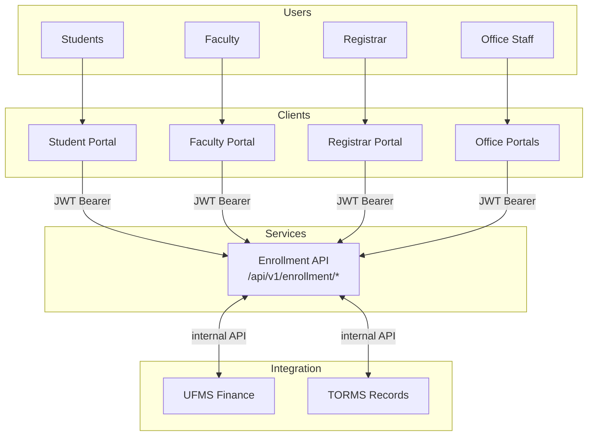

**Client-specific routes:**
- Student: `/student/*`
- Faculty: `/faculty/*`
- Registrar: `/registrar/*`
- Offices: `/offices/:officeType/*`

---

### 3. Student Enrollment Workflow

#### 3.1 Enrollment State Machine

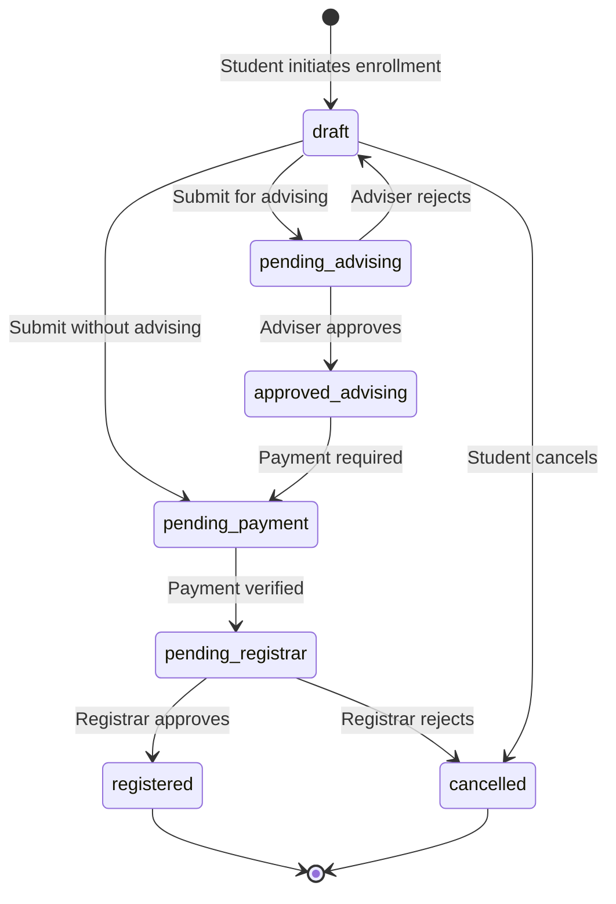

#### 3.2 Enrollment Submission Sequence

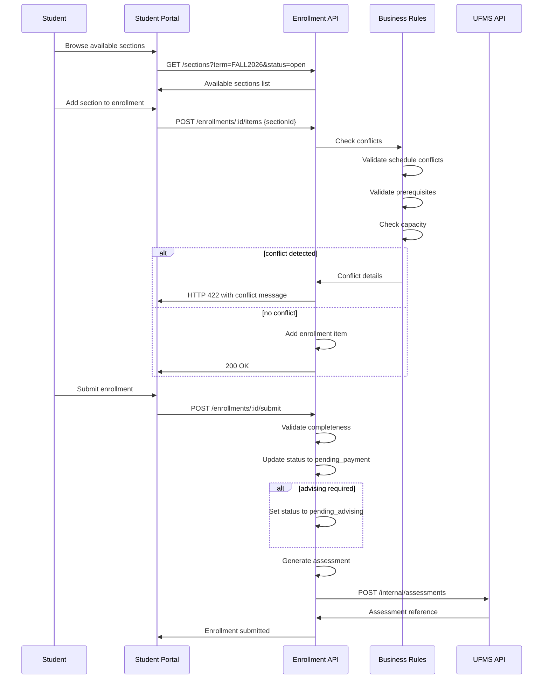

#### 3.3 Conflict Detection Logic

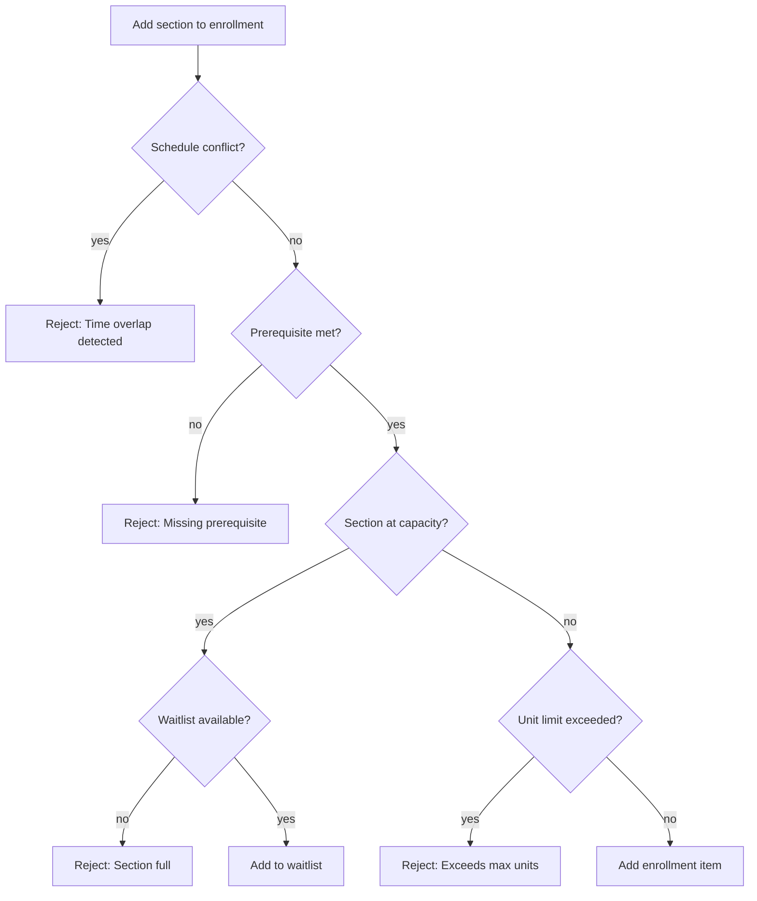

---

### 4. Grade Management Workflow

#### 4.1 Faculty Grade Submission

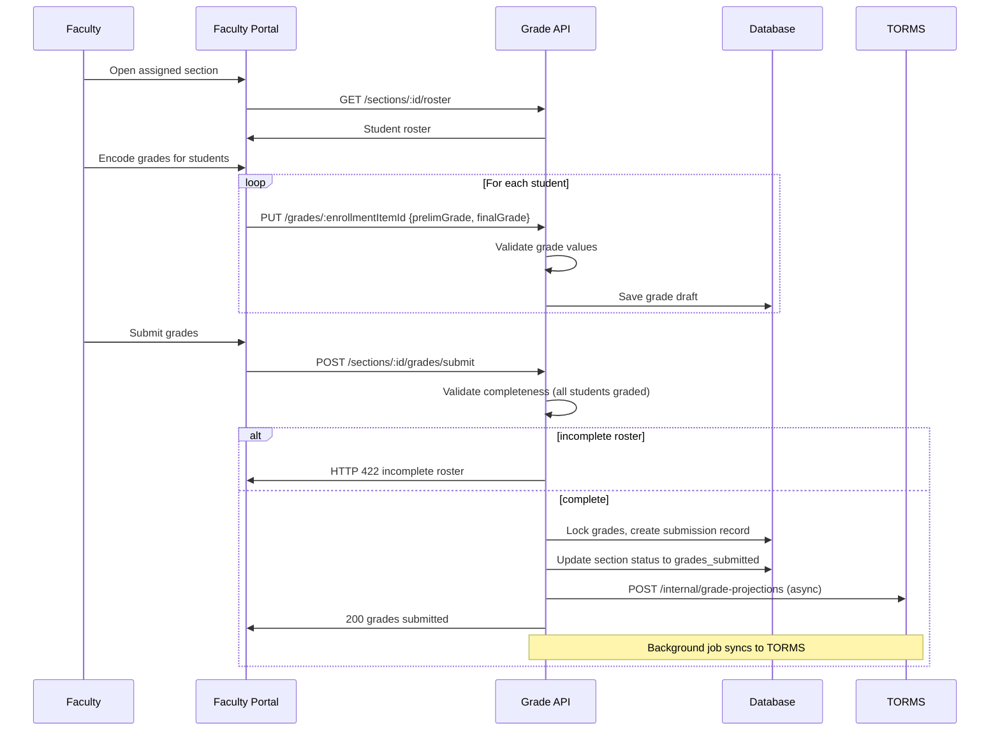

#### 4.2 Grade Correction Workflow

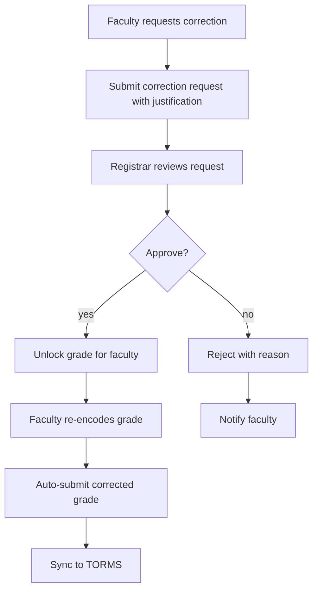

---

### 5. Advising Workflow

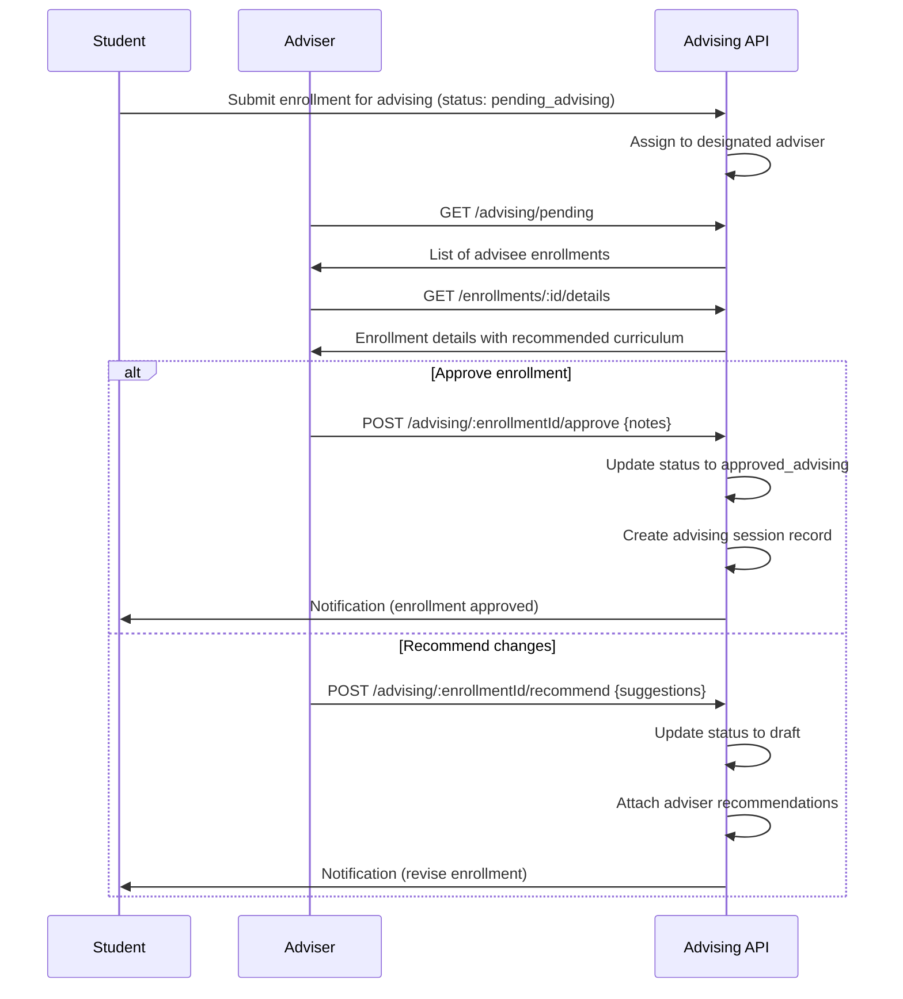

---

### 6. Assessment & Payment Integration

#### 6.1 Assessment Preparation

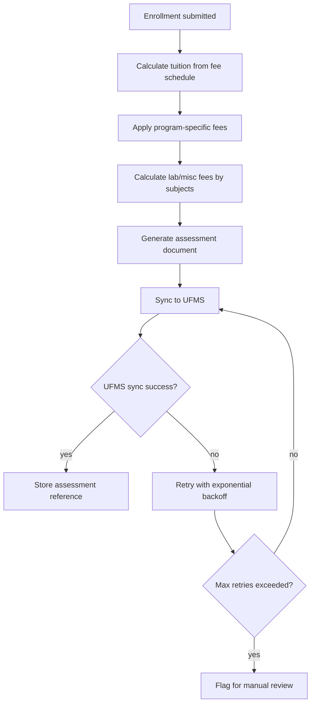

#### 6.2 Payment Status Verification

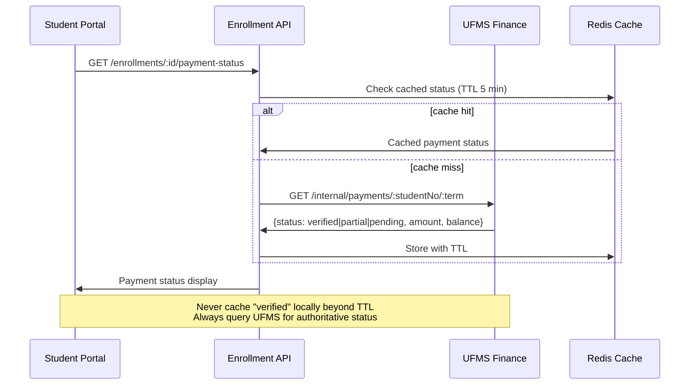

---

### 7. Clearance Management

#### 7.1 Clearance Status Aggregation

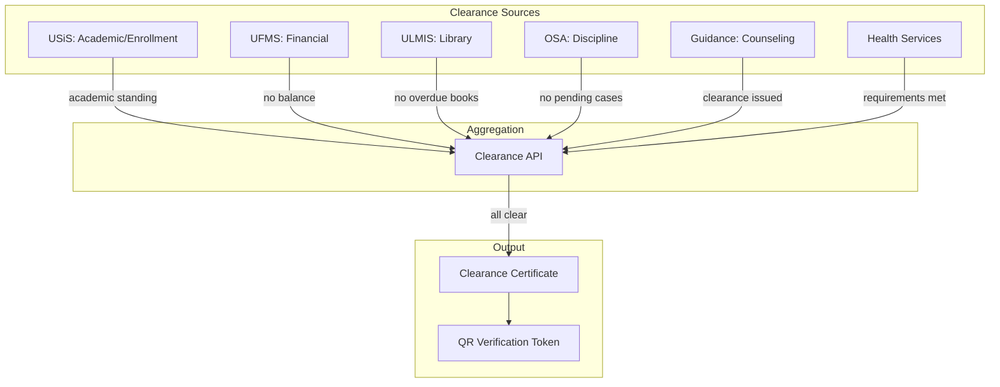

#### 7.2 Clearance Certificate Generation

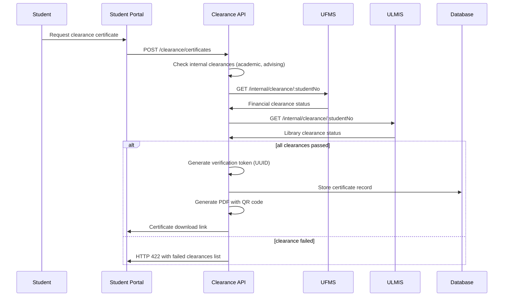

#### 7.3 Public Clearance Verification

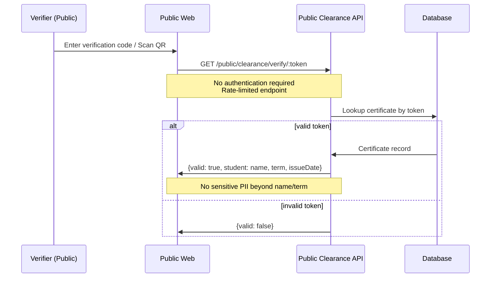

---

### 8. Faculty Evaluation Workflow

#### 8.1 Evaluation Period Setup

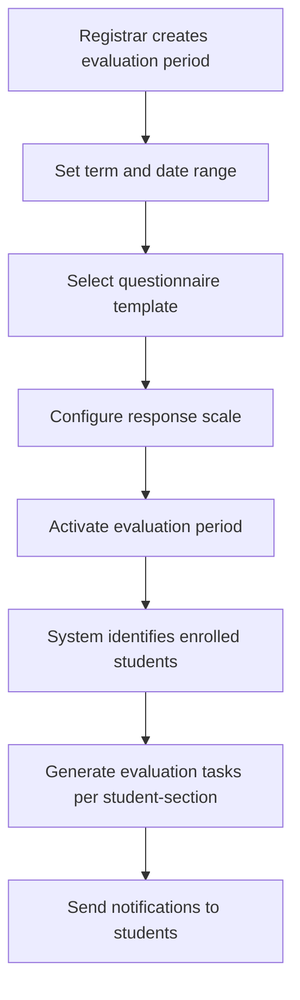

#### 8.2 Anonymous Submission

```mermaid
sequenceDiagram
    participant S as Student
    participant UI as Student Portal
    participant API as Evaluation API
    participant DB as Database
    
    S->>UI: View pending evaluations
    UI->>API: GET /evaluations/pending
    API->>DB: Fetch sections for student in active period
    API->>UI: Evaluation task list
    
    S->>UI: Complete evaluation for section
    UI->>API: POST /evaluations/submit {sectionId, responses[]}
    
    Note over API: Critical: Strip student identity<br/>before storing responses
    
    API->>API: Validate evaluation period active
    API->>API: Validate student enrolled in section
    API->>API: Remove student_id from response payload
    API->>DB: Store anonymous response with section_id only
    API->>DB: Mark evaluation complete for student-section
    API->>UI: 200 submitted
    
    Note over DB: Responses table: no student FK<br/>Completion table: tracks who submitted,<br/>not what they submitted
```

#### 8.3 Result Aggregation

```mermaid
flowchart TD
    A[Evaluation period closes] --> B[Background job aggregates responses]
    B --> C[Group by section and question]
    C --> D[Calculate statistics: mean, median, distribution]
    D --> E[Store aggregated results]
    E --> F{Faculty can view?}
    F -->|yes| G[Show anonymized summary to faculty]
    F -->|no| H[Restrict to admin only]
```

---

### 9. Registrar Enrollment Approval

```mermaid
sequenceDiagram
    participant R as Registrar
    participant UI as Registrar Portal
    participant API as Enrollment API
    participant UFMS as UFMS
    
    R->>UI: View pending enrollments
    UI->>API: GET /registrar/enrollments?status=pending_registrar
    API->>UI: Enrollment list with payment status
    
    R->>UI: Review enrollment details
    UI->>API: GET /enrollments/:id
    API->>UFMS: Verify payment (real-time)
    UFMS->>API: Payment status
    API->>UI: Full enrollment details + payment
    
    alt Approve
        R->>UI: Approve enrollment
        UI->>API: POST /registrar/enrollments/:id/approve
        API->>API: Validate payment verified
        API->>API: Update status to registered
        API->>API: Generate COR document
        API->>UI: 200 approved
        API->>Student: Notification (enrollment approved, download COR)
    else Reject
        R->>UI: Reject with reason
        UI->>API: POST /registrar/enrollments/:id/reject {reason}
        API->>API: Update status to cancelled
        API->>UI: 200 rejected
        API->>Student: Notification (enrollment rejected)
    end
```

---

### 10. Office Support Request Workflow

```mermaid
stateDiagram-v2
    [*] --> submitted: Student submits request
    submitted --> assigned: Office assigns to staff
    assigned --> in_progress: Staff begins work
    in_progress --> pending_student: Awaiting student info
    pending_student --> in_progress: Student responds
    in_progress --> resolved: Issue resolved
    in_progress --> cancelled: Request cancelled
    submitted --> cancelled: Auto-cancel after 30 days
    resolved --> [*]
    cancelled --> [*]
```

---

### 11. Error Cases & Edge Conditions

| Case | Expected Behavior | HTTP Status | User Message |
|------|-------------------|-------------|--------------|
| Enroll with schedule conflict | Block enrollment, return conflicting section | 422 | "Schedule conflict with [Section Name] on [Days] at [Time]" |
| Enroll with missing prerequisite | Block enrollment, list missing prerequisites | 422 | "Prerequisite required: [Course Code]" |
| Enroll in full section without waitlist | Block enrollment | 422 | "Section is full. No waitlist available." |
| Submit incomplete grade roster | Block submission | 422 | "Cannot submit. [N] students have no grades." |
| Query UFMS when service down | Return cached status with warning | 200 | "Payment status (last checked [timestamp]). Verify with cashier if recently paid." |
| Generate clearance with ULMIS down | Fail certificate generation | 503 | "Clearance unavailable. Library system temporarily unreachable." |
| Verify invalid clearance token | Return not found | 404 | "Invalid verification code." |
| Faculty view grades before submission | Allow view of draft grades | 200 | Display with "Draft" indicator |
| Student access other student's data | Authorization failure | 403 | "Access denied." |
| Registrar override without permission | Authorization failure | 403 | "Insufficient permissions for override." |
| Evaluation submission outside period | Block submission | 422 | "Evaluation period has ended." |
| Duplicate enrollment submission (idempotency) | Return original submission result | 200 | Previous submission details |

---

### 12. Background Job Workflows

#### 12.1 Nightly Grade Sync to TORMS

```mermaid
flowchart TD
    A[Cron: 2:00 AM daily] --> B[Query submitted grades since last sync]
    B --> C{Any new grades?}
    C -->|no| END[Skip sync]
    C -->|yes| D[Batch grade projections by student]
    D --> E[For each student batch]
    E --> F[POST /internal/grade-projections to TORMS]
    F --> G{Sync success?}
    G -->|yes| H[Mark records synced]
    G -->|no| I[Log error, retry next cycle]
    H --> J{More batches?}
    J -->|yes| E
    J -->|no| K[Update last sync timestamp]
    K --> END
```

#### 12.2 Enrollment Deadline Notifications

```mermaid
flowchart TD
    A[Cron: Daily 8:00 AM] --> B[Query enrollments in draft/pending_payment]
    B --> C[Calculate days until deadline]
    C --> D{Deadline within 3 days?}
    D -->|yes| E[Queue notification email/SMS]
    D -->|no| F[Skip]
    E --> G[BullMQ job: Send notification]
    G --> H{Send success?}
    H -->|yes| I[Mark notification sent]
    H -->|no| J[Retry with backoff]
```

---

**End of LLD — USiS**

---
