# University Platform Access — Complete System Specification

| Field | Value |
|-------|-------|
| **Product** | University Platform Access |
| **Document type** | Complete System Specification (SRS + Architecture + Features + LLD) |
| **Date** | August 2026 |
| **Classification** | Proprietary |

## Document contents

1. System Requirements Specification (SRS)
2. Architecture Design
3. Features & Requirements
4. Low-Level Design (LLD) Workflows

---

## Part 1 — System Requirements Specification (SRS)

### University Platform Access

| Field | Value |
|-------|-------|
| **Document ID** | SRS-UPA-001 |
| **Product** | University Platform Access |
| **Repository** | `INDENTITY_SERVICE` |
| **Version** | 0.1.0 |
| **Date** | August 2026 |
| **Classification** | Proprietary |

---

### 1. Introduction

#### 1.1 Purpose

This SRS defines requirements for **University Platform Access**: the central login hub and **RS256 SSO issuer** for campus platforms. It provides authentication, MFA, JWKS publication, role-based platform entitlements, a platform launcher, enrollment provisioning, and an administrator console.

#### 1.2 Scope

**In scope**

- Email/password authentication, refresh sessions, logout
- TOTP MFA (setup, enable, disable, login challenge)
- RS256 JWT issuance with `roles`, `permissions`, and `apps` claims
- JWKS at `/.well-known/jwks.json`
- Platform launcher with SSO fragment handoff
- Enrollment student provision API (Library-only)
- Admin management of users, roles, permissions, and platform grants
- M2M sync hooks for UHRIS employees and Library staff

**Integrated SSO consumers**

| Platform | Codes |
|----------|-------|
| ULMIS | `library`, `library_opac`, `library_kiosk` |
| UHRIS | `hris` |
| UDMS | `docstrack` |
| UIMS | `uims` |

**Out of scope**

- Business logic inside ULMIS, UHRIS, UDMS, or UIMS
- Self-service password reset (admin-assisted in current version)

#### 1.3 Definitions

| Term | Definition |
|------|------------|
| **UPA** | University Platform Access |
| **JWKS** | JSON Web Key Set for RS256 verification |
| **Platform grant** | Entitlement to launch a platform code |
| **Dual-mode SSO** | Platform accepts local login and University Platform Access SSO |
| **externalId** | Enrollment system stable identifier |

#### 1.4 References

- `INDENTITY_SERVICE/README.md`
- `docs/Identity-Complete-Guide.md` (legacy filename; product name is University Platform Access)
- `docs/API-Specs-Manual.md`
- `docs/enrollment-integration.md`
- `apps/api/docs/openapi.yaml`

---

### 2. Overall Description

#### 2.1 Product Perspective

| Component | Path | Port (dev) |
|-----------|------|------------|
| University Platform Access API | `apps/api` (AdonisJS) | 3401 |
| University Platform Access Web Portal | `apps/web` (React 19 + Vite) | 3400 |
| Database | PostgreSQL schema **`identity`** | — |

University Platform Access is upstream of campus apps. Platforms verify JWTs via JWKS and optionally auto-provision local users (`platformUserId = University Platform Access sub`).

#### 2.2 User Classes

| Class | Role | Platform access |
|-------|------|-----------------|
| Platform Admin | `identity_admin` | All platforms + admin console |
| Student | `student` | **Library-only** (library, OPAC, kiosk) — never UHRIS/UDMS/UIMS |
| Employee | `employee` | Admin-assigned staff platforms (default includes Library suite, UHRIS, UDMS, UIMS) |

External actors: Enrollment system, UHRIS, ULMIS (service API key).

#### 2.3 Constraints

- Students are Library-only at enrollment, admin edit, launcher, and JWT `apps`
- Schema `identity` isolates tables on shared Postgres
- Production signing keys must persist via `JWT_PRIVATE_KEY` / `JWT_PUBLIC_KEY`
- Enrollment batch max 500 students
- Platforms keep `AUTH_MODE=local` until dual/platform cutover

#### 2.4 Assumptions

- Platforms implement `/sso/callback` fragment token handoff
- Platform JWKS URL, issuer, and audience match University Platform Access
- Optional tenant bindings: `LIBRARY_TENANT_ID`, `HRIS_COMPANY_ID`, `DOCSTRACK_TENANT_ID`, `UIMS_TENANT_ID`

---

### 3. Functional Requirements

#### 3.1 Authentication & MFA

| ID | Requirement | Priority |
|----|-------------|----------|
| FR-AUTH-001 | Accept email/password login; reject disabled or invalid credentials | Must |
| FR-AUTH-002 | Issue RS256 access JWT and refresh token on success | Must |
| FR-AUTH-003 | Support refresh rotation and logout | Must |
| FR-AUTH-004 | Expose `/auth/me` with roles, permissions, platforms | Must |
| FR-AUTH-005 | Hash passwords; never store plaintext | Must |
| FR-AUTH-006 | Rate-limit login and MFA verify | Must |
| FR-MFA-001 | When MFA enabled, return challenge token instead of session tokens | Must |
| FR-MFA-002 | Verify TOTP to complete login; support setup/enable/disable | Must |

#### 3.2 SSO & JWKS

| ID | Requirement | Priority |
|----|-------------|----------|
| FR-SSO-001 | Publish public JWKS | Must |
| FR-SSO-002 | Access claims include `sub`, `email`, `org_id`, `org_slug`, `roles`, `permissions`, `apps`, `sid`, `iss`, `aud` | Must |
| FR-SSO-003 | Students must not receive hris/docstrack/uims in `apps` | Must |
| FR-SSO-004 | Health endpoint for load balancers | Must |

#### 3.3 Launcher & Entitlements

| ID | Requirement | Priority |
|----|-------------|----------|
| FR-LAUNCH-001 | Show only granted platforms after login | Must |
| FR-LAUNCH-002 | Admins see all active platforms; students see full Library suite | Must |
| FR-LAUNCH-003 | Launch opens `{platform}/sso/callback#access_token=…&refresh_token=…` | Must |
| FR-ENT-001 | Maintain platform registry and per-user grants | Must |
| FR-ENT-002 | Assigning student role clamps platforms to Library-only | Must |

#### 3.4 Enrollment & Integrations

| ID | Requirement | Priority |
|----|-------------|----------|
| FR-ENR-001 | Protect enrollment routes with `X-Service-Api-Key` | Must |
| FR-ENR-002 | Upsert student with Library-only platforms; optional temporary password | Must |
| FR-ENR-003 | Batch upsert (1–500) with partial error reporting | Must |
| FR-ENR-004 | Deactivate student by externalId (status=disabled) | Must |
| FR-INT-001 | UHRIS employee and Library staff upsert endpoints (service key) | Should |

#### 3.5 Administration

| ID | Requirement | Priority |
|----|-------------|----------|
| FR-ADM-001 | Admin APIs require Bearer + `identity_admin` | Must |
| FR-ADM-002 | CRUD users with roleCodes and platformCodes | Must |
| FR-ADM-003 | List/manage roles, permissions, platforms | Must |
| FR-ADM-004 | Portal admin UI for authorized admins | Should |

#### 3.6 Dual-Mode Platform Integration

| ID | Requirement | Priority |
|----|-------------|----------|
| FR-DUAL-001 | Platforms support AUTH_MODE local | dual | platform | Must |
| FR-DUAL-002 | Dual mode configures PLATFORM_IDENTITY_URL, JWKS, issuer, audience | Must |

---

### 4. External Interface Requirements

#### 4.1 Ports (local)

| Service | Port |
|---------|------|
| Web portal | 3400 |
| API / JWKS / Swagger | 3401 |

#### 4.2 Software Interfaces

| Interface | Path / detail |
|-----------|---------------|
| Auth API | `/api/v1/auth/*` |
| Admin API | `/api/v1/admin/*` |
| Enrollment | `/api/v1/integrations/enrollment/*` |
| UHRIS / Library M2M | `/api/v1/integrations/hris/employees`, `/library/staff` |
| JWKS | `/.well-known/jwks.json` |
| OpenAPI | `/api/v1/docs` |

SSO handoff (platforms): `/sso/callback#access_token=…&refresh_token=…`

---

### 5. Non-Functional Requirements

| ID | Category | Requirement |
|----|----------|-------------|
| NFR-SEC-001 | Security | RS256 2048-bit keys; hashed refresh tokens; rotatable service keys |
| NFR-SEC-002 | Security | CORS allowlist; DB SSL in production; student isolation defense-in-depth |
| NFR-PERF-001 | Performance | Default access TTL ~900s; health check for probes |
| NFR-REL-001 | Reliability | Idempotent migrations; schema `identity` isolation |
| NFR-UX-001 | Usability | Modern browsers; clear student vs staff launcher scope |
| NFR-ERR-001 | Errors | Consistent JSON errors; 401/403/429 as documented |

---

### 6. Verification Criteria (Summary)

| Scenario | Expected result |
|----------|-----------------|
| Student login | Only Library/OPAC/Kiosk; JWT apps exclude staff platforms |
| Admin login | All platforms + admin APIs |
| MFA login | Challenge then TOTP yields tokens |
| Enrollment upsert/deactivate | Library-only student created; deactivated cannot login |
| JWKS | Valid RS256 public key |
| Admin assigns student + UHRIS | Clamped to Library-only |

---

### 7. Document Control

| Version | Date | Description |
|---------|------|-------------|
| 0.1.0 | August 2026 | SRS baseline; product branded as University Platform Access |

#### Related design docs

- **[Unified_Platform_Access-Architecture.md](./Unified_Platform_Access-Architecture.md)** — Architecture design (SSO issuer, schema, trust boundaries)
- **[Unified_Platform_Access-Features-Requirements.md](./Unified_Platform_Access-Features-Requirements.md)** — Feature catalog + requirements matrix
- **[Unified_Platform_Access-LLD.md](./Unified_Platform_Access-LLD.md)** — Low-level design workflows (login/MFA, JWT/JWKS, launcher SSO, enrollment, dual-mode)

**End of SRS — University Platform Access**

---

## Part 2 — Architecture Design

### University Platform Access

| Field | Value |
|-------|-------|
| **Document ID** | AD-UPA-001 |
| **Product** | University Platform Access |
| **Companions** | [Unified_Platform_Access-SRS.md](./Unified_Platform_Access-SRS.md) · [Unified_Platform_Access-Features-Requirements.md](./Unified_Platform_Access-Features-Requirements.md) · [Unified_Platform_Access-LLD.md](./Unified_Platform_Access-LLD.md) |
| **Date** | August 2026 |

---

### 1. Purpose

Architecture Design for the central login hub and **RS256 SSO issuer** serving ULMIS, UHRIS, UDMS, and UIMS.

---

### 2. System context

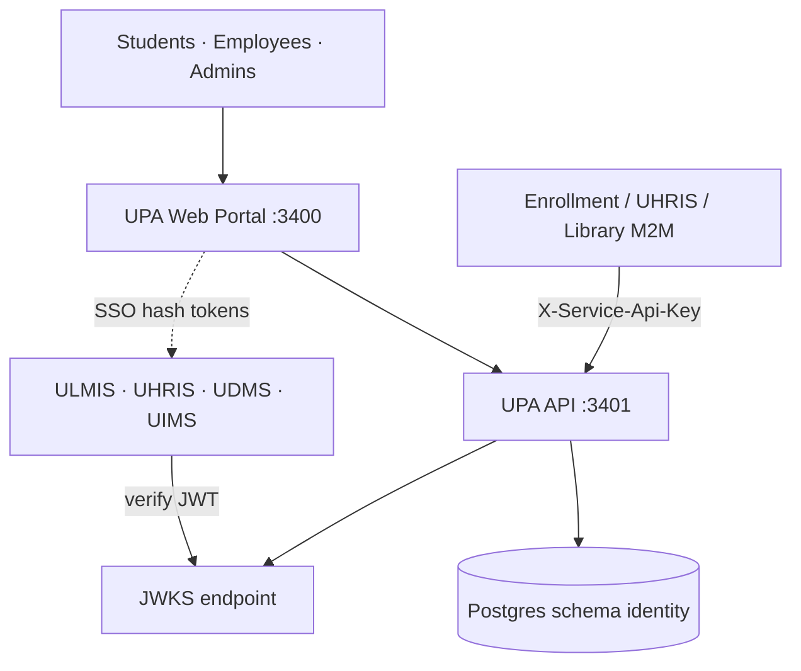

---

### 3. Container view

| Container | Path | Port | Role |
|-----------|------|------|------|
| Web portal | `apps/web` React 19 + Vite | 3400 | Login, MFA, launcher, admin, support |
| API | `apps/api` AdonisJS | 3401 | Auth, JWT, admin, integrations |
| Database | PostgreSQL schema **`identity`** | — | Isolated from platform `public` schemas |

**Production pattern:** API on Railway (Docker); web on Vercel; JWKS at `/.well-known/jwks.json`.

---

### 4. Logical components

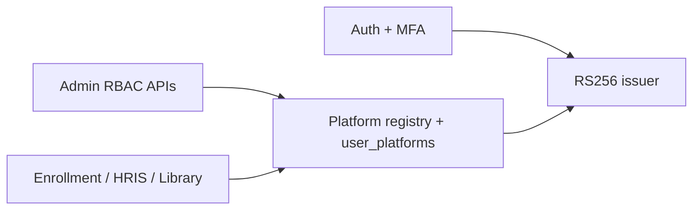

| Component | Responsibility |
|-----------|----------------|
| Auth | Password verify, refresh sessions, rate limits |
| MFA | TOTP setup/challenge via `otplib` |
| JWT | Sign access tokens (`jose`); publish JWKS |
| Entitlements | Resolve launcher cards + `apps` claim |
| Student clamp | Force Library-only platforms |
| Integrations | Service-key upsert/deactivate |

---

### 5. Data architecture

| Table | Purpose |
|-------|---------|
| organizations | Org slug/name |
| users | Credentials, MFA, external_id, student_number, status |
| roles / permissions / role_permissions / user_roles | RBAC |
| platforms / user_platforms | Launch entitlements |
| refresh_tokens | Hashed refresh sessions |

**JWT claims:** `sub`, `email`, `org_id`, `org_slug`, `roles`, `permissions`, `apps`, `sid`, `iss`, `aud`.

---

### 6. Trust boundaries

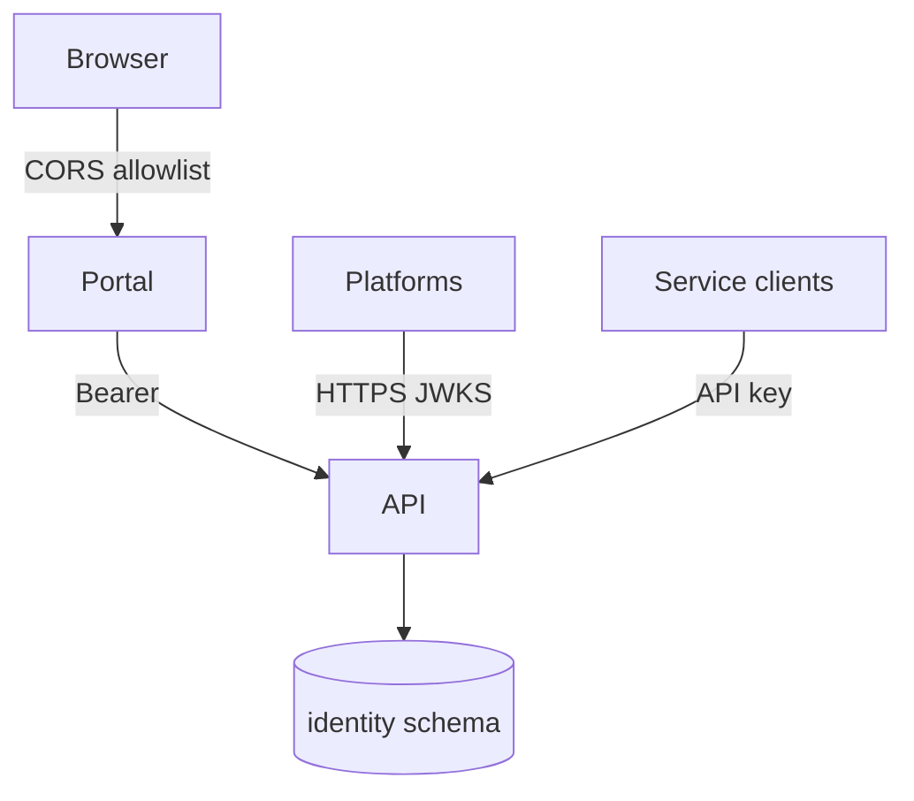

| Boundary | Control |
|----------|---------|
| Browser | Never holds private signing key |
| Platforms | Verify `iss`/`aud`/signature; dual-mode local fallback |
| M2M | Rotatable `ENROLLMENT_SERVICE_API_KEY` |
| Keys | Production PEM via env (`JWT_PRIVATE_KEY` / `JWT_PUBLIC_KEY`) |

---

### 7. Deployment topology

| Surface | Example |
|---------|---------|
| API | `identity-service-api…` |
| JWKS | `…/.well-known/jwks.json` |
| Portal | Vercel web with `VITE_API_URL` |

Platforms configure `PLATFORM_IDENTITY_URL`, `PLATFORM_JWKS_URL`, issuer, audience. Optional tenant bindings: `LIBRARY_TENANT_ID`, `HRIS_COMPANY_ID`, `DOCSTRACK_TENANT_ID`, `UIMS_TENANT_ID`.

---

### 8. Quality attributes

| Attribute | Approach |
|-----------|----------|
| Security | RS256, hashed refresh, rate limits, CORS, student isolation |
| Continuity | Persistent signing keys across redeploys |
| Isolation | Dedicated `identity` schema on shared Postgres |
| Operability | `/health`, OpenAPI, structured logs |

---

**End of Architecture Design — University Platform Access**

---

## Part 3 — Features & Requirements

### University Platform Access

| Field | Value |
|-------|-------|
| **Document ID** | FR-UPA-001 |
| **Product** | University Platform Access |
| **Companions** | [Unified_Platform_Access-SRS.md](./Unified_Platform_Access-SRS.md) · [Unified_Platform_Access-LLD.md](./Unified_Platform_Access-LLD.md) |
| **Date** | August 2026 |

---

### 1. Feature summary

| Area | Features |
|------|----------|
| **Authentication** | Email/password login, refresh, logout, session profile |
| **MFA** | TOTP setup/enable/disable + login challenge |
| **SSO issuer** | RS256 JWT, JWKS, `apps` / roles / permissions claims |
| **Launcher** | Entitlement-filtered platform cards + SSO fragment handoff |
| **Entitlements** | Platform registry + per-user grants; student Library-only clamp |
| **Enrollment API** | Upsert/batch/deactivate students (Library-only) |
| **Integrations** | UHRIS employee + Library staff M2M upsert |
| **Admin console** | Users, roles, permissions, platforms |
| **Support** | In-portal guidance + documentation links |

**SSO consumers:** ULMIS · UHRIS · UDMS · UIMS

---

### 2. Feature catalog

| Feature ID | Feature | Description | Priority |
|------------|---------|-------------|----------|
| F-AUTH-01 | Password login | Validate email/password; reject disabled | Must |
| F-AUTH-02 | Token pair | RS256 access JWT + refresh token | Must |
| F-AUTH-03 | Refresh / logout | Rotate refresh; invalidate session | Must |
| F-AUTH-04 | Profile (`/me`) | Roles, permissions, platforms | Must |
| F-AUTH-05 | Rate limit | Brute-force protection on login/MFA | Must |
| F-MFA-01 | Challenge login | Challenge token when MFA enabled | Must |
| F-MFA-02 | TOTP lifecycle | Setup, enable, disable | Must |
| F-SSO-01 | JWKS publish | Public `/.well-known/jwks.json` | Must |
| F-SSO-02 | Claim set | sub, email, org, roles, permissions, apps, sid | Must |
| F-SSO-03 | Student isolation | No UHRIS/UDMS/UIMS in student `apps` | Must |
| F-LAUNCH-01 | Entitled launcher | Show only granted platforms | Must |
| F-LAUNCH-02 | SSO handoff | `/sso/callback#access_token=…&refresh_token=…` | Must |
| F-ENT-01 | Platform registry | Codes, URLs, sort, active flag | Must |
| F-ENT-02 | User grants | Many-to-many platform assignments | Must |
| F-ENT-03 | Student clamp | Auto Library-only on student role | Must |
| F-ENR-01 | Student upsert | Service-key enrollment provision | Must |
| F-ENR-02 | Batch upsert | 1–500 students with partial errors | Must |
| F-ENR-03 | Deactivate | Disable by externalId | Must |
| F-INT-01 | UHRIS sync | Employee upsert M2M | Should |
| F-INT-02 | Library staff sync | Staff upsert M2M | Should |
| F-ADM-01 | Admin users | CRUD + roles + platforms | Must |
| F-ADM-02 | Roles/permissions | List and replace role permissions | Must |
| F-ADM-03 | Admin portal UI | Web console for admins | Should |
| F-DUAL-01 | Dual-mode support | Platforms local \| dual \| platform | Must |
| F-DOC-01 | Docs & support | Guides, API specs, support chat | Medium |
| F-ENT-04 | Launch ≠ app CRUD | UPA grants launch entitlement only; create/read/update/delete is enforced by each app’s local RBAC (“normal users with no CRUD powers” at UPA layer) | Must |
| F-ENT-05 | Docs-only employee | Per-user `user_platforms` may grant UDMS only (User 4 pattern) | Must |
| F-ENT-06 | Default staff platforms | HRIS-provisioned employees get UHRIS + Library + UDMS + UIMS as normal users | Must |
| F-ENT-07 | Admin all apps | `identity_admin` can launch all registered platforms | Must |

---

### 3. Requirements matrix

| Req ID | Requirement | Related features | Priority |
|--------|-------------|------------------|----------|
| FR-AUTH-001..006 | Login, tokens, refresh, logout, /me, rate limit | F-AUTH-01..05 | Must |
| FR-MFA-001..002 | Challenge + TOTP lifecycle | F-MFA-01, F-MFA-02 | Must |
| FR-SSO-001..004 | JWKS, claims, student clamp, health | F-SSO-01..03 | Must |
| FR-LAUNCH-001..003 | Launcher + SSO open | F-LAUNCH-01, F-LAUNCH-02 | Must |
| FR-ENT-001..002 | Registry + grants + clamp | F-ENT-01..03 | Must |
| FR-ENR-001..004 | Service-key enrollment APIs | F-ENR-01..03 | Must |
| FR-INT-001 | UHRIS/Library M2M | F-INT-01, F-INT-02 | Should |
| FR-ADM-001..004 | Admin APIs + UI | F-ADM-01..03 | Must/Should |
| FR-DUAL-001..002 | Platform AUTH_MODE integration | F-DUAL-01 | Must |
| FR-ENT-003 | Launch entitlement ≠ app CRUD | F-ENT-04 | Must |
| FR-ENT-004 | Docs-only and default staff grant patterns | F-ENT-05, F-ENT-06 | Must |
| FR-ENT-005 | Super admin all-app access | F-ENT-07, F-ADM-01 | Must |

---

### 3a. Source DOCX traceability (University User Management .docx) — 100%

| Source requirement | Feature / ID | Status |
|--------------------|--------------|--------|
| Two user types: Employee + Student | Roles + F-ENT-* | Delivered |
| Employee basic info from HRIS; add users from HRIS | F-INT-01 | Delivered |
| Student managed in UPA + open API | F-ENR-01..03 | Delivered |
| Super admin user management (student + employee) | F-ADM-01 | Delivered |
| HRIS-added users → HRIS, Library, Document Mgmt, Inventory as normal users (no CRUD at UPA) | F-ENT-06, F-ENT-04 | Delivered |
| Super admin can access all apps | F-ENT-07 | Delivered |
| Student → Library only on unified login | F-SSO-03, F-ENT-03 | Delivered |
| Employee → HRIS, Library, Inventory, Document Mgmt | F-ENT-06 | Delivered |
| Employee → document tracking only | F-ENT-05 | Delivered |
| SSO across apps without re-login | F-LAUNCH-02, F-SSO-* | Delivered |

---

### 4. Non-functional requirements (summary)

| ID | Category | Requirement |
|----|----------|-------------|
| NFR-SEC-001 | Security | RS256 2048-bit; hashed refresh; rotatable service keys |
| NFR-SEC-002 | Security | CORS allowlist; DB SSL; student isolation defense-in-depth |
| NFR-PERF-001 | Performance | ~900s access TTL; `/health` for probes |
| NFR-REL-001 | Reliability | Idempotent migrations; schema `identity` |
| NFR-UX-001 | Usability | Clear student vs staff launcher scope |

---

### 5. Actors & feature access

| Actor | Primary features |
|-------|------------------|
| Platform Admin | F-ADM-*, all launcher platforms |
| Employee | F-AUTH-*, F-LAUNCH-* (granted apps) |
| Student | Library suite only (F-SSO-03, F-ENT-03) |
| Enrollment system | F-ENR-* |
| Platform APIs | F-SSO-01 verification |

---

**End of Features & Requirements — University Platform Access**

---

## Part 4 — Low-Level Design (LLD) Workflows

### University Platform Access

| Field | Value |
|-------|-------|
| **Document ID** | LLD-UPA-001 |
| **Product** | University Platform Access |
| **Companion** | [Unified_Platform_Access-SRS.md](./Unified_Platform_Access-SRS.md) |
| **Date** | August 2026 |

---

### 1. Purpose

This LLD details authentication, MFA, JWT issuance, platform launcher SSO handoff, enrollment provisioning, and dual-mode platform integration.

---

### 2. System context

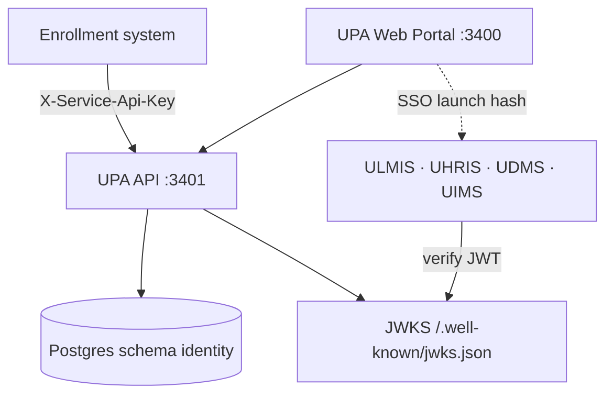

---

### 3. Login + MFA workflow

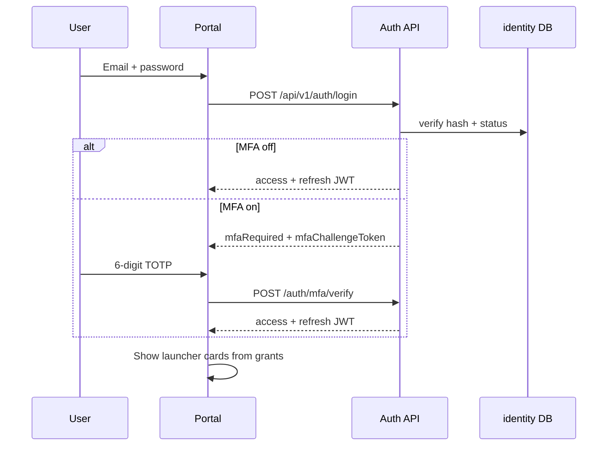

**MFA setup (authenticated):** `setup` → scan otpauth → `enable` with TOTP → `mfa_enabled=true`.

---

### 4. JWT issuance & JWKS verification

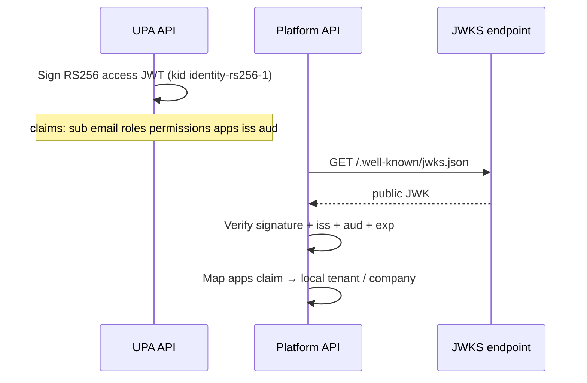

| Claim | Use |
|-------|-----|
| `sub` | Platform user link / auto-provision key |
| `roles` / `permissions` | Coarse entitlement hints |
| `apps` | Platform codes + optional tenant IDs |
| `sid` | Session correlation |

**Student clamp:** `apps` must not include `hris`, `docstrack`, or `uims`.

---

### 5. Platform launcher SSO handoff

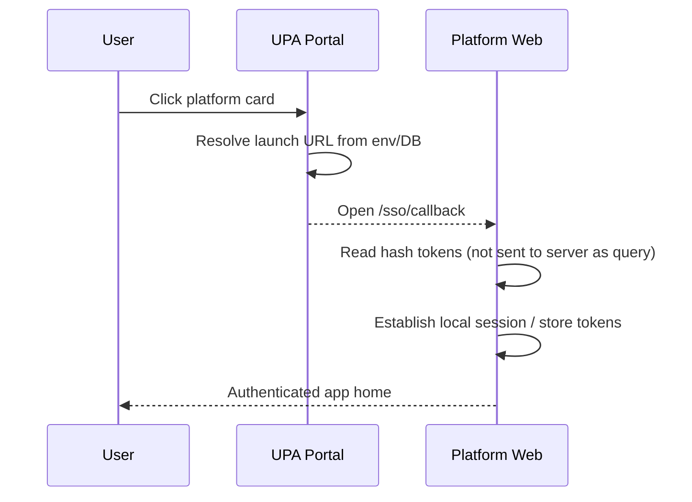

**URL normalization:** strip trailing `/login`, `/signin`, `/sso/callback` from base URL before append.

---

### 6. Dual-mode platform cutover

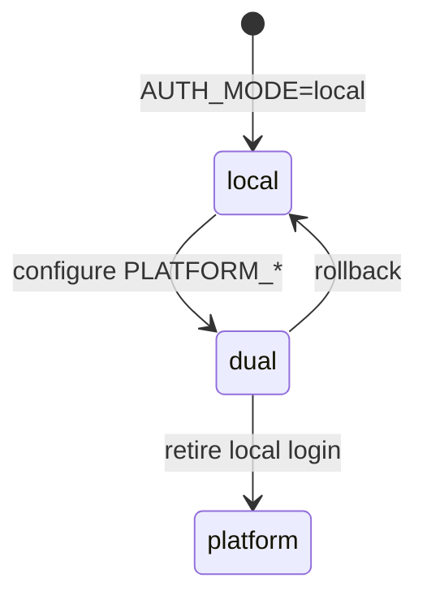

| Mode | Behavior |
|------|----------|
| `local` | Platform tokens only |
| `dual` | Accept UPA JWT **or** local login |
| `platform` | UPA JWT only |

---

### 7. Enrollment provision workflow

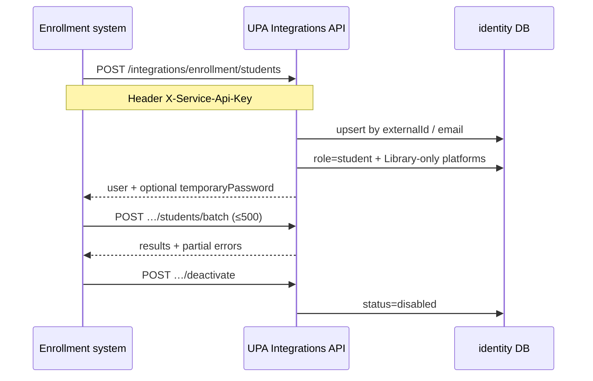

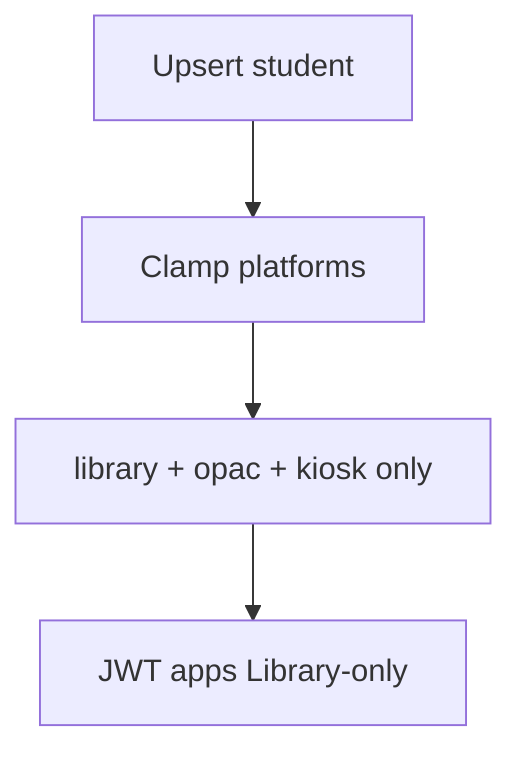

---

### 8. Admin user grant workflow

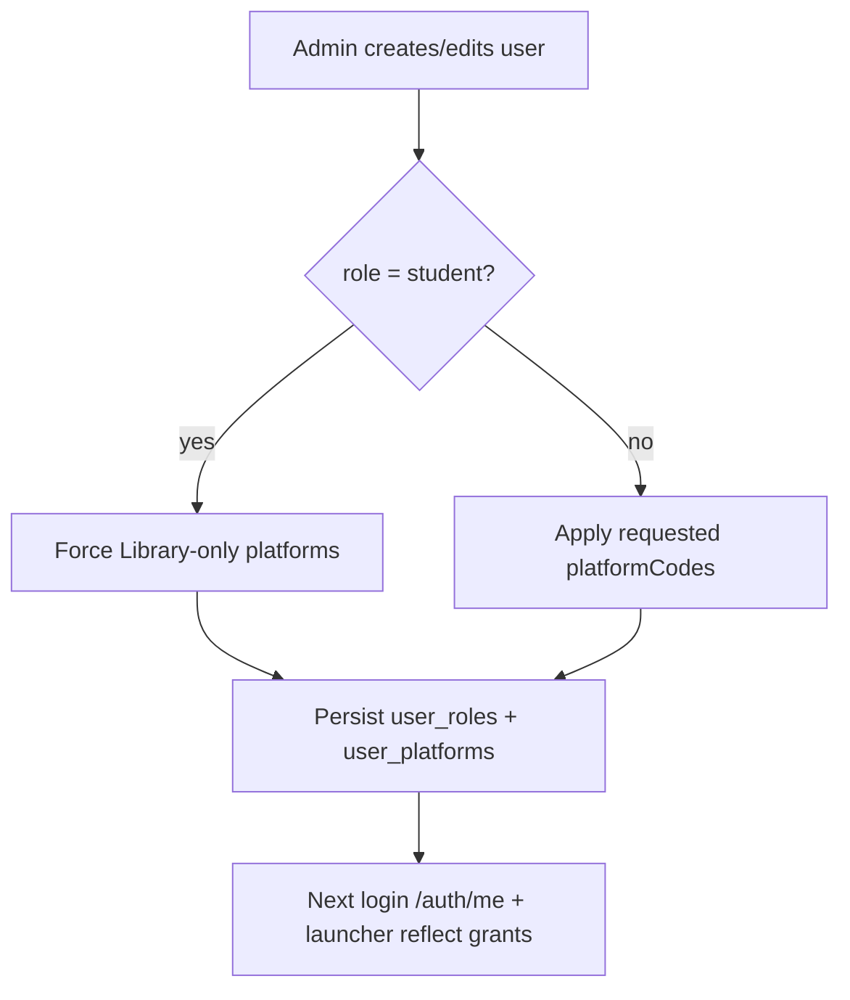

---

### 9. Error / edge cases

| Case | Expected behavior |
|------|-------------------|
| Disabled user | 401 on login |
| Bad API key | 401 on enrollment |
| Non-admin admin API | 403 |
| Rate limit login | 429 |
| Ephemeral signing keys in prod | Tokens invalidate on restart — set PEM env keys |
| Student assigned UHRIS codes | Auto-clamped to Library suite |

---

**End of LLD — University Platform Access**

---
